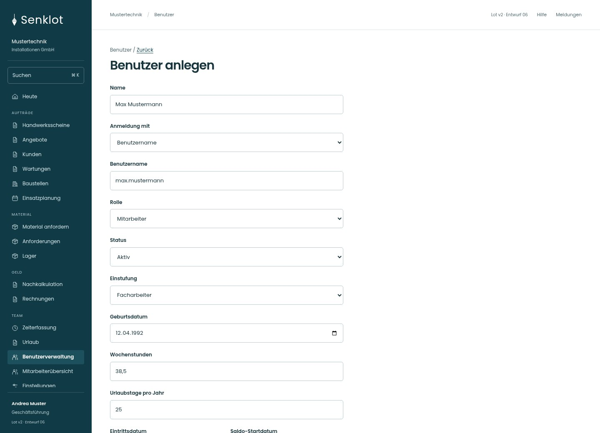
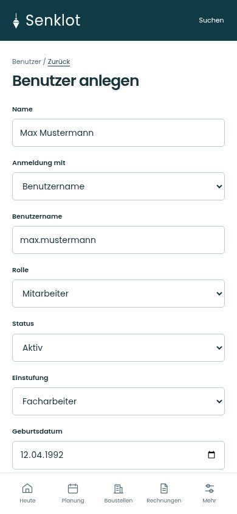
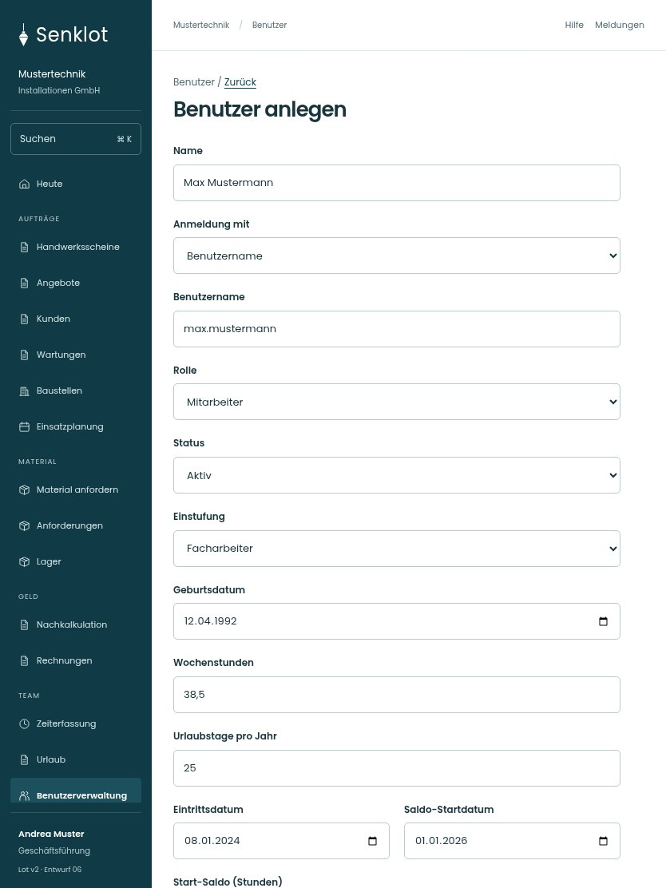

# 127 · Benutzer anlegen

[Zur Gesamtübersicht](../README.md) · [Vollständiges Konzept](../Konzept.md)

**Bereich:** Benutzer · **Bestandsort:** `/user-mgmt · Anlegen`

Handy · 390 px

[Ganze Seite ansehen](../bilder/127-benutzer-neu-handy-gesamt.jpg)

Tablet · 834 px

[Ganze Seite ansehen](../bilder/127-benutzer-neu-tablet-gesamt.jpg)

[Desktop in voller Seitenlänge](../bilder/127-benutzer-neu-desktop-gesamt.jpg)

## Entscheidung

Nur arbeitsrelevante Angaben; Details über die Zeile öffnen.

**Gezeigte Rolle:** Geschäftsführung. Sichtbarkeit und Aktionen bleiben an bestehende Rollen, Zusatzrechte, Module und Datensatzstatus gebunden.

**Hauptaktion:** Benutzer anlegen.

**Handy/Tablet:** Zeilen statt zusätzlicher Karten; Hauptaktion bleibt gut erreichbar.

## Muss erhalten bleiben

- Benutzername benötigt Startpasswort statt Mail
- Neueinstellung vs bestehender Mitarbeiter
- Aliquoter Erstjahresurlaub
- Lehrbeginn/-zeit/Budgetzählung
- Kein neues Adminrecht für GF

## Felder

- Name
- Anmeldung mit
- Benutzername
- Rolle
- Status
- Einstufung
- Geburtsdatum
- Wochenstunden
- Urlaubstage pro Jahr
- Eintrittsdatum
- Saldo-Startdatum
- Start-Saldo (Stunden)
- Resturlaub beim Umstieg (Tage)
- Montag
- Dienstag
- Mittwoch
- Donnerstag
- Freitag
- Tagessoll je Wochentag · bei Bedarf

## Quelle

- [src/features/users/UserMgmtView.tsx](https://github.com/juliandeutsch22/Prototype-App-Installateure/blob/d4b8542821d86c7057761af16de1331d1de87e09/src/features/users/UserMgmtView.tsx)
- [src/features/users/EinstufungFelder.tsx](https://github.com/juliandeutsch22/Prototype-App-Installateure/blob/d4b8542821d86c7057761af16de1331d1de87e09/src/features/users/EinstufungFelder.tsx)
- [src/features/users/TagessollFelder.tsx](https://github.com/juliandeutsch22/Prototype-App-Installateure/blob/d4b8542821d86c7057761af16de1331d1de87e09/src/features/users/TagessollFelder.tsx)

Gestaltungsvorschau mit fiktiven Beispieldaten. Keine Änderung oder Auslieferung der App.
