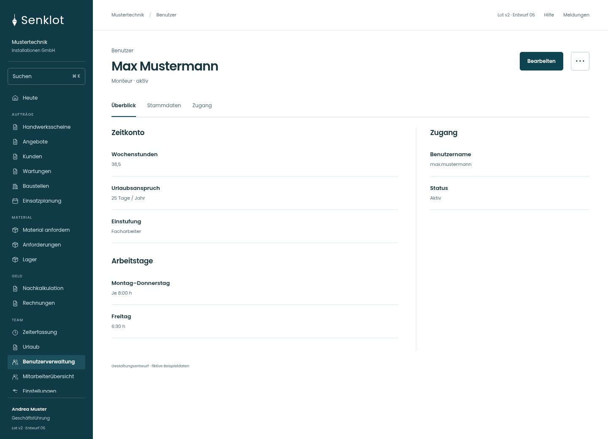
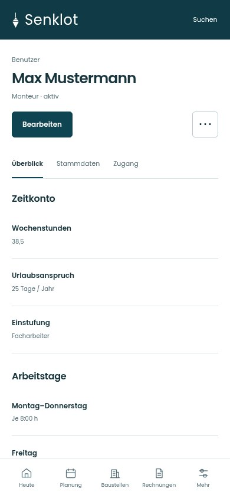
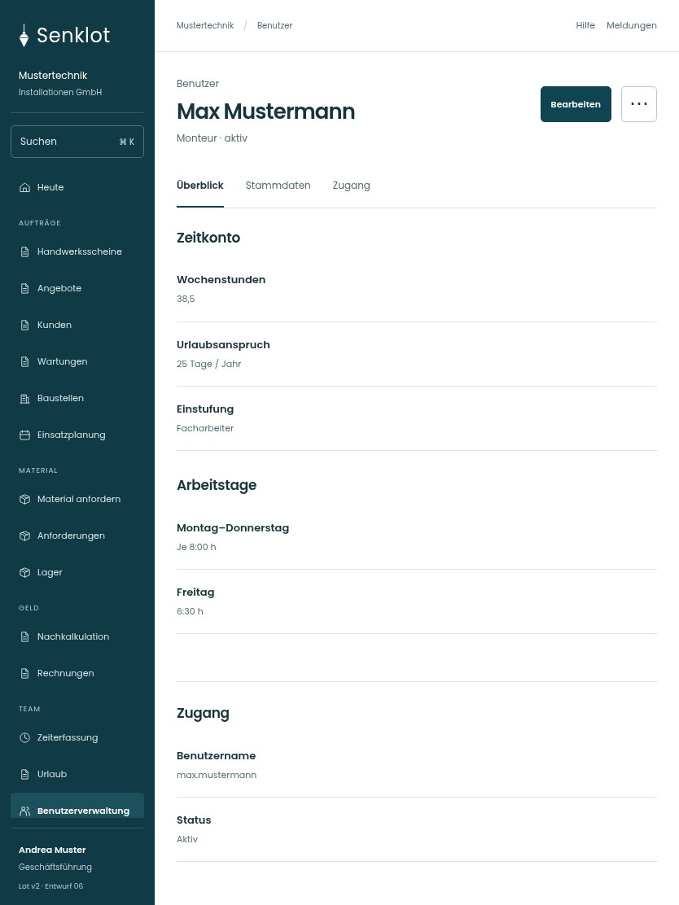

# 128 · Max Mustermann

[Zur Gesamtübersicht](../README.md) · [Vollständiges Konzept](../Konzept.md)

**Bereich:** Benutzer · **Bestandsort:** `/user-mgmt/:uid`

Handy · 390 px

[Ganze Seite ansehen](../bilder/128-benutzerakte-handy-gesamt.jpg)

Tablet · 834 px

## Entscheidung

Nur arbeitsrelevante Angaben; Details über die Zeile öffnen.

**Gezeigte Rolle:** Geschäftsführung. Sichtbarkeit und Aktionen bleiben an bestehende Rollen, Zusatzrechte, Module und Datensatzstatus gebunden.

**Hauptaktion:** Bearbeiten.

**Weitere Aktionen:** Urlaub anpassen, Datenauskunft.

**Handy/Tablet:** Zeilen statt zusätzlicher Karten; Hauptaktion bleibt gut erreichbar.

## Muss erhalten bleiben

- Geburtsdatum vertraulich
- Start-Saldo und Gültigkeit
- Kontoänderung und Zugang getrennt

## Quelle

- [src/features/users/BenutzerakteView.tsx](https://github.com/juliandeutsch22/Prototype-App-Installateure/blob/d4b8542821d86c7057761af16de1331d1de87e09/src/features/users/BenutzerakteView.tsx)
- [src/features/users/GeburtsdatumKarte.tsx](https://github.com/juliandeutsch22/Prototype-App-Installateure/blob/d4b8542821d86c7057761af16de1331d1de87e09/src/features/users/GeburtsdatumKarte.tsx)
- [src/features/users/UrlaubsanspruchKarte.tsx](https://github.com/juliandeutsch22/Prototype-App-Installateure/blob/d4b8542821d86c7057761af16de1331d1de87e09/src/features/users/UrlaubsanspruchKarte.tsx)

Gestaltungsvorschau mit fiktiven Beispieldaten. Keine Änderung oder Auslieferung der App.
