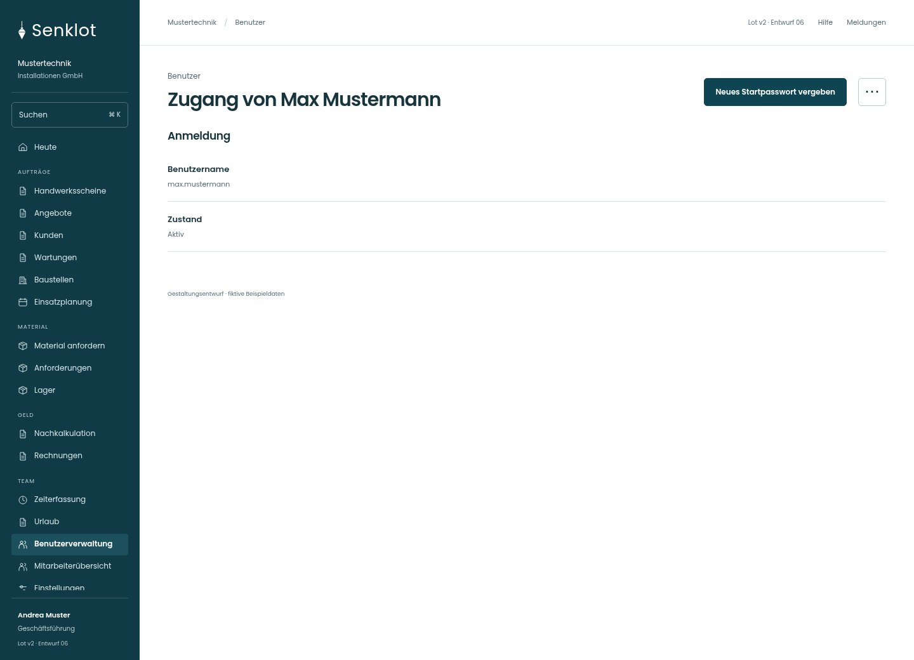
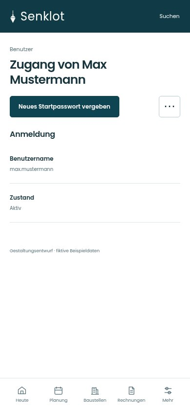
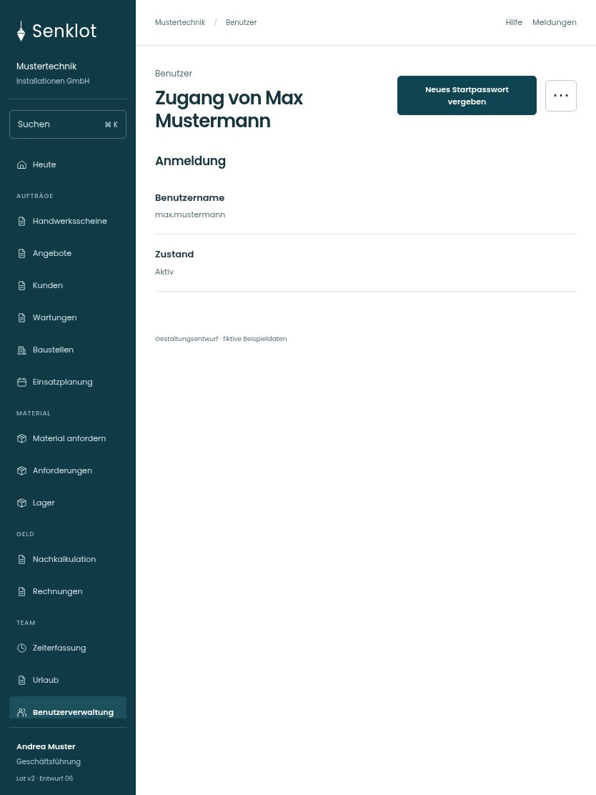

# 130 · Zugang von Max Mustermann

[Zur Gesamtübersicht](../README.md) · [Vollständiges Konzept](../Konzept.md)

**Bereich:** Benutzer · **Bestandsort:** `/user-mgmt/:uid · Zugang`

Handy · 390 px

Tablet · 834 px

## Entscheidung

Nur arbeitsrelevante Angaben; Details über die Zeile öffnen.

**Gezeigte Rolle:** Geschäftsführung. Sichtbarkeit und Aktionen bleiben an bestehende Rollen, Zusatzrechte, Module und Datensatzstatus gebunden.

**Hauptaktion:** Neues Startpasswort vergeben.

**Weitere Aktionen:** Anmeldeart umstellen, Benutzer deaktivieren.

**Handy/Tablet:** Zeilen statt zusätzlicher Karten; Hauptaktion bleibt gut erreichbar.

## Muss erhalten bleiben

- Bei E-Mail Passwort-Mail statt Startpasswort
- Eigener Zugang unter Mein Konto
- Letzter Administrator geschützt

## Quelle

- [src/features/users/BenutzerakteView.tsx](https://github.com/juliandeutsch22/Prototype-App-Installateure/blob/d4b8542821d86c7057761af16de1331d1de87e09/src/features/users/BenutzerakteView.tsx)
- [src/features/users/KontoUmstellen.tsx](https://github.com/juliandeutsch22/Prototype-App-Installateure/blob/d4b8542821d86c7057761af16de1331d1de87e09/src/features/users/KontoUmstellen.tsx)

Gestaltungsvorschau mit fiktiven Beispieldaten. Keine Änderung oder Auslieferung der App.
