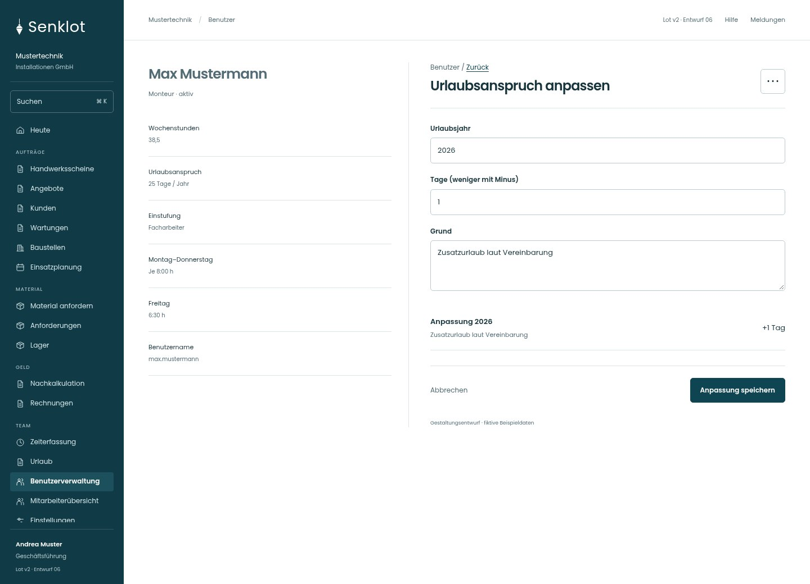
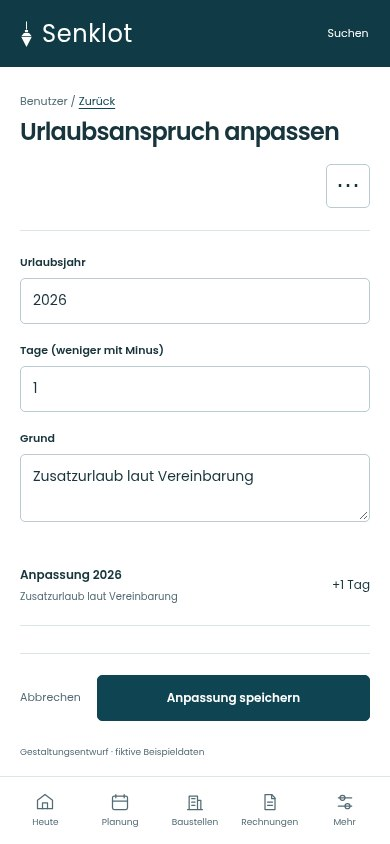
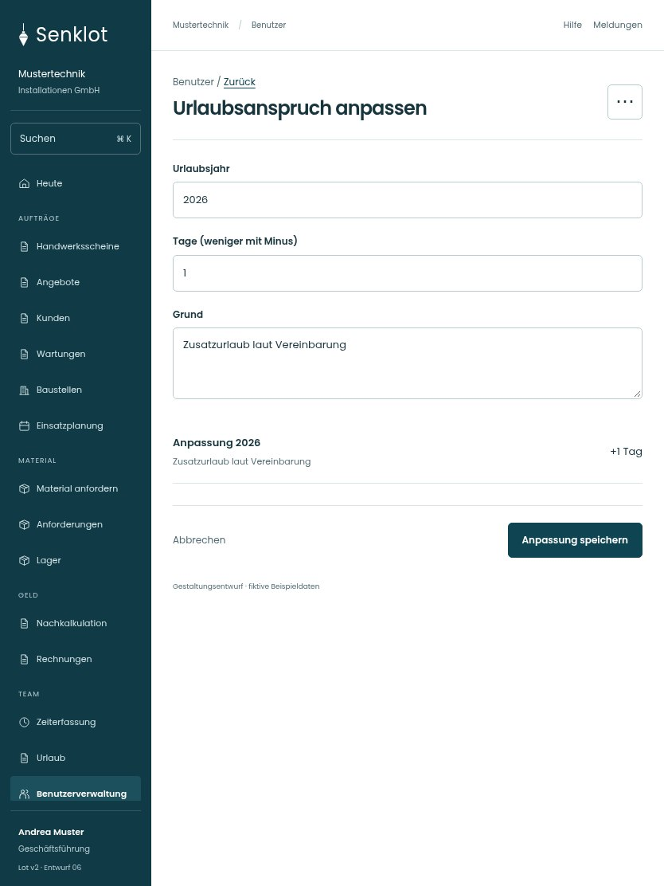

# 133 · Urlaubsanspruch anpassen

[Zur Gesamtübersicht](../README.md) · [Vollständiges Konzept](../Konzept.md)

**Bereich:** Benutzer · **Bestandsort:** `/user-mgmt/:uid · Urlaubsanspruch`

Handy · 390 px

Tablet · 834 px

## Entscheidung

Nur arbeitsrelevante Angaben; Details über die Zeile öffnen.

**Gezeigte Rolle:** Geschäftsführung. Sichtbarkeit und Aktionen bleiben an bestehende Rollen, Zusatzrechte, Module und Datensatzstatus gebunden.

**Hauptaktion:** Anpassung speichern.

**Weitere Aktionen:** Anpassung entfernen.

**Handy/Tablet:** Zeilen statt zusätzlicher Karten; Hauptaktion bleibt gut erreichbar.

## Muss erhalten bleiben

- Anpassung entfernen nur mit Bestätigung
- Urlaubsjahr getrennt
- Kein stilles Überschreiben des Grundanspruchs

## Felder

- Urlaubsjahr
- Tage (weniger mit Minus)
- Grund

## Quelle

- [src/features/users/UrlaubsanspruchKarte.tsx](https://github.com/juliandeutsch22/Prototype-App-Installateure/blob/d4b8542821d86c7057761af16de1331d1de87e09/src/features/users/UrlaubsanspruchKarte.tsx)

Gestaltungsvorschau mit fiktiven Beispieldaten. Keine Änderung oder Auslieferung der App.
