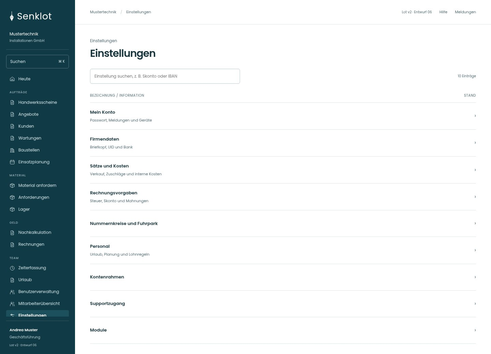
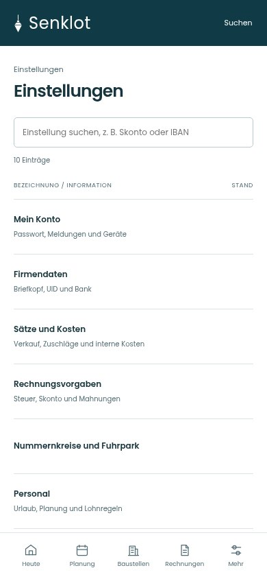
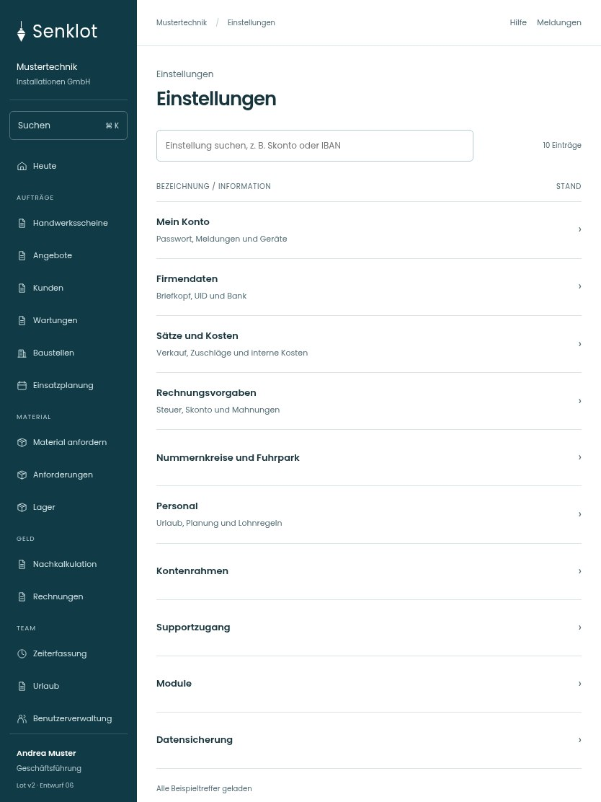

# 134 · Einstellungen

[Zur Gesamtübersicht](../README.md) · [Vollständiges Konzept](../Konzept.md)

**Bereich:** Einstellungen · **Bestandsort:** `/settings/uebersicht`

Handy · 390 px

[Ganze Seite ansehen](../bilder/134-einstellungen-handy-gesamt.jpg)

Tablet · 834 px

[Ganze Seite ansehen](../bilder/134-einstellungen-tablet-gesamt.jpg)

[Desktop in voller Seitenlänge](../bilder/134-einstellungen-desktop-gesamt.jpg)

## Entscheidung

Suchbare Themenliste statt Kacheln. Nur konkrete offene Einrichtungspunkte zeigen; erledigte Grunddaten nicht ständig wiederholen.

**Gezeigte Rolle:** Geschäftsführung. Sichtbarkeit und Aktionen bleiben an bestehende Rollen, Zusatzrechte, Module und Datensatzstatus gebunden.

**Hauptaktion:** Keine zusätzliche Hauptaktion.

**Handy/Tablet:** Zeilen statt zusätzlicher Karten; Hauptaktion bleibt gut erreichbar.

## Muss erhalten bleiben

- Unterseiten und Adressen
- Sichtbarkeit je Rolle
- Einrichtungsstand unbekannt nicht als erledigt

## Quelle

- [src/features/settings/EinstellungenUebersicht.tsx](https://github.com/juliandeutsch22/Prototype-App-Installateure/blob/d4b8542821d86c7057761af16de1331d1de87e09/src/features/settings/EinstellungenUebersicht.tsx)

Gestaltungsvorschau mit fiktiven Beispieldaten. Keine Änderung oder Auslieferung der App.
