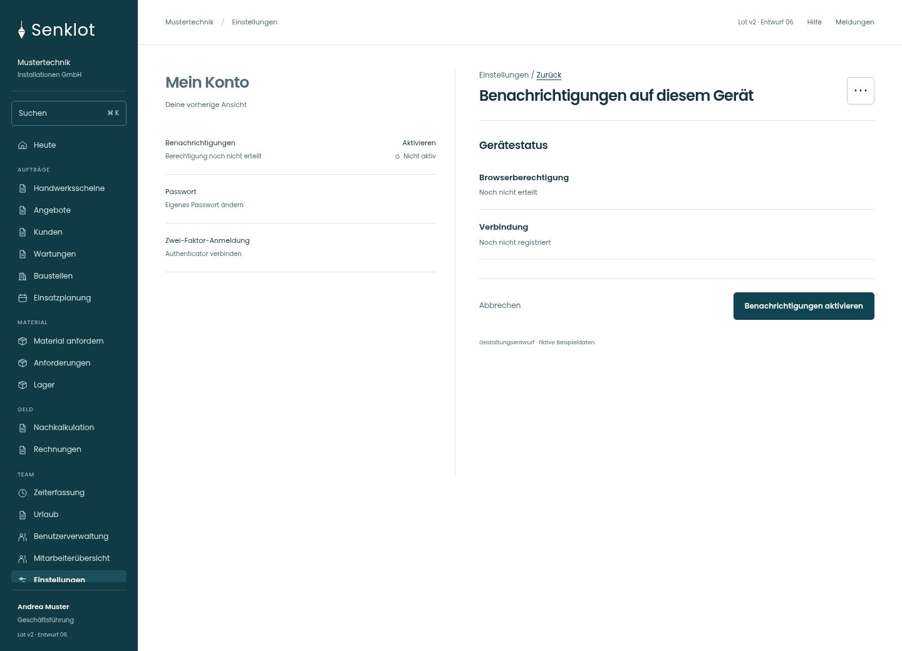
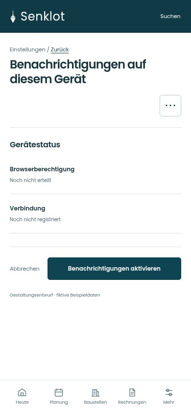
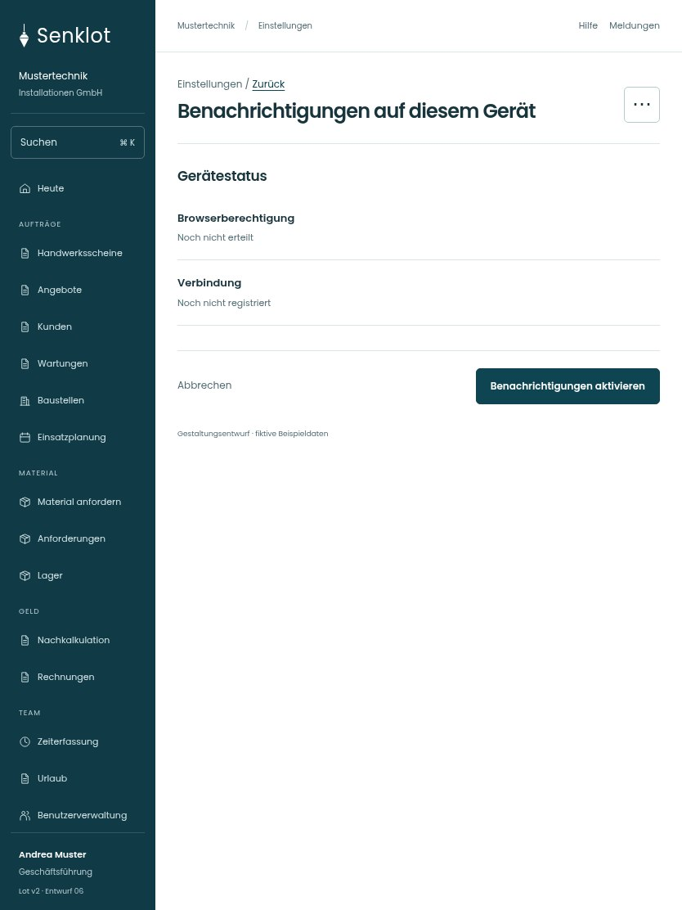

# 136 · Benachrichtigungen auf diesem Gerät

[Zur Gesamtübersicht](../README.md) · [Vollständiges Konzept](../Konzept.md)

**Bereich:** Einstellungen · **Bestandsort:** `/settings/meldungen · Gerät`

Handy · 390 px

Tablet · 834 px

## Entscheidung

Nur arbeitsrelevante Angaben; Details über die Zeile öffnen.

**Gezeigte Rolle:** Geschäftsführung. Sichtbarkeit und Aktionen bleiben an bestehende Rollen, Zusatzrechte, Module und Datensatzstatus gebunden.

**Hauptaktion:** Benachrichtigungen aktivieren.

**Weitere Aktionen:** Testmeldung senden.

**Handy/Tablet:** Zeilen statt zusätzlicher Karten; Hauptaktion bleibt gut erreichbar.

## Muss erhalten bleiben

- Nicht unterstützt/abgelehnt/unbekannt unterscheiden
- iOS Installation berücksichtigen
- Erfolg erst nach echtem Test

## Quelle

- [src/features/settings/PushStatus.tsx](https://github.com/juliandeutsch22/Prototype-App-Installateure/blob/d4b8542821d86c7057761af16de1331d1de87e09/src/features/settings/PushStatus.tsx)
- [src/features/settings/NotificationSettings.tsx](https://github.com/juliandeutsch22/Prototype-App-Installateure/blob/d4b8542821d86c7057761af16de1331d1de87e09/src/features/settings/NotificationSettings.tsx)

Gestaltungsvorschau mit fiktiven Beispieldaten. Keine Änderung oder Auslieferung der App.
