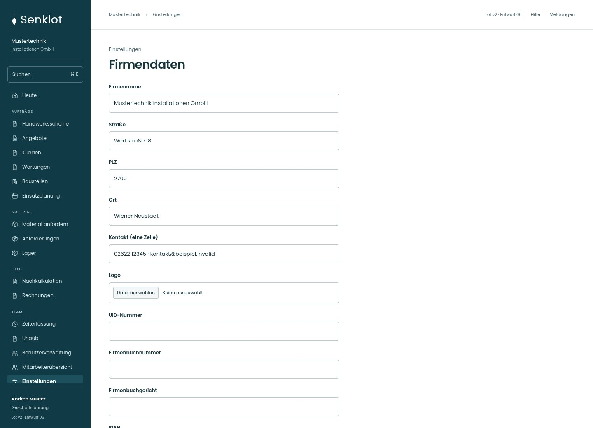
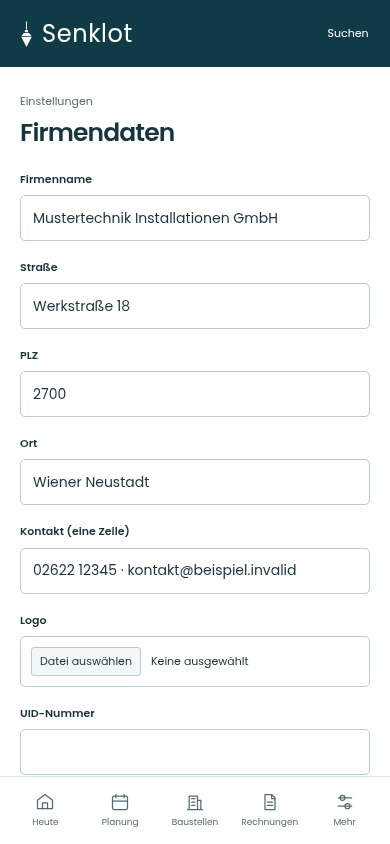
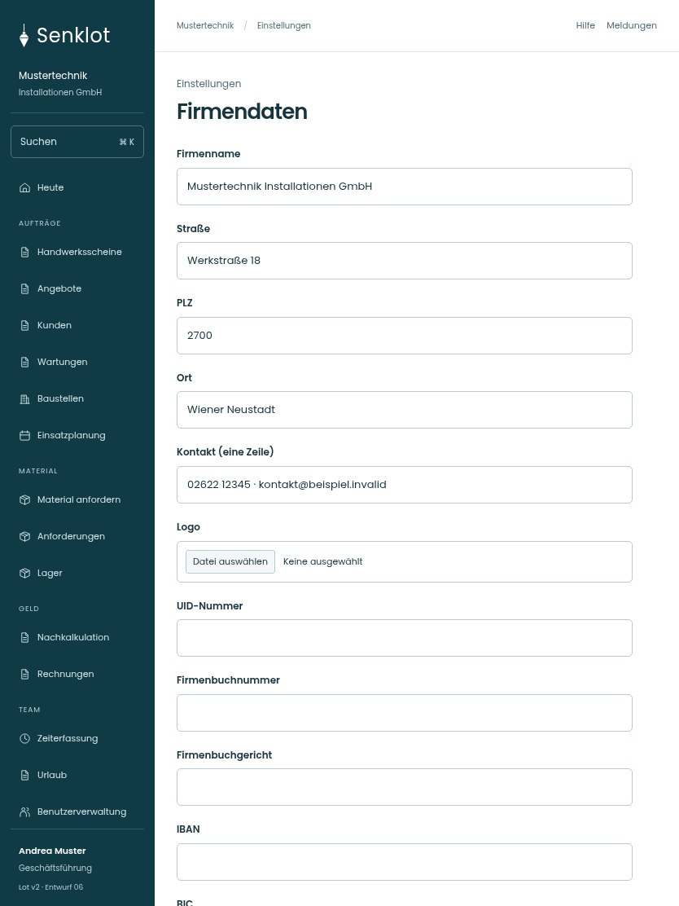

# 137 · Firmendaten

[Zur Gesamtübersicht](../README.md) · [Vollständiges Konzept](../Konzept.md)

**Bereich:** Einstellungen · **Bestandsort:** `/settings/firma`

Handy · 390 px

[Ganze Seite ansehen](../bilder/137-firma-handy-gesamt.jpg)

Tablet · 834 px

[Ganze Seite ansehen](../bilder/137-firma-tablet-gesamt.jpg)

[Desktop in voller Seitenlänge](../bilder/137-firma-desktop-gesamt.jpg)

## Entscheidung

Nur arbeitsrelevante Angaben; Details über die Zeile öffnen.

**Gezeigte Rolle:** Geschäftsführung. Sichtbarkeit und Aktionen bleiben an bestehende Rollen, Zusatzrechte, Module und Datensatzstatus gebunden.

**Hauptaktion:** Firmendaten speichern.

**Handy/Tablet:** Zeilen statt zusätzlicher Karten; Hauptaktion bleibt gut erreichbar.

## Muss erhalten bleiben

- Briefkopf-/Logo-Vorschau
- UID/IBAN-Prüfung
- Kontrastprüfung
- Bestehende PDF-Belegfarben unabhängig vom UI

## Felder

- Firmenname
- Straße
- PLZ
- Ort
- Kontakt (eine Zeile)
- Logo
- UID-Nummer
- Firmenbuchnummer
- Firmenbuchgericht
- IBAN
- BIC
- Bank
- Hauptfarbe (#rrggbb) · bei Bedarf
- Schrift auf der Hauptfarbe · bei Bedarf
- Akzentfarbe (#rrggbb) · bei Bedarf
- Schrift auf der Akzentfarbe · bei Bedarf

## Quelle

- [src/features/settings/FirmendatenView.tsx](https://github.com/juliandeutsch22/Prototype-App-Installateure/blob/d4b8542821d86c7057761af16de1331d1de87e09/src/features/settings/FirmendatenView.tsx)

Gestaltungsvorschau mit fiktiven Beispieldaten. Keine Änderung oder Auslieferung der App.
