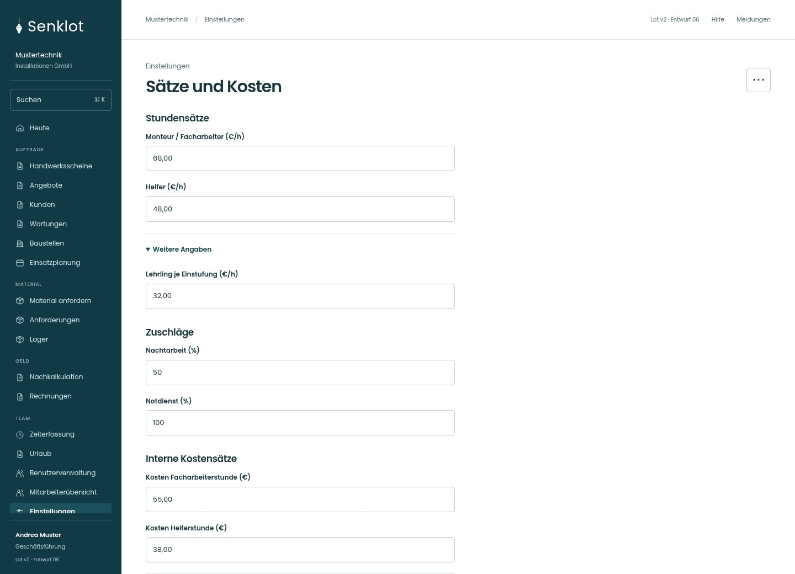
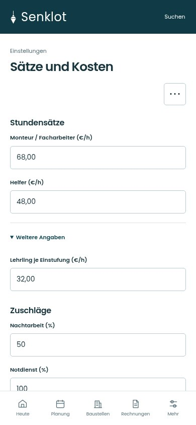
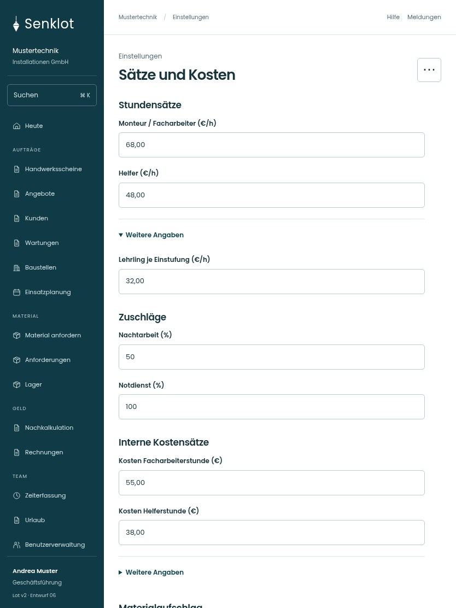

# 138 · Sätze und Kosten

[Zur Gesamtübersicht](../README.md) · [Vollständiges Konzept](../Konzept.md)

**Bereich:** Einstellungen · **Bestandsort:** `/settings/saetze`

Handy · 390 px

[Ganze Seite ansehen](../bilder/138-saetze-handy-gesamt.jpg)

Tablet · 834 px

[Ganze Seite ansehen](../bilder/138-saetze-tablet-gesamt.jpg)

[Desktop in voller Seitenlänge](../bilder/138-saetze-desktop-gesamt.jpg)

## Entscheidung

Nur arbeitsrelevante Angaben; Details über die Zeile öffnen.

**Gezeigte Rolle:** Geschäftsführung. Sichtbarkeit und Aktionen bleiben an bestehende Rollen, Zusatzrechte, Module und Datensatzstatus gebunden.

**Hauptaktion:** Sätze speichern.

**Weitere Aktionen:** Auf Standardwerte zurücksetzen.

**Handy/Tablet:** Zeilen statt zusätzlicher Karten; Hauptaktion bleibt gut erreichbar.

## Muss erhalten bleiben

- Einstufungen und Lehrjahre
- Interne Kosten nur Spitze
- Historische Belegwerte unverändert
- Warengruppenaufschläge

## Felder

- Monteur / Facharbeiter (€/h)
- Helfer (€/h)
- Lehrling je Einstufung (€/h) · bei Bedarf
- Nachtarbeit (%)
- Notdienst (%)
- Kosten Facharbeiterstunde (€)
- Kosten Helferstunde (€)
- Kosten je Einstufung (€) · bei Bedarf
- Standard-Aufschlag (%)
- Warengruppe · bei Bedarf
- Aufschlag der Warengruppe (%) · bei Bedarf

## Quelle

- [src/features/settings/SettingsView.tsx](https://github.com/juliandeutsch22/Prototype-App-Installateure/blob/d4b8542821d86c7057761af16de1331d1de87e09/src/features/settings/SettingsView.tsx)
- [src/features/settings/MaterialaufschlagFelder.tsx](https://github.com/juliandeutsch22/Prototype-App-Installateure/blob/d4b8542821d86c7057761af16de1331d1de87e09/src/features/settings/MaterialaufschlagFelder.tsx)

Gestaltungsvorschau mit fiktiven Beispieldaten. Keine Änderung oder Auslieferung der App.
