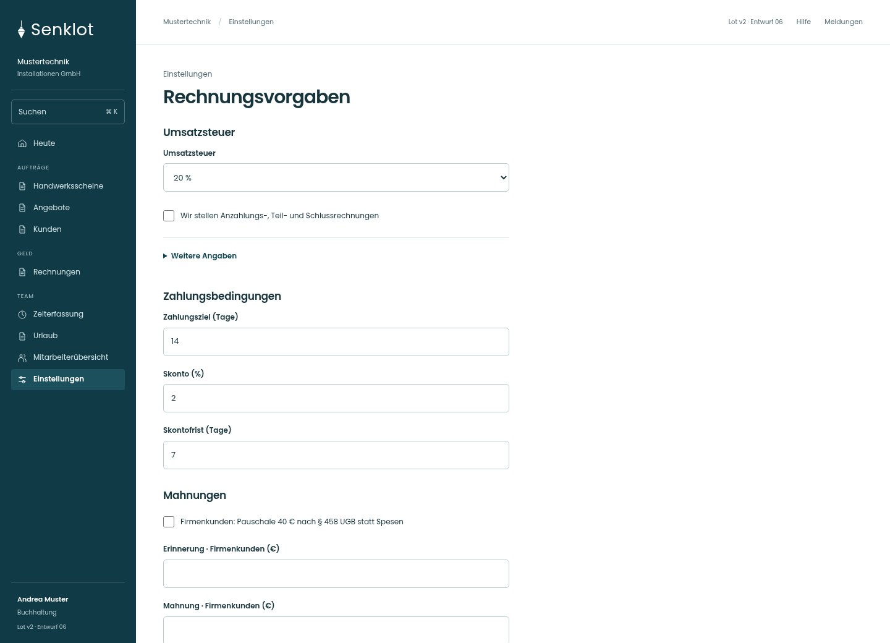
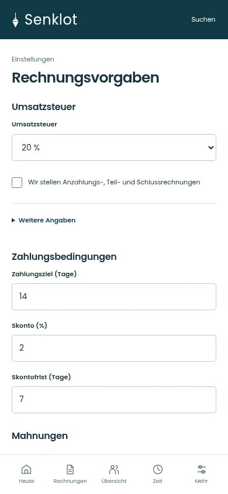
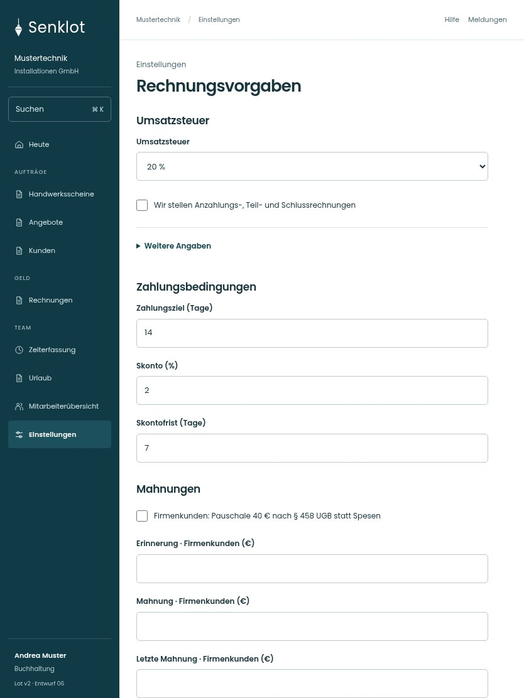

# 139 · Rechnungsvorgaben

[Zur Gesamtübersicht](../README.md) · [Vollständiges Konzept](../Konzept.md)

**Bereich:** Einstellungen · **Bestandsort:** `/settings/rechnung`

Handy · 390 px

[Ganze Seite ansehen](../bilder/139-rechnungsvorgaben-handy-gesamt.jpg)

Tablet · 834 px

[Ganze Seite ansehen](../bilder/139-rechnungsvorgaben-tablet-gesamt.jpg)

[Desktop in voller Seitenlänge](../bilder/139-rechnungsvorgaben-desktop-gesamt.jpg)

## Entscheidung

Nur arbeitsrelevante Angaben; Details über die Zeile öffnen.

**Gezeigte Rolle:** Buchhaltung. Sichtbarkeit und Aktionen bleiben an bestehende Rollen, Zusatzrechte, Module und Datensatzstatus gebunden.

**Hauptaktion:** Rechnungsvorgaben speichern.

**Handy/Tablet:** Zeilen statt zusätzlicher Karten; Hauptaktion bleibt gut erreichbar.

## Muss erhalten bleiben

- Privat-/Firmenkunde getrennt
- Zentrale Basiszinsen nicht lokal erfinden
- Historie/Gültigkeit
- Keine Stundensätze für Buchhaltung

## Felder

- Umsatzsteuer
- Grund der Steuerbefreiung · bei Bedarf
- Wir stellen Anzahlungs-, Teil- und Schlussrechnungen
- Zahlungsziel (Tage)
- Skonto (%)
- Skontofrist (Tage)
- Firmenkunden: Pauschale 40 € nach § 458 UGB statt Spesen
- Erinnerung · Firmenkunden (€)
- Mahnung · Firmenkunden (€)
- Letzte Mahnung · Firmenkunden (€)
- Erinnerung · Privatkunden (€)
- Mahnung · Privatkunden (€)
- Letzte Mahnung · Privatkunden (€)

## Quelle

- [src/features/settings/SettingsView.tsx](https://github.com/juliandeutsch22/Prototype-App-Installateure/blob/d4b8542821d86c7057761af16de1331d1de87e09/src/features/settings/SettingsView.tsx)
- [src/features/settings/BasiszinsVerlauf.tsx](https://github.com/juliandeutsch22/Prototype-App-Installateure/blob/d4b8542821d86c7057761af16de1331d1de87e09/src/features/settings/BasiszinsVerlauf.tsx)

Gestaltungsvorschau mit fiktiven Beispieldaten. Keine Änderung oder Auslieferung der App.
