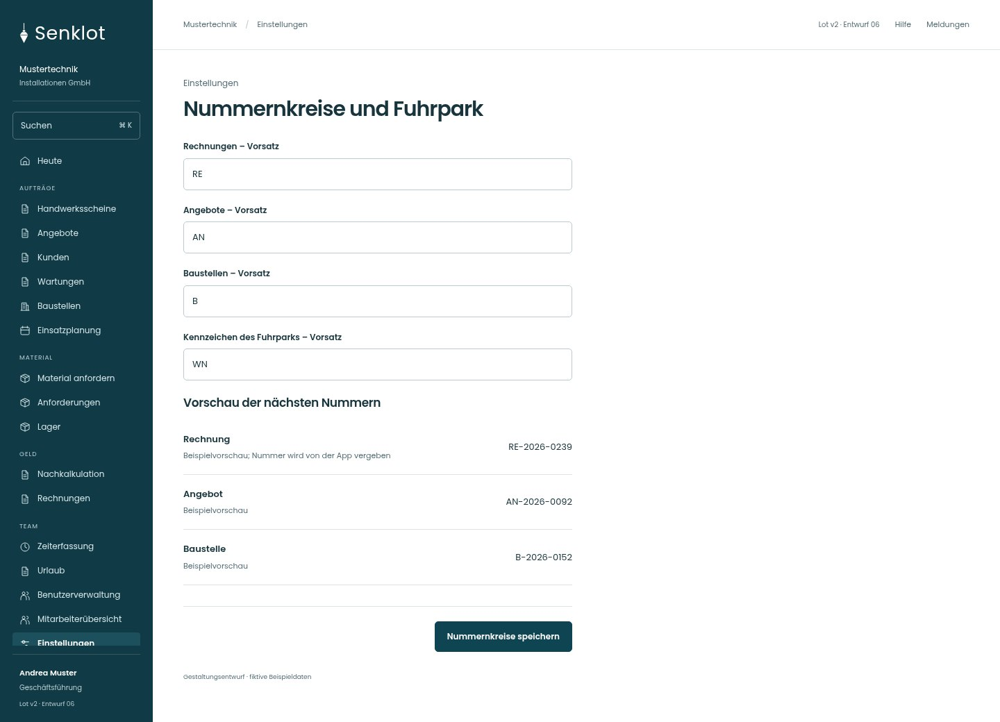
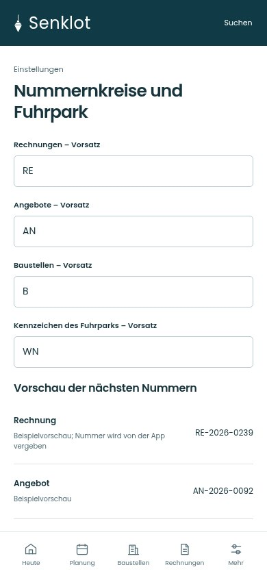
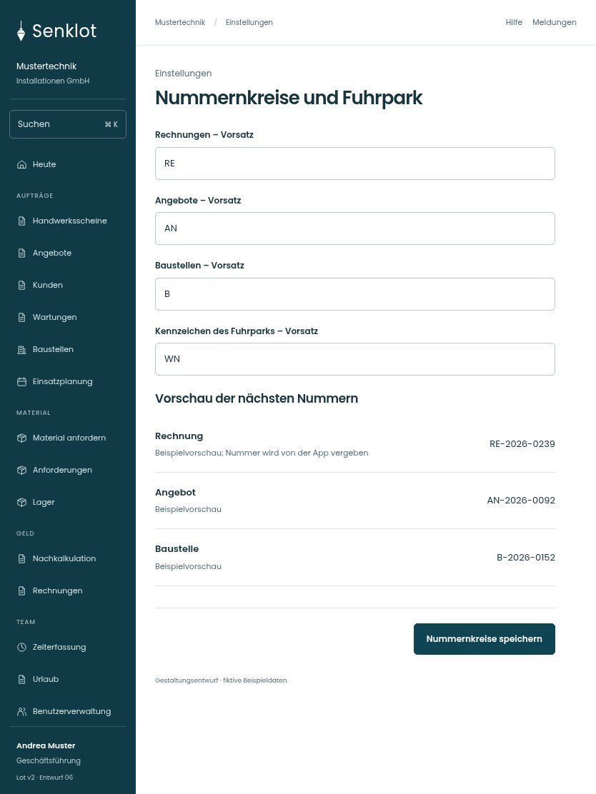

# 141 · Nummernkreise und Fuhrpark

[Zur Gesamtübersicht](../README.md) · [Vollständiges Konzept](../Konzept.md)

**Bereich:** Einstellungen · **Bestandsort:** `/settings/nummern`

Handy · 390 px

[Ganze Seite ansehen](../bilder/141-nummern-handy-gesamt.jpg)

Tablet · 834 px

## Entscheidung

Nur arbeitsrelevante Angaben; Details über die Zeile öffnen.

**Gezeigte Rolle:** Geschäftsführung. Sichtbarkeit und Aktionen bleiben an bestehende Rollen, Zusatzrechte, Module und Datensatzstatus gebunden.

**Hauptaktion:** Nummernkreise speichern.

**Handy/Tablet:** Zeilen statt zusätzlicher Karten; Hauptaktion bleibt gut erreichbar.

## Muss erhalten bleiben

- Keine Wiederverwendung vergebener Nummern
- Präfixe und Jahreswechsel nach Bestand
- Fuhrpark für Zeiterfassung
- Nächste laufende Nummer ist eine Vorschau, kein freies Eingabefeld
- Fuhrparkfeld ist der Vorsatz, keine neue Fahrzeugverwaltung

## Felder

- Rechnungen – Vorsatz
- Angebote – Vorsatz
- Baustellen – Vorsatz
- Kennzeichen des Fuhrparks – Vorsatz

## Quelle

- [src/features/settings/SettingsView.tsx](https://github.com/juliandeutsch22/Prototype-App-Installateure/blob/d4b8542821d86c7057761af16de1331d1de87e09/src/features/settings/SettingsView.tsx)

Gestaltungsvorschau mit fiktiven Beispieldaten. Keine Änderung oder Auslieferung der App.
