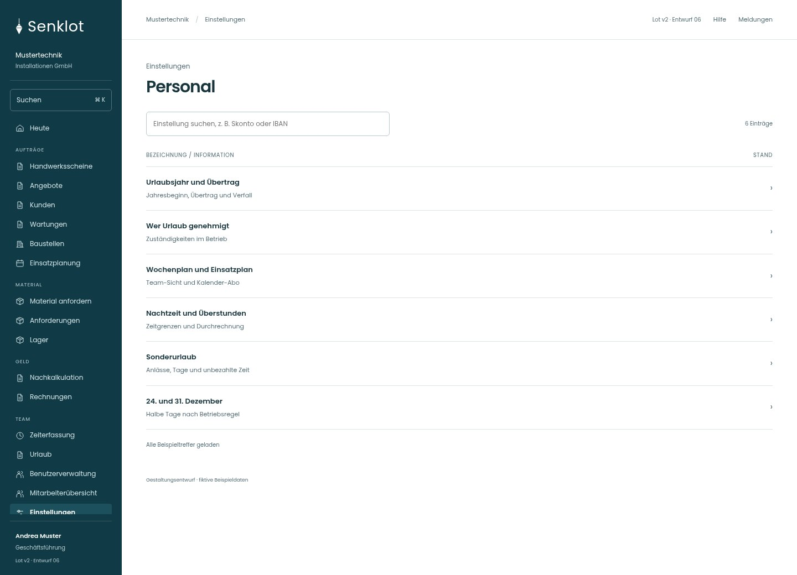
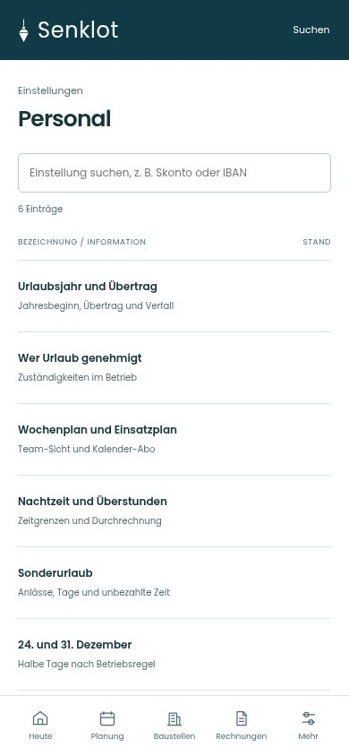
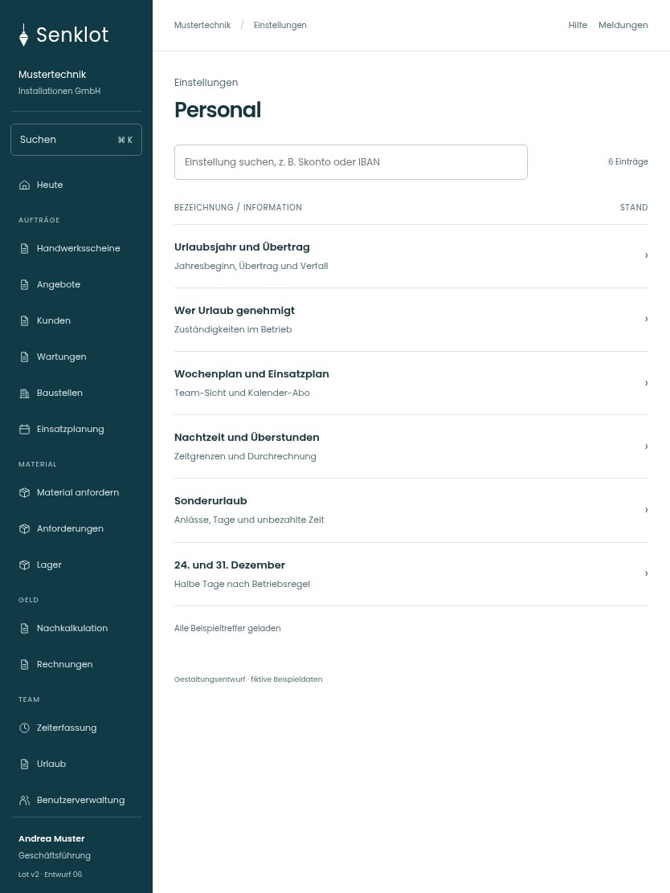

# 142 · Personal

[Zur Gesamtübersicht](../README.md) · [Vollständiges Konzept](../Konzept.md)

**Bereich:** Einstellungen · **Bestandsort:** `/settings/personal`

Handy · 390 px

[Ganze Seite ansehen](../bilder/142-personal-handy-gesamt.jpg)

Tablet · 834 px

## Entscheidung

Eine Themenliste führt direkt zu den vorhandenen Gruppen auf derselben Unterseite. Keine neue oberste Navigation.

**Gezeigte Rolle:** Geschäftsführung. Sichtbarkeit und Aktionen bleiben an bestehende Rollen, Zusatzrechte, Module und Datensatzstatus gebunden.

**Hauptaktion:** Keine zusätzliche Hauptaktion.

**Handy/Tablet:** Zeilen statt zusätzlicher Karten; Hauptaktion bleibt gut erreichbar.

## Muss erhalten bleiben

- Alle bisherigen Untergruppen bleiben höchstens einen Klick weiter
- Keine neuen Backend-Einstellungen

## Quelle

- [src/features/settings/SettingsView.tsx](https://github.com/juliandeutsch22/Prototype-App-Installateure/blob/d4b8542821d86c7057761af16de1331d1de87e09/src/features/settings/SettingsView.tsx)
- [src/features/settings/LohnregelnKarte.tsx](https://github.com/juliandeutsch22/Prototype-App-Installateure/blob/d4b8542821d86c7057761af16de1331d1de87e09/src/features/settings/LohnregelnKarte.tsx)
- [src/features/settings/SonderurlaubKarte.tsx](https://github.com/juliandeutsch22/Prototype-App-Installateure/blob/d4b8542821d86c7057761af16de1331d1de87e09/src/features/settings/SonderurlaubKarte.tsx)

Gestaltungsvorschau mit fiktiven Beispieldaten. Keine Änderung oder Auslieferung der App.
