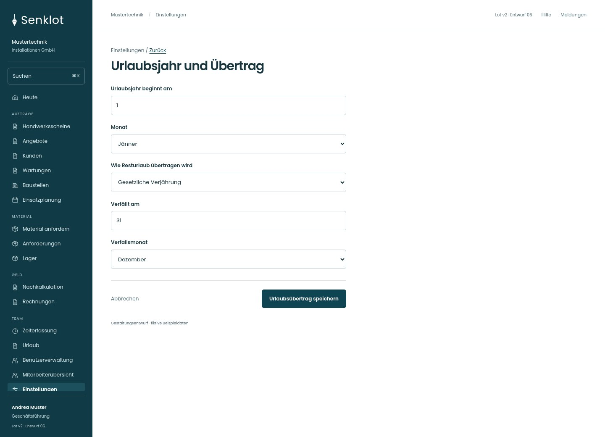
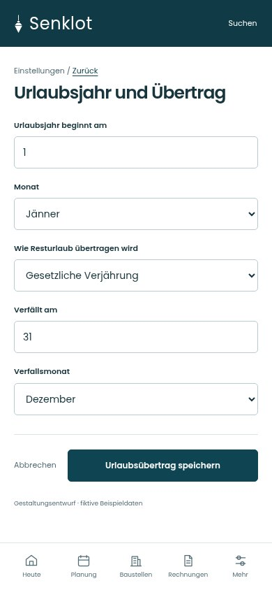
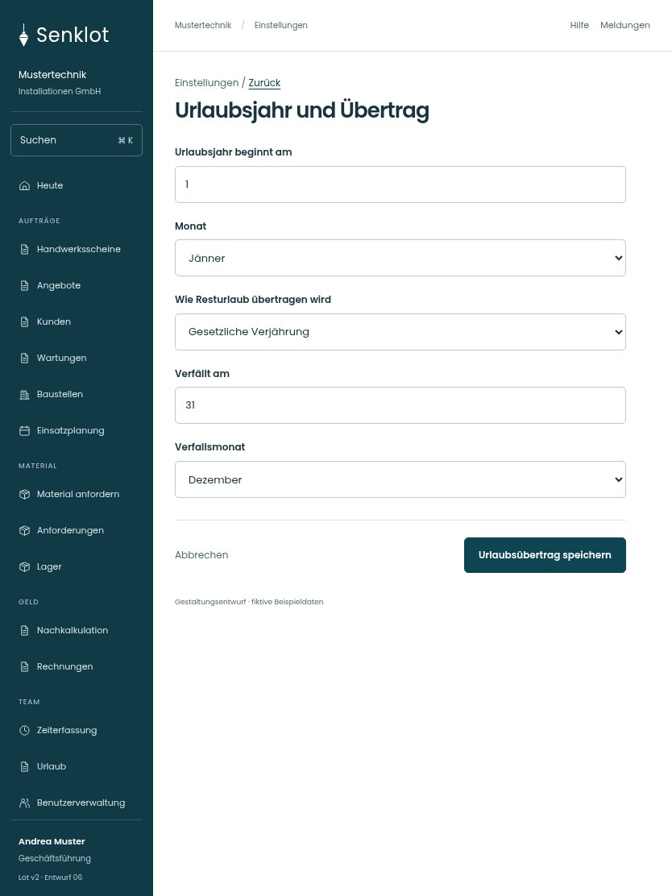

# 143 · Urlaubsjahr und Übertrag

[Zur Gesamtübersicht](../README.md) · [Vollständiges Konzept](../Konzept.md)

**Bereich:** Einstellungen · **Bestandsort:** `/settings/personal · Urlaub`

Handy · 390 px

Tablet · 834 px

## Entscheidung

Nur arbeitsrelevante Angaben; Details über die Zeile öffnen.

**Gezeigte Rolle:** Geschäftsführung. Sichtbarkeit und Aktionen bleiben an bestehende Rollen, Zusatzrechte, Module und Datensatzstatus gebunden.

**Hauptaktion:** Urlaubsübertrag speichern.

**Handy/Tablet:** Zeilen statt zusätzlicher Karten; Hauptaktion bleibt gut erreichbar.

## Muss erhalten bleiben

- Jahresübergreifende Anträge
- Urlaubsjahr vs Kalenderjahr
- Kein stiller Bestandsumbau
- Verfallstag nur bei gewähltem Stichtagsmodell sichtbar; rechtlicher Hinweis bleibt in der Hilfe

## Felder

- Urlaubsjahr beginnt am
- Monat
- Wie Resturlaub übertragen wird
- Verfällt am
- Verfallsmonat

## Quelle

- [src/features/settings/SettingsView.tsx](https://github.com/juliandeutsch22/Prototype-App-Installateure/blob/d4b8542821d86c7057761af16de1331d1de87e09/src/features/settings/SettingsView.tsx)

Gestaltungsvorschau mit fiktiven Beispieldaten. Keine Änderung oder Auslieferung der App.
