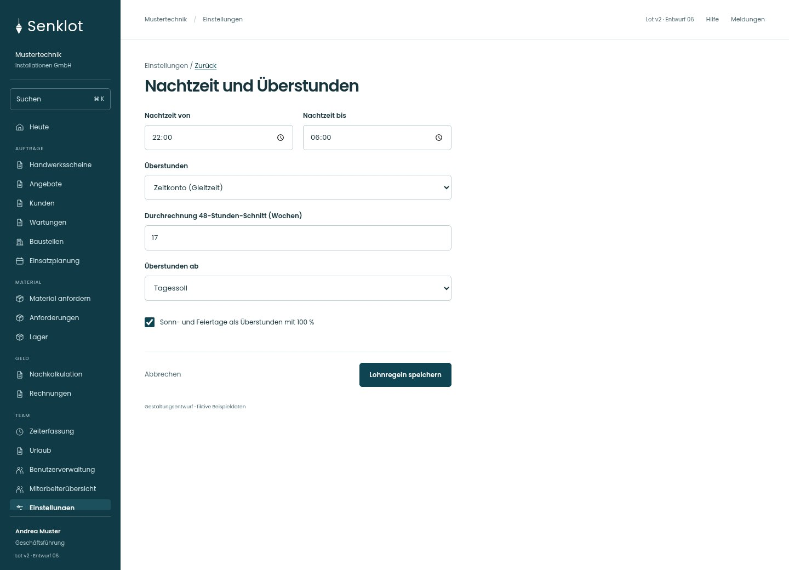
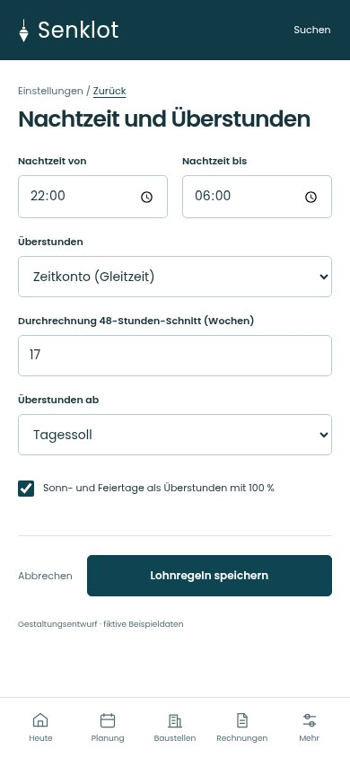
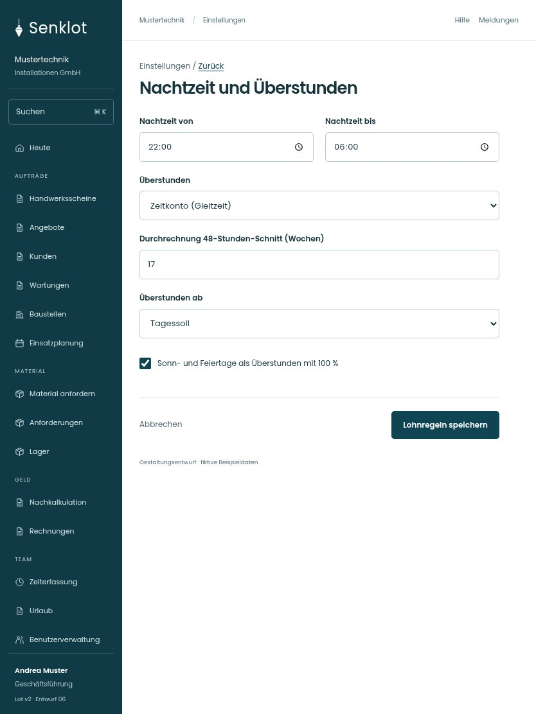

# 146 · Nachtzeit und Überstunden

[Zur Gesamtübersicht](../README.md) · [Vollständiges Konzept](../Konzept.md)

**Bereich:** Einstellungen · **Bestandsort:** `/settings/personal · Lohnregeln`

Handy · 390 px

Tablet · 834 px

## Entscheidung

Nur arbeitsrelevante Angaben; Details über die Zeile öffnen.

**Gezeigte Rolle:** Geschäftsführung. Sichtbarkeit und Aktionen bleiben an bestehende Rollen, Zusatzrechte, Module und Datensatzstatus gebunden.

**Hauptaktion:** Lohnregeln speichern.

**Handy/Tablet:** Zeilen statt zusätzlicher Karten; Hauptaktion bleibt gut erreichbar.

## Muss erhalten bleiben

- Bestehende Zuschlagsrechnung
- Jugendliche gesondert
- Keine pauschale Gleichsetzung von Soll und Überstunden

## Felder

- Nachtzeit von
- Nachtzeit bis
- Überstunden
- Durchrechnung 48-Stunden-Schnitt (Wochen)
- Überstunden ab
- Sonn- und Feiertage als Überstunden mit 100 %

## Quelle

- [src/features/settings/LohnregelnKarte.tsx](https://github.com/juliandeutsch22/Prototype-App-Installateure/blob/d4b8542821d86c7057761af16de1331d1de87e09/src/features/settings/LohnregelnKarte.tsx)

Gestaltungsvorschau mit fiktiven Beispieldaten. Keine Änderung oder Auslieferung der App.
