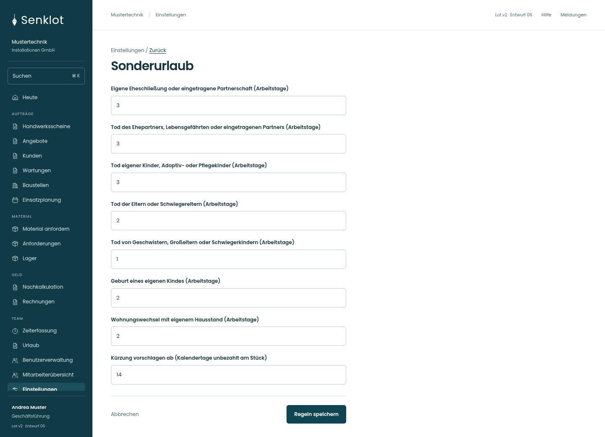
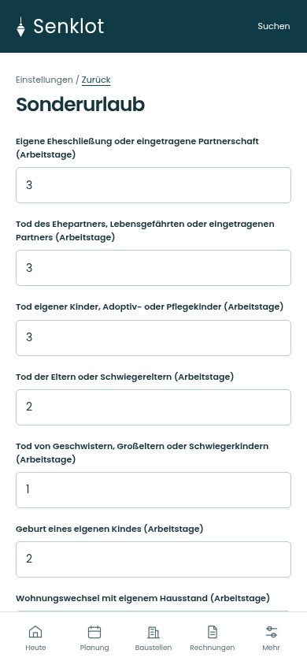
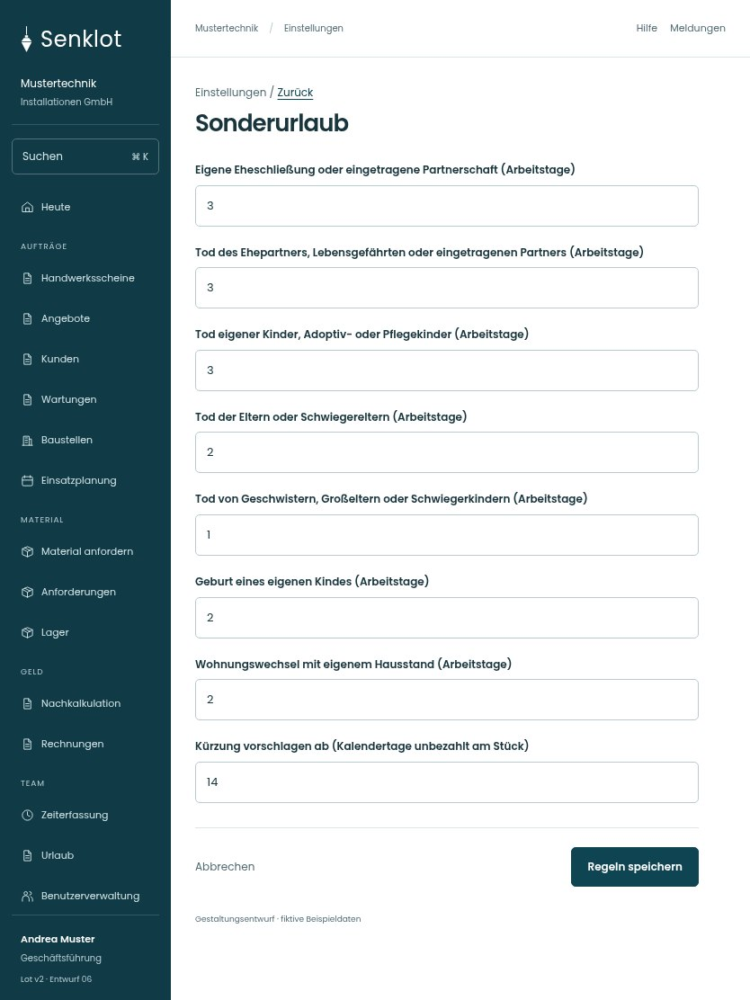

# 147 · Sonderurlaub

[Zur Gesamtübersicht](../README.md) · [Vollständiges Konzept](../Konzept.md)

**Bereich:** Einstellungen · **Bestandsort:** `/settings/personal · Sonderurlaub`

Handy · 390 px

[Ganze Seite ansehen](../bilder/147-personal-sonder-handy-gesamt.jpg)

Tablet · 834 px

## Entscheidung

Nur arbeitsrelevante Angaben; Details über die Zeile öffnen.

**Gezeigte Rolle:** Geschäftsführung. Sichtbarkeit und Aktionen bleiben an bestehende Rollen, Zusatzrechte, Module und Datensatzstatus gebunden.

**Hauptaktion:** Regeln speichern.

**Handy/Tablet:** Zeilen statt zusätzlicher Karten; Hauptaktion bleibt gut erreichbar.

## Muss erhalten bleiben

- Vollständige vorhandene Anlassliste
- Gesetzliche/vertragliche Freigrenzen nicht neu definieren
- Grund für Tage darüber

## Felder

- Eigene Eheschließung oder eingetragene Partnerschaft (Arbeitstage)
- Tod des Ehepartners, Lebensgefährten oder eingetragenen Partners (Arbeitstage)
- Tod eigener Kinder, Adoptiv- oder Pflegekinder (Arbeitstage)
- Tod der Eltern oder Schwiegereltern (Arbeitstage)
- Tod von Geschwistern, Großeltern oder Schwiegerkindern (Arbeitstage)
- Geburt eines eigenen Kindes (Arbeitstage)
- Wohnungswechsel mit eigenem Hausstand (Arbeitstage)
- Kürzung vorschlagen ab (Kalendertage unbezahlt am Stück)

## Quelle

- [src/features/settings/SonderurlaubKarte.tsx](https://github.com/juliandeutsch22/Prototype-App-Installateure/blob/d4b8542821d86c7057761af16de1331d1de87e09/src/features/settings/SonderurlaubKarte.tsx)

Gestaltungsvorschau mit fiktiven Beispieldaten. Keine Änderung oder Auslieferung der App.
