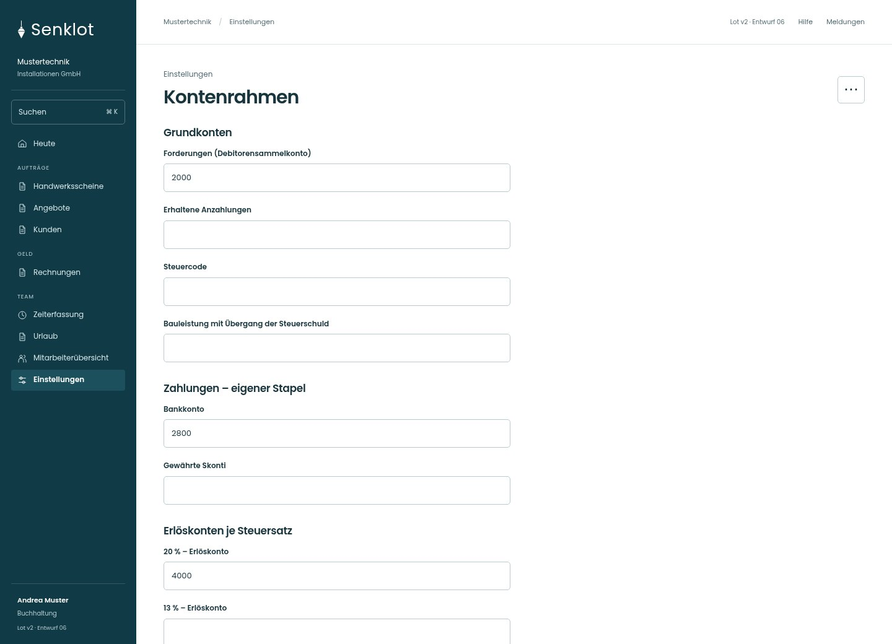
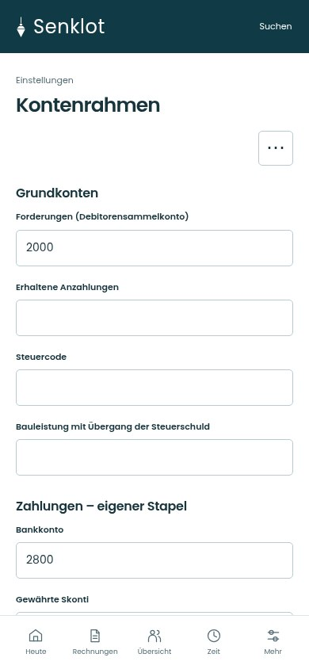
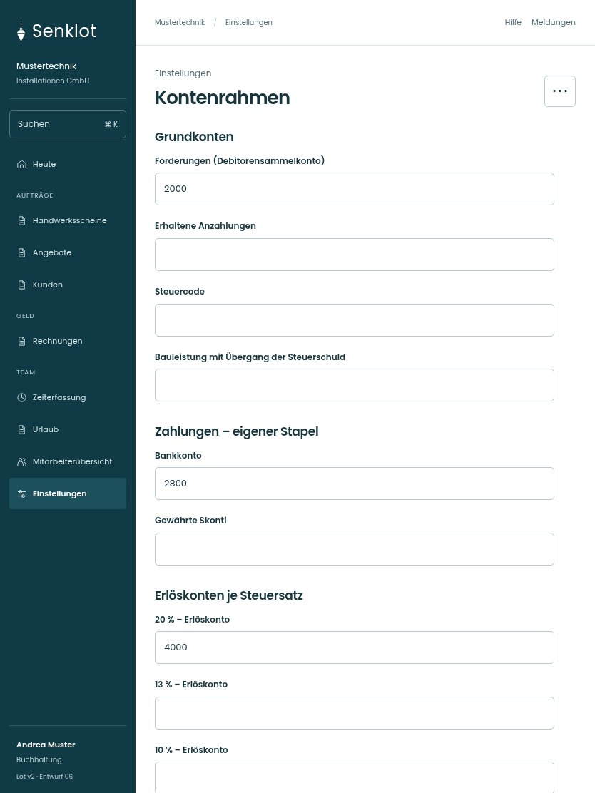

# 149 · Kontenrahmen

[Zur Gesamtübersicht](../README.md) · [Vollständiges Konzept](../Konzept.md)

**Bereich:** Einstellungen · **Bestandsort:** `/settings/konten`

Handy · 390 px

[Ganze Seite ansehen](../bilder/149-kontenrahmen-handy-gesamt.jpg)

Tablet · 834 px

[Ganze Seite ansehen](../bilder/149-kontenrahmen-tablet-gesamt.jpg)

[Desktop in voller Seitenlänge](../bilder/149-kontenrahmen-desktop-gesamt.jpg)

## Entscheidung

Nur arbeitsrelevante Angaben; Details über die Zeile öffnen.

**Gezeigte Rolle:** Buchhaltung. Sichtbarkeit und Aktionen bleiben an bestehende Rollen, Zusatzrechte, Module und Datensatzstatus gebunden.

**Hauptaktion:** Kontenrahmen speichern.

**Weitere Aktionen:** Vorschlag einsetzen.

**Handy/Tablet:** Zeilen statt zusätzlicher Karten; Hauptaktion bleibt gut erreichbar.

## Muss erhalten bleiben

- Abstimmung mit Kanzlei
- Steuercodes/Anzahlungen/Bauleistung
- Keine internen Kostensätze öffnen

## Felder

- Forderungen (Debitorensammelkonto)
- Erhaltene Anzahlungen
- Steuercode
- Bauleistung mit Übergang der Steuerschuld
- Bankkonto
- Gewährte Skonti
- 20 % – Erlöskonto
- 13 % – Erlöskonto
- 10 % – Erlöskonto
- 0 % – Erlöskonto

## Quelle

- [src/features/settings/KontenrahmenView.tsx](https://github.com/juliandeutsch22/Prototype-App-Installateure/blob/d4b8542821d86c7057761af16de1331d1de87e09/src/features/settings/KontenrahmenView.tsx)

Gestaltungsvorschau mit fiktiven Beispieldaten. Keine Änderung oder Auslieferung der App.
