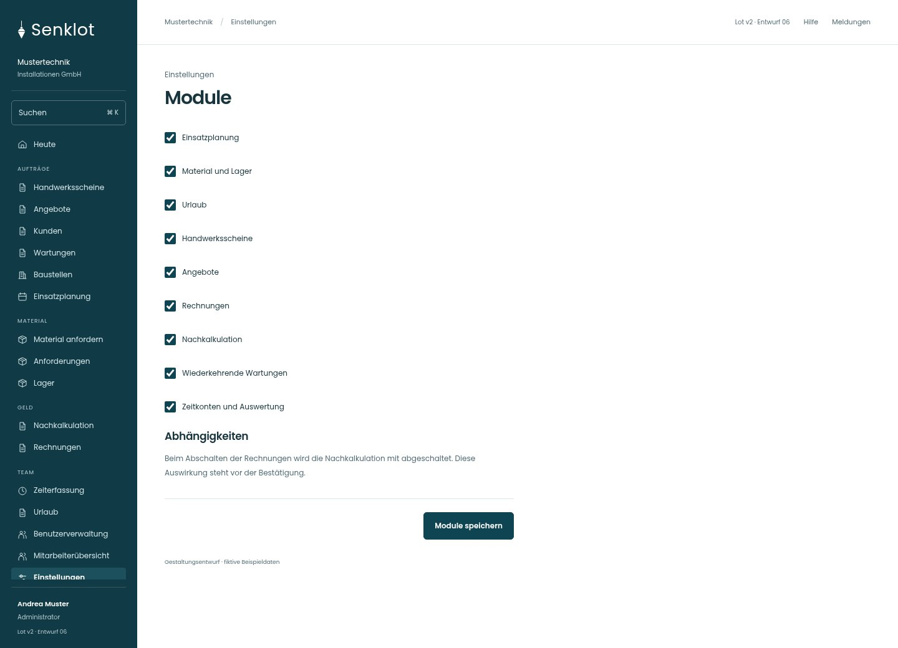
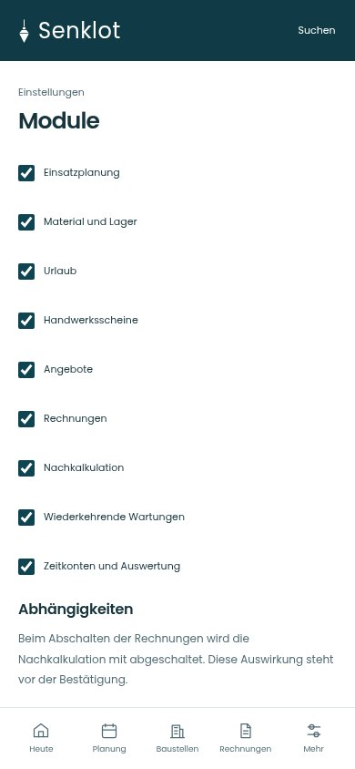
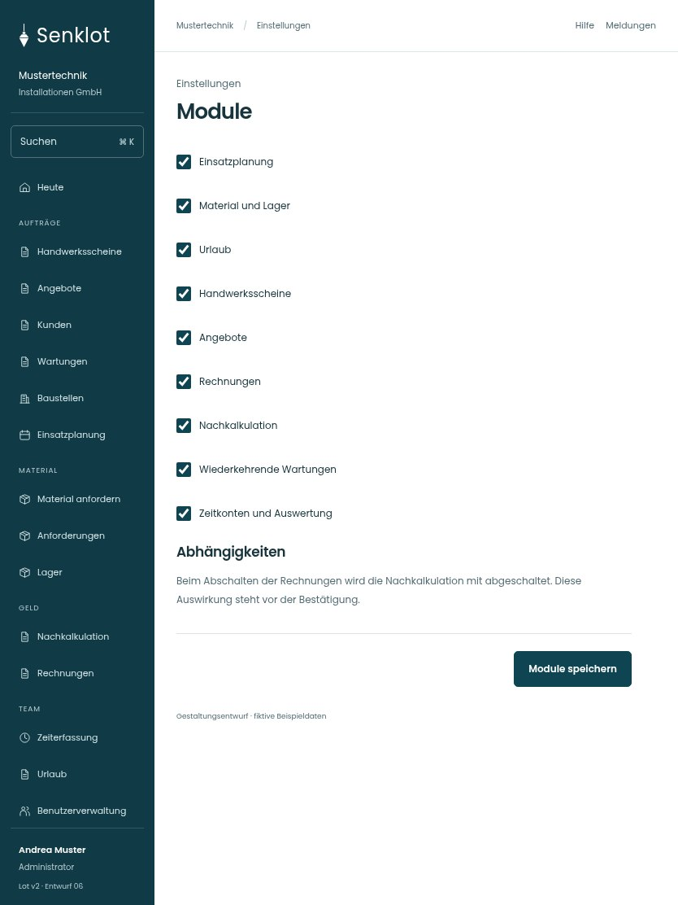

# 152 · Module

[Zur Gesamtübersicht](../README.md) · [Vollständiges Konzept](../Konzept.md)

**Bereich:** Einstellungen · **Bestandsort:** `/settings/module`

Handy · 390 px

[Ganze Seite ansehen](../bilder/152-module-handy-gesamt.jpg)

Tablet · 834 px

## Entscheidung

Nur arbeitsrelevante Angaben; Details über die Zeile öffnen.

**Gezeigte Rolle:** Administrator. Sichtbarkeit und Aktionen bleiben an bestehende Rollen, Zusatzrechte, Module und Datensatzstatus gebunden.

**Hauptaktion:** Module speichern.

**Handy/Tablet:** Zeilen statt zusätzlicher Karten; Hauptaktion bleibt gut erreichbar.

## Muss erhalten bleiben

- Nur Administrator
- Kern nicht abschaltbar
- Abhängige Module vorab nennen
- Kein Ersatz für Rechteverwaltung

## Felder

- Einsatzplanung
- Material und Lager
- Urlaub
- Handwerksscheine
- Angebote
- Rechnungen
- Nachkalkulation
- Wiederkehrende Wartungen
- Zeitkonten und Auswertung

## Quelle

- [src/features/modules/ModulesView.tsx](https://github.com/juliandeutsch22/Prototype-App-Installateure/blob/d4b8542821d86c7057761af16de1331d1de87e09/src/features/modules/ModulesView.tsx)

Gestaltungsvorschau mit fiktiven Beispieldaten. Keine Änderung oder Auslieferung der App.
