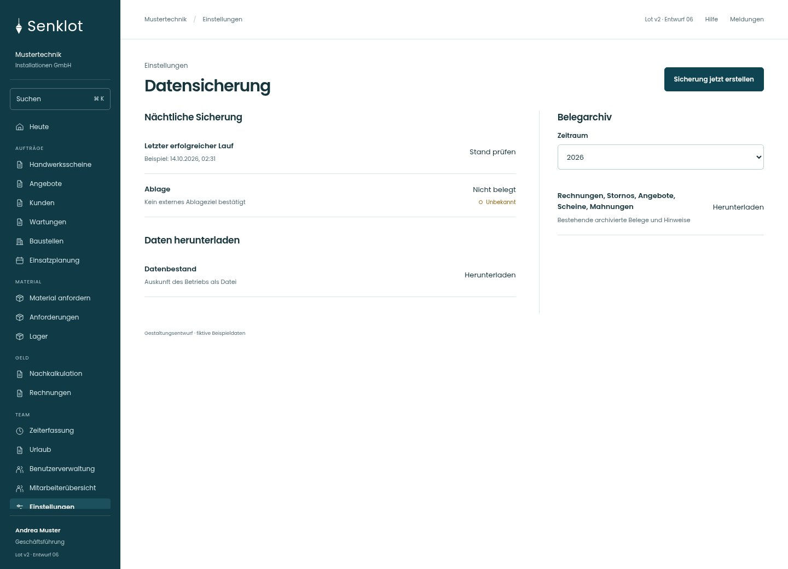
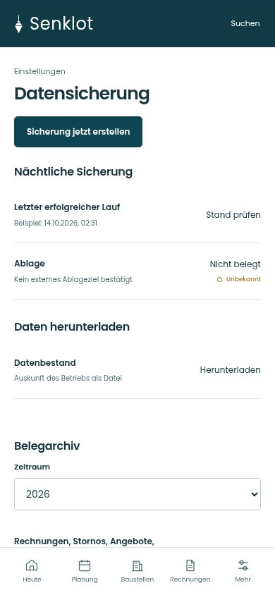
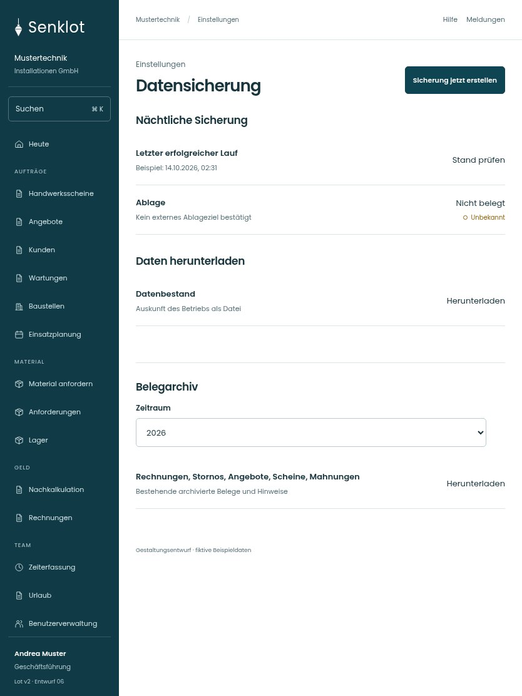

# 153 · Datensicherung

[Zur Gesamtübersicht](../README.md) · [Vollständiges Konzept](../Konzept.md)

**Bereich:** Einstellungen · **Bestandsort:** `/settings/sicherung`

Handy · 390 px

[Ganze Seite ansehen](../bilder/153-sicherung-handy-gesamt.jpg)

Tablet · 834 px

## Entscheidung

Nur arbeitsrelevante Angaben; Details über die Zeile öffnen.

**Gezeigte Rolle:** Geschäftsführung. Sichtbarkeit und Aktionen bleiben an bestehende Rollen, Zusatzrechte, Module und Datensatzstatus gebunden.

**Hauptaktion:** Sicherung jetzt erstellen.

**Handy/Tablet:** Zeilen statt zusätzlicher Karten; Hauptaktion bleibt gut erreichbar.

## Muss erhalten bleiben

- Erfolg/unbekannt/überfällig unterscheiden
- Externes Ziel nicht aus erfolgreichem Lauf ableiten
- Fotos/Dateien separat nachweisen
- Kein Restore-Knopf ohne bestehende Funktion
- Exportgrenzen und Teilfehler

## Felder

- Zeitraum

## Quelle

- [src/features/settings/SicherungView.tsx](https://github.com/juliandeutsch22/Prototype-App-Installateure/blob/d4b8542821d86c7057761af16de1331d1de87e09/src/features/settings/SicherungView.tsx)
- [src/features/settings/LaufStatus.tsx](https://github.com/juliandeutsch22/Prototype-App-Installateure/blob/d4b8542821d86c7057761af16de1331d1de87e09/src/features/settings/LaufStatus.tsx)

Gestaltungsvorschau mit fiktiven Beispieldaten. Keine Änderung oder Auslieferung der App.
