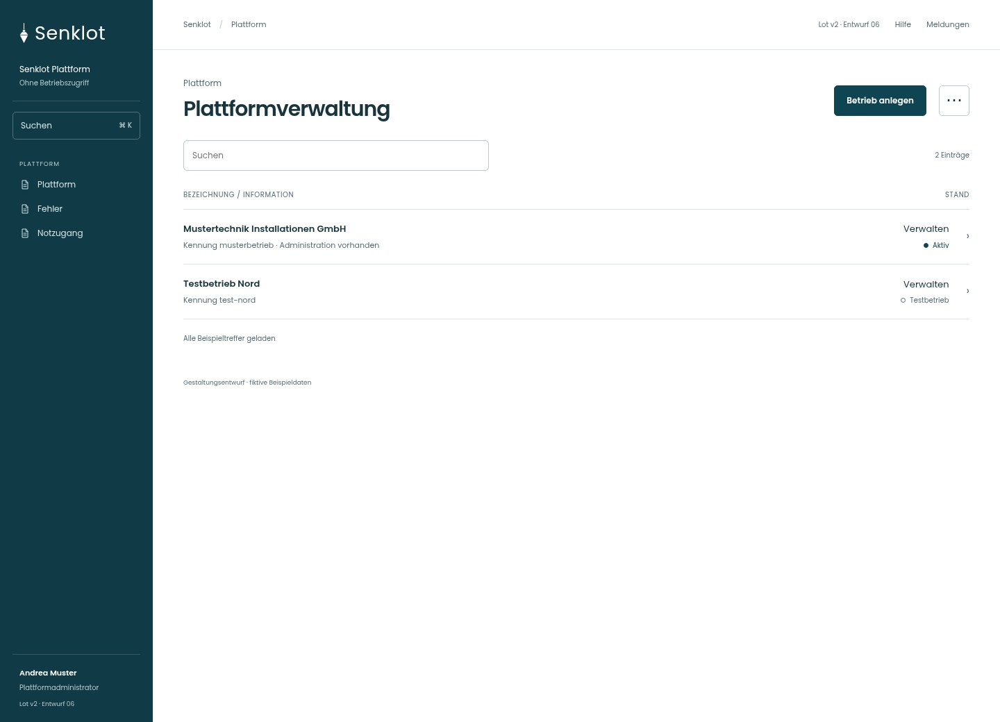
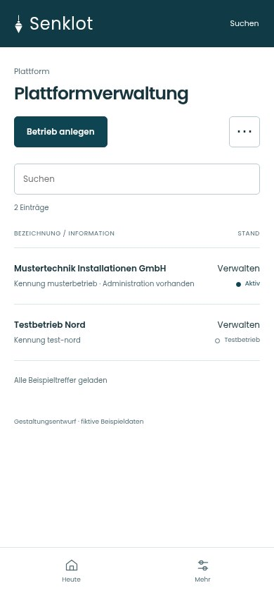
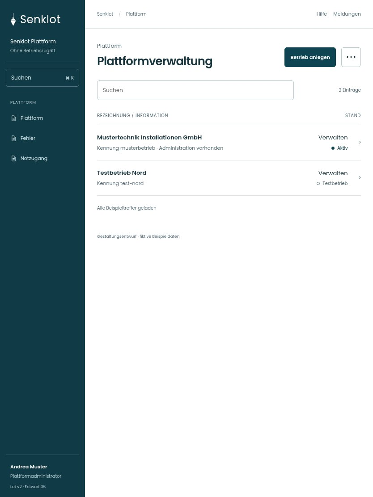

# 154 · Plattformverwaltung

[Zur Gesamtübersicht](../README.md) · [Vollständiges Konzept](../Konzept.md)

**Bereich:** Plattform · **Bestandsort:** `/plattform`

Handy · 390 px

Tablet · 834 px

## Entscheidung

Eigene reduzierte Hülle ohne betriebliche Menüpunkte. Administration darf nicht wie ein freier Betriebswechsel wirken.

**Gezeigte Rolle:** Plattformadministrator. Sichtbarkeit und Aktionen bleiben an bestehende Rollen, Zusatzrechte, Module und Datensatzstatus gebunden.

**Hauptaktion:** Betrieb anlegen.

**Weitere Aktionen:** Fehler aus Betrieben, Notzugang, Basiszinssatz.

**Handy/Tablet:** Zeilen statt zusätzlicher Karten; Hauptaktion bleibt gut erreichbar.

## Muss erhalten bleiben

- Plattformkonto hat keinen Betriebszugriff
- Einblick nur mit Freigabe/Notzugang
- Gelöschte separat
- Eigene MFA/Passwort erreichbar

## Quelle

- [src/features/plattform/PlattformView.tsx](https://github.com/juliandeutsch22/Prototype-App-Installateure/blob/d4b8542821d86c7057761af16de1331d1de87e09/src/features/plattform/PlattformView.tsx)

Gestaltungsvorschau mit fiktiven Beispieldaten. Keine Änderung oder Auslieferung der App.
