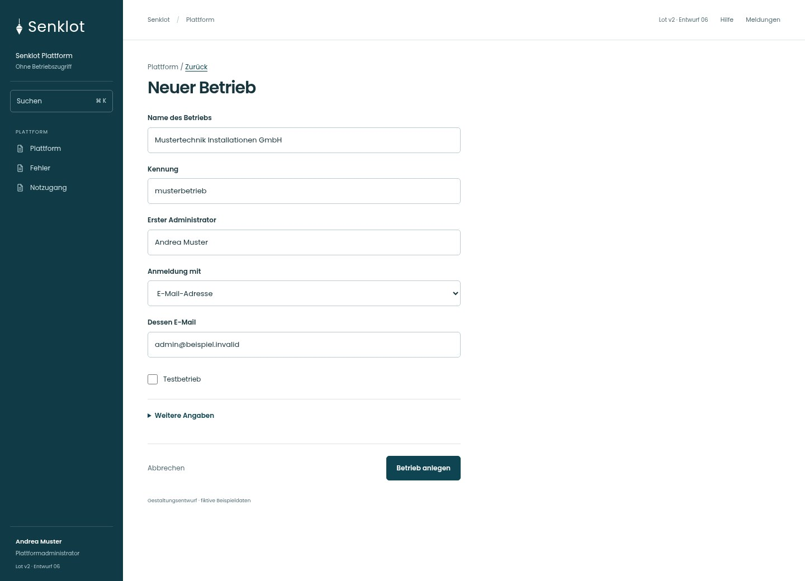
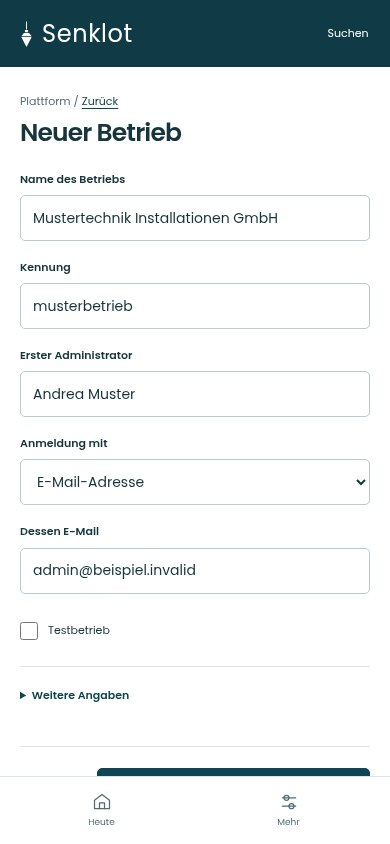
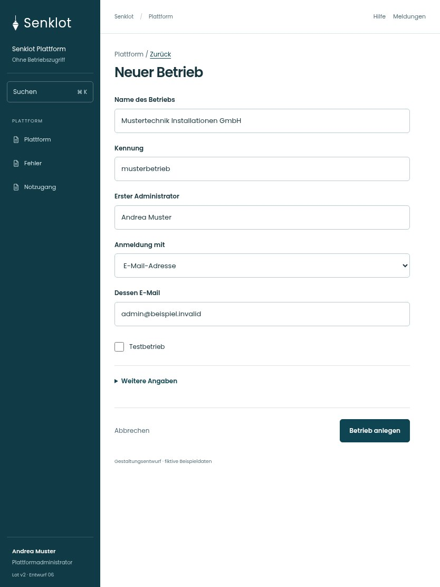

# 155 · Neuer Betrieb

[Zur Gesamtübersicht](../README.md) · [Vollständiges Konzept](../Konzept.md)

**Bereich:** Plattform · **Bestandsort:** `/plattform · Betrieb anlegen`

Handy · 390 px

[Ganze Seite ansehen](../bilder/155-plattform-neu-handy-gesamt.jpg)

Tablet · 834 px

## Entscheidung

Nur arbeitsrelevante Angaben; Details über die Zeile öffnen.

**Gezeigte Rolle:** Plattformadministrator. Sichtbarkeit und Aktionen bleiben an bestehende Rollen, Zusatzrechte, Module und Datensatzstatus gebunden.

**Hauptaktion:** Betrieb anlegen.

**Handy/Tablet:** Zeilen statt zusätzlicher Karten; Hauptaktion bleibt gut erreichbar.

## Muss erhalten bleiben

- Einmalige Übergabe Link/Startpasswort
- Betriebskennung eindeutig
- Keine wiederverwendbaren Geheimnisse im Mockup

## Felder

- Name des Betriebs
- Kennung
- Erster Administrator
- Anmeldung mit
- Dessen E-Mail
- Benutzername · bei Bedarf
- Testbetrieb

## Quelle

- [src/features/plattform/PlattformView.tsx](https://github.com/juliandeutsch22/Prototype-App-Installateure/blob/d4b8542821d86c7057761af16de1331d1de87e09/src/features/plattform/PlattformView.tsx)

Gestaltungsvorschau mit fiktiven Beispieldaten. Keine Änderung oder Auslieferung der App.
