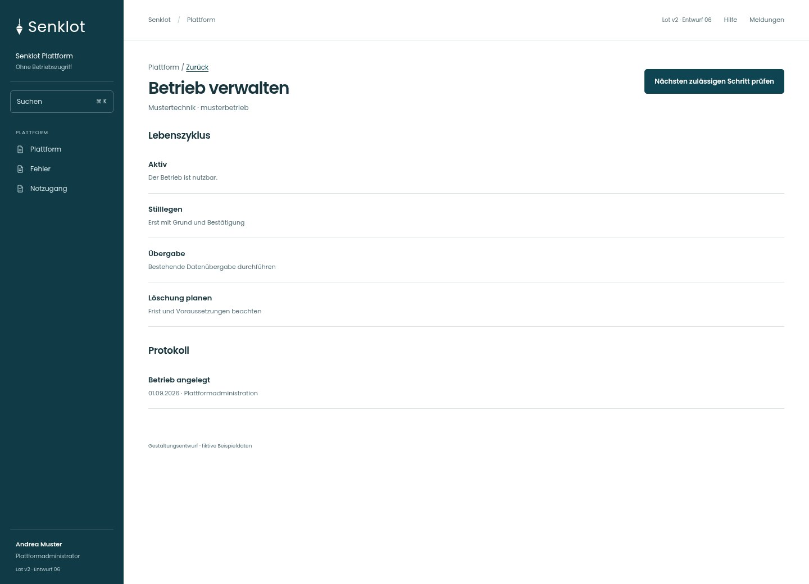
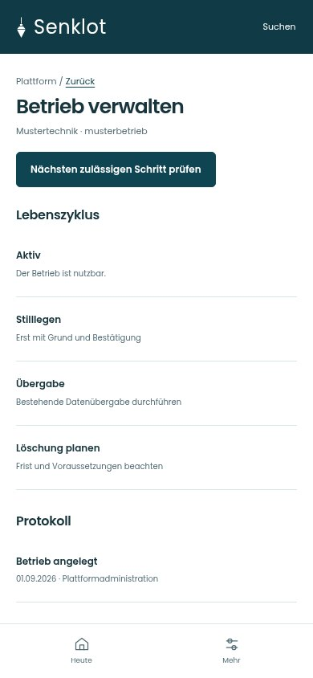
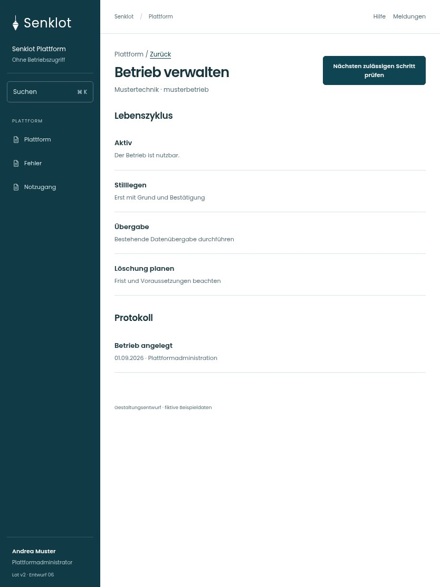

# 156 · Betrieb verwalten

[Zur Gesamtübersicht](../README.md) · [Vollständiges Konzept](../Konzept.md)

**Bereich:** Plattform · **Bestandsort:** `/plattform · Betriebsfenster`

Handy · 390 px

Tablet · 834 px

## Entscheidung

Nur arbeitsrelevante Angaben; Details über die Zeile öffnen.

**Gezeigte Rolle:** Plattformadministrator. Sichtbarkeit und Aktionen bleiben an bestehende Rollen, Zusatzrechte, Module und Datensatzstatus gebunden.

**Hauptaktion:** Nächsten zulässigen Schritt prüfen.

**Handy/Tablet:** Zeilen statt zusätzlicher Karten; Hauptaktion bleibt gut erreichbar.

## Muss erhalten bleiben

- Stilllegen→Übergabe→Löschfrist→Löschen
- Testbetrieb-Ausnahme nur wie Bestand
- Kennungsbestätigung
- Kein neuer pauschaler Löschknopf

## Felder

- Grund (steht im Protokoll)
- Frist (Tage)
- Zur Löschbestätigung die Kennung eintippen

## Quelle

- [src/features/plattform/BetriebVerwalten.tsx](https://github.com/juliandeutsch22/Prototype-App-Installateure/blob/d4b8542821d86c7057761af16de1331d1de87e09/src/features/plattform/BetriebVerwalten.tsx)
- [src/features/plattform/PlattformView.tsx](https://github.com/juliandeutsch22/Prototype-App-Installateure/blob/d4b8542821d86c7057761af16de1331d1de87e09/src/features/plattform/PlattformView.tsx)

Gestaltungsvorschau mit fiktiven Beispieldaten. Keine Änderung oder Auslieferung der App.
