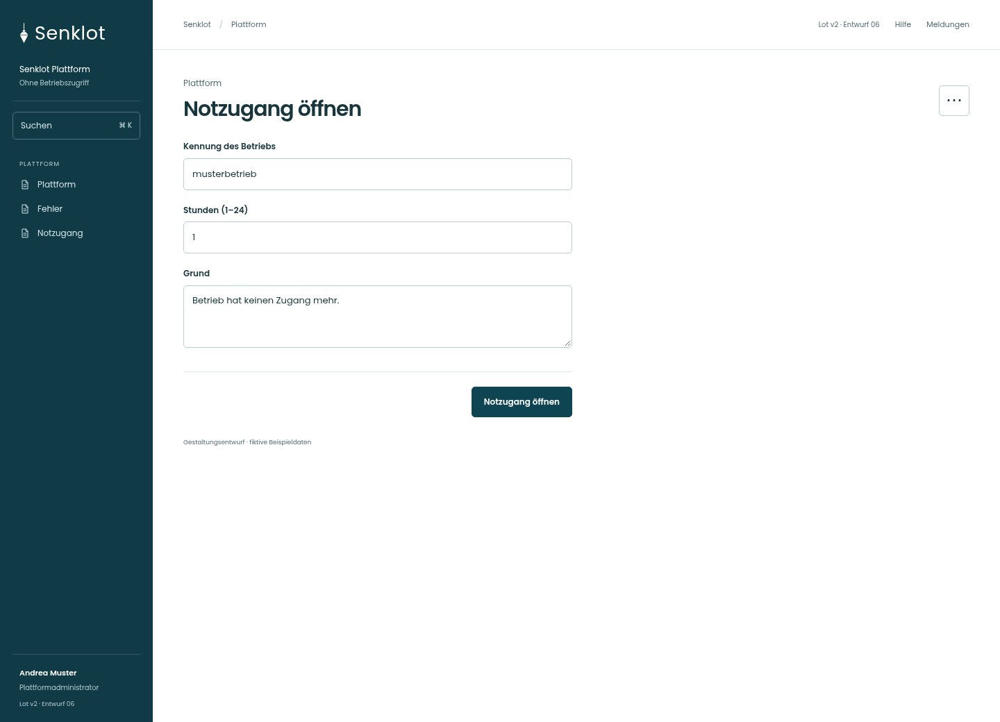
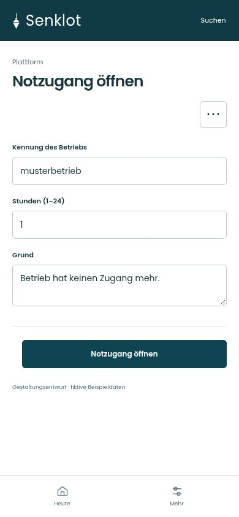
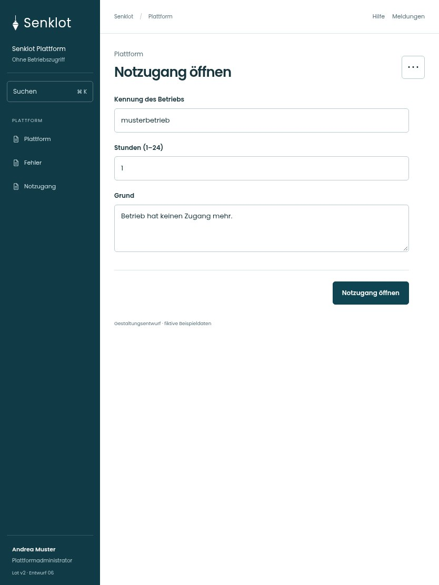

# 159 · Notzugang öffnen

[Zur Gesamtübersicht](../README.md) · [Vollständiges Konzept](../Konzept.md)

**Bereich:** Plattform · **Bestandsort:** `/plattform · Notzugang`

Handy · 390 px

Tablet · 834 px

## Entscheidung

Nur arbeitsrelevante Angaben; Details über die Zeile öffnen.

**Gezeigte Rolle:** Plattformadministrator. Sichtbarkeit und Aktionen bleiben an bestehende Rollen, Zusatzrechte, Module und Datensatzstatus gebunden.

**Hauptaktion:** Notzugang öffnen.

**Weitere Aktionen:** Startpasswort zurücksetzen, Zweiten Faktor zurücksetzen.

**Handy/Tablet:** Zeilen statt zusätzlicher Karten; Hauptaktion bleibt gut erreichbar.

## Muss erhalten bleiben

- Befristung und Protokoll
- Keine automatische Einsicht nur durch Kenntnis der Kennung
- Kontrollierte Notfallrechte

## Felder

- Kennung des Betriebs
- Stunden (1–24)
- Grund

## Quelle

- [src/features/plattform/PlattformView.tsx](https://github.com/juliandeutsch22/Prototype-App-Installateure/blob/d4b8542821d86c7057761af16de1331d1de87e09/src/features/plattform/PlattformView.tsx)

Gestaltungsvorschau mit fiktiven Beispieldaten. Keine Änderung oder Auslieferung der App.
