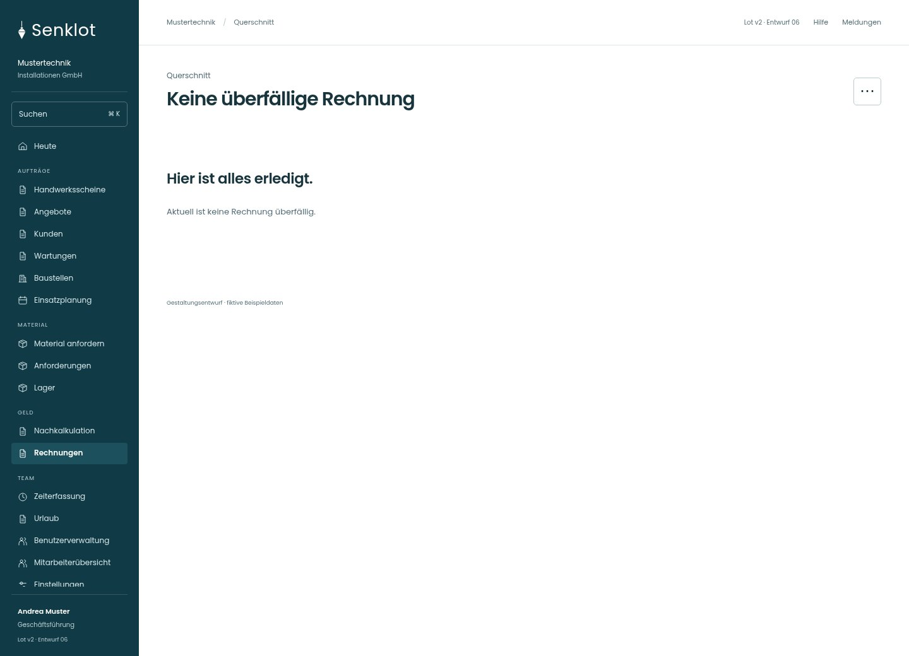
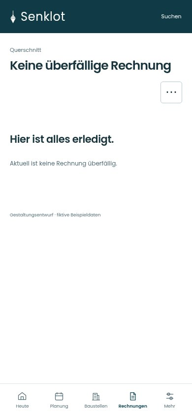
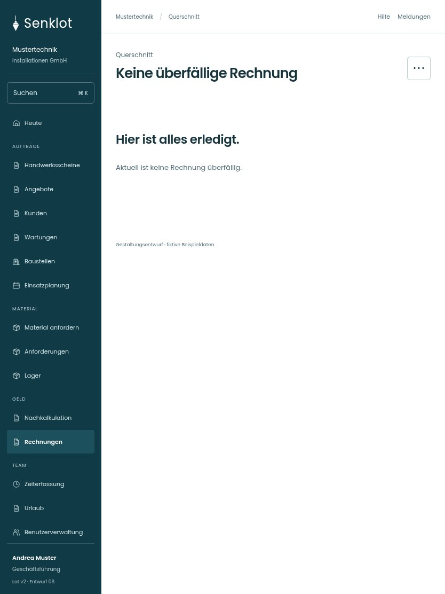

# 168 · Keine überfällige Rechnung

[Zur Gesamtübersicht](../README.md) · [Vollständiges Konzept](../Konzept.md)

**Bereich:** Querschnitt · **Bestandsort:** `/invoices · leerer Mahnzustand`

Handy · 390 px

Tablet · 834 px

## Entscheidung

Eine klare Aussage und ein sinnvoller Rückweg. Keine Grafik, Erfolgszahl oder wiederholte Erklärung.

**Gezeigte Rolle:** Geschäftsführung. Sichtbarkeit und Aktionen bleiben an bestehende Rollen, Zusatzrechte, Module und Datensatzstatus gebunden.

**Hauptaktion:** Keine zusätzliche Hauptaktion.

**Weitere Aktionen:** Offene Rechnungen ansehen.

**Handy/Tablet:** Zeilen statt zusätzlicher Karten; Hauptaktion bleibt gut erreichbar.

## Muss erhalten bleiben

- Leer vs Suche ohne Treffer vs Ladefehler unterscheiden

## Quelle

- [src/components/States.tsx](https://github.com/juliandeutsch22/Prototype-App-Installateure/blob/d4b8542821d86c7057761af16de1331d1de87e09/src/components/States.tsx)

Gestaltungsvorschau mit fiktiven Beispieldaten. Keine Änderung oder Auslieferung der App.
