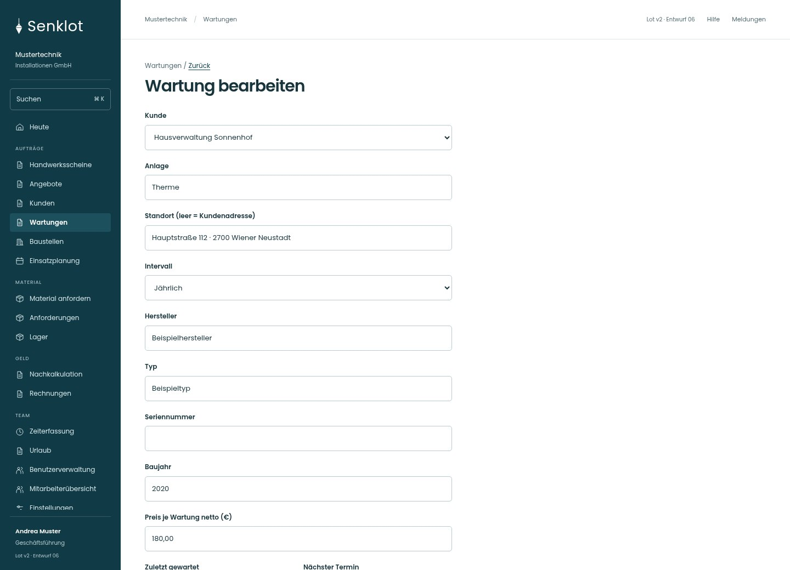
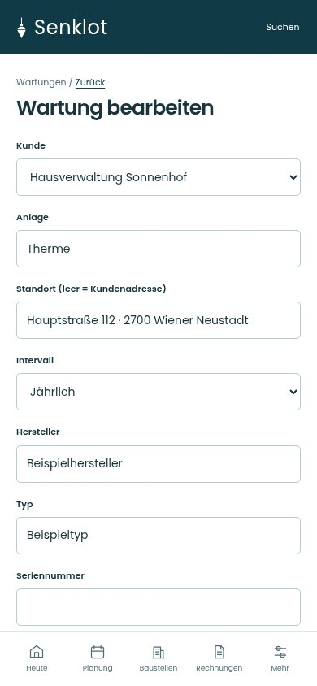
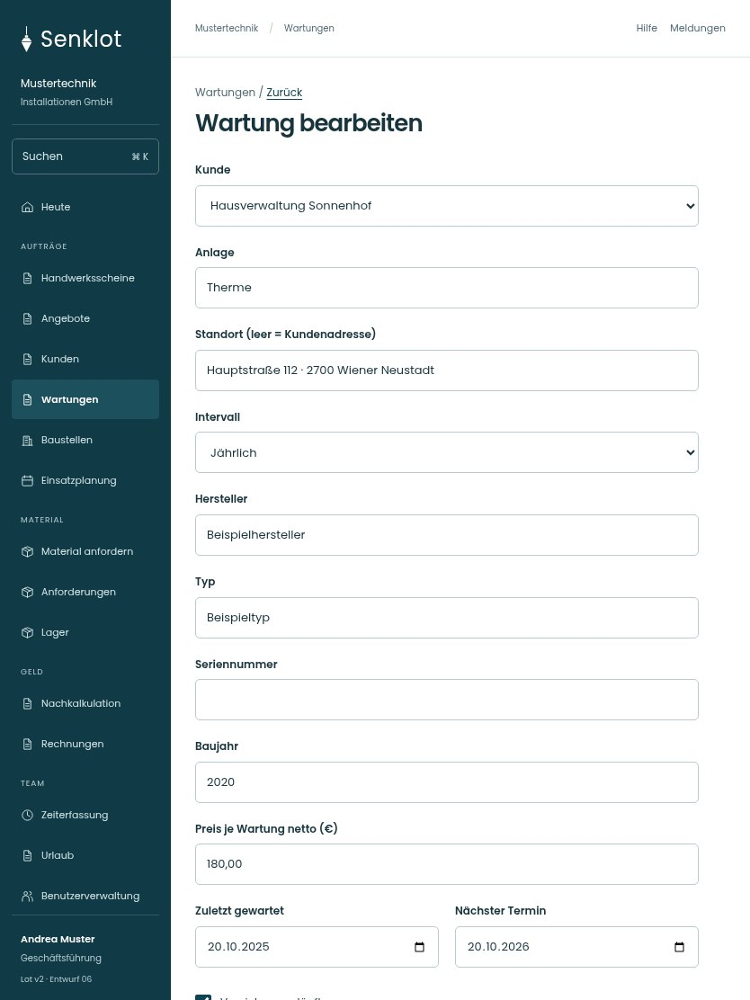

# 187 · Wartung bearbeiten

[Zur Gesamtübersicht](../README.md) · [Vollständiges Konzept](../Konzept.md)

**Bereich:** Wartungen · **Bestandsort:** `/wartungen · Formular`

Handy · 390 px

[Ganze Seite ansehen](../bilder/187-wartung-neu-handy-gesamt.jpg)

Tablet · 834 px

[Ganze Seite ansehen](../bilder/187-wartung-neu-tablet-gesamt.jpg)

[Desktop in voller Seitenlänge](../bilder/187-wartung-neu-desktop-gesamt.jpg)

## Entscheidung

Nur arbeitsrelevante Angaben; Details über die Zeile öffnen.

**Gezeigte Rolle:** Geschäftsführung. Sichtbarkeit und Aktionen bleiben an bestehende Rollen, Zusatzrechte, Module und Datensatzstatus gebunden.

**Hauptaktion:** Wartung speichern.

**Handy/Tablet:** Zeilen statt zusätzlicher Karten; Hauptaktion bleibt gut erreichbar.

## Muss erhalten bleiben

- Fälligkeit aus Intervall wie bisher
- Verwaltung liest nur

## Felder

- Kunde
- Anlage
- Standort (leer = Kundenadresse)
- Intervall
- Hersteller
- Typ
- Seriennummer
- Baujahr
- Preis je Wartung netto (€)
- Zuletzt gewartet
- Nächster Termin
- Vereinbarung läuft
- Hinweis

## Quelle

- [src/features/maintenance/WartungenView.tsx](https://github.com/juliandeutsch22/Prototype-App-Installateure/blob/d4b8542821d86c7057761af16de1331d1de87e09/src/features/maintenance/WartungenView.tsx)

Gestaltungsvorschau mit fiktiven Beispieldaten. Keine Änderung oder Auslieferung der App.
