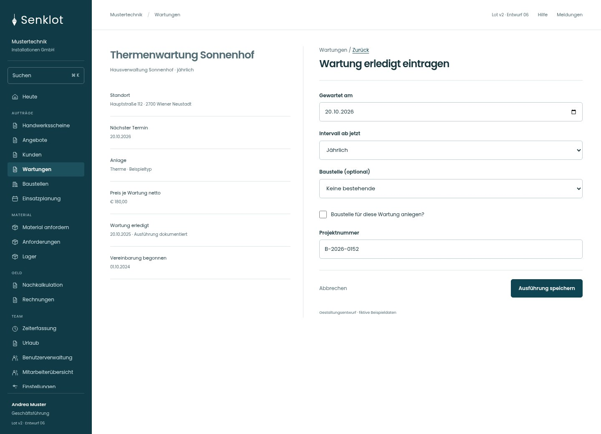
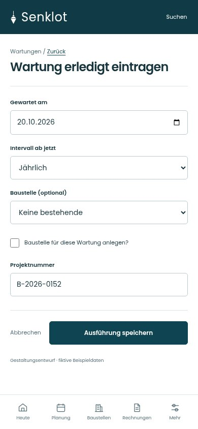
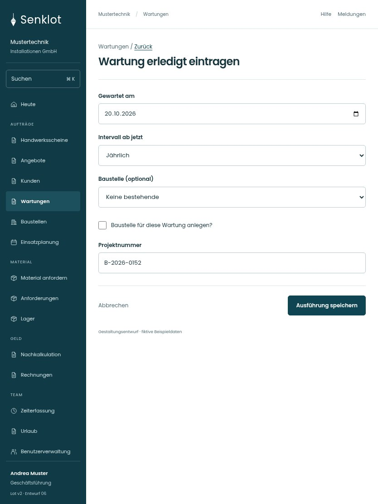

# 188 · Wartung erledigt eintragen

[Zur Gesamtübersicht](../README.md) · [Vollständiges Konzept](../Konzept.md)

**Bereich:** Wartungen · **Bestandsort:** `/wartungen · Ausführung`

Handy · 390 px

Tablet · 834 px

## Entscheidung

Nur arbeitsrelevante Angaben; Details über die Zeile öffnen.

**Gezeigte Rolle:** Geschäftsführung. Sichtbarkeit und Aktionen bleiben an bestehende Rollen, Zusatzrechte, Module und Datensatzstatus gebunden.

**Hauptaktion:** Ausführung speichern.

**Handy/Tablet:** Zeilen statt zusätzlicher Karten; Hauptaktion bleibt gut erreichbar.

## Muss erhalten bleiben

- Neue Ausführung statt Datum überschreiben
- Optionale Wartungsbaustelle
- Leistungs-/Rechnungsweg bleibt bestehen

## Felder

- Gewartet am
- Intervall ab jetzt
- Baustelle (optional)
- Baustelle für diese Wartung anlegen?
- Projektnummer

## Quelle

- [src/features/maintenance/WartungenView.tsx](https://github.com/juliandeutsch22/Prototype-App-Installateure/blob/d4b8542821d86c7057761af16de1331d1de87e09/src/features/maintenance/WartungenView.tsx)

Gestaltungsvorschau mit fiktiven Beispieldaten. Keine Änderung oder Auslieferung der App.
