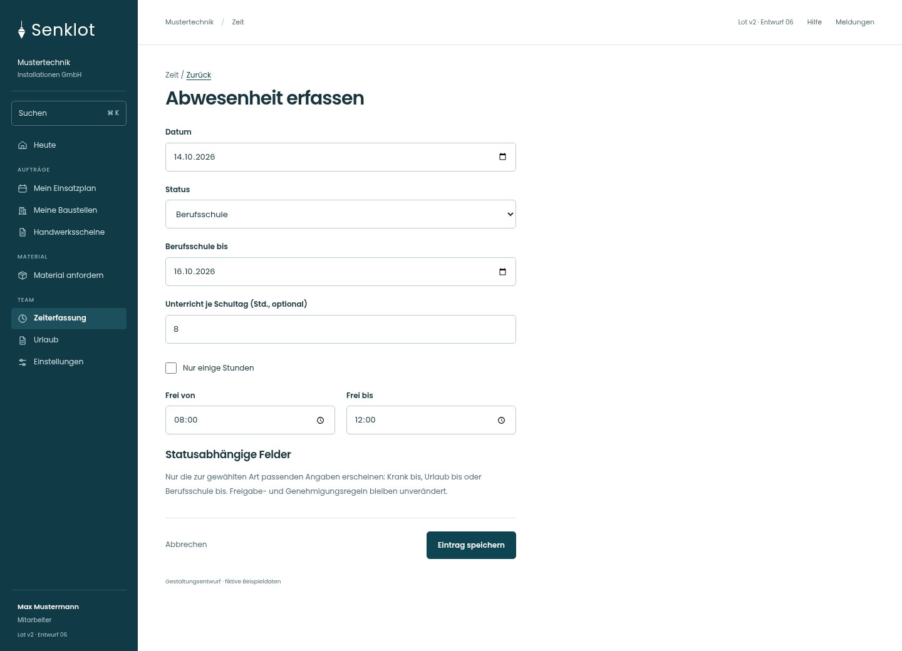
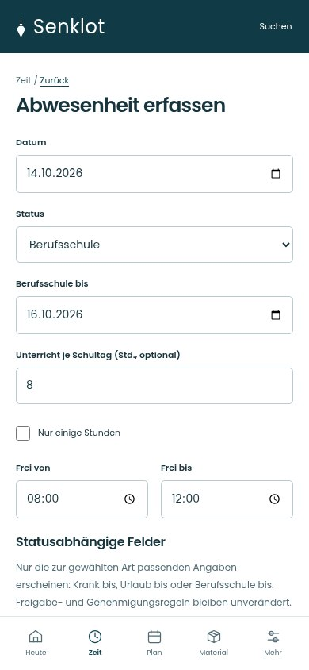
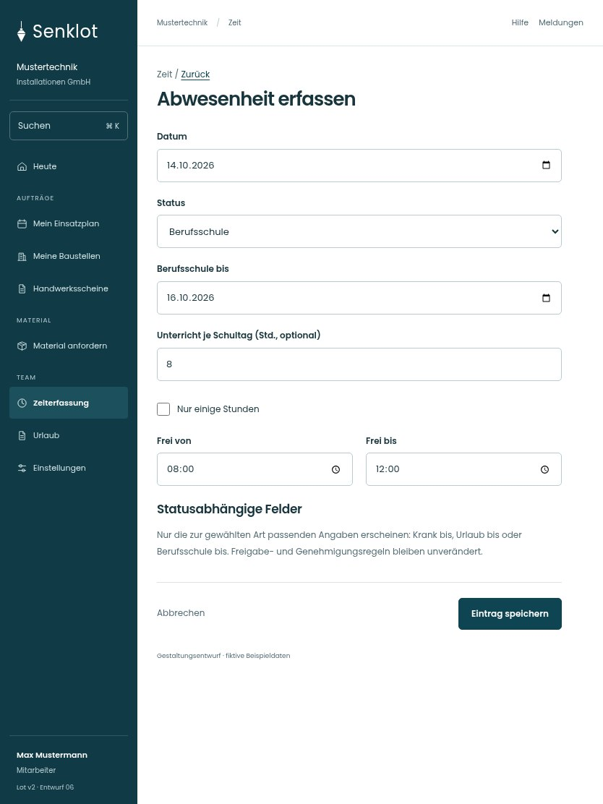

# 191 · Abwesenheit erfassen

[Zur Gesamtübersicht](../README.md) · [Vollständiges Konzept](../Konzept.md)

**Bereich:** Zeit · **Bestandsort:** `/time · Statusabhängige Eingabe`

Handy · 390 px

[Ganze Seite ansehen](../bilder/191-zeit-abwesenheit-handy-gesamt.jpg)

Tablet · 834 px

## Entscheidung

Nur arbeitsrelevante Angaben; Details über die Zeile öffnen.

**Gezeigte Rolle:** Mitarbeiter. Sichtbarkeit und Aktionen bleiben an bestehende Rollen, Zusatzrechte, Module und Datensatzstatus gebunden.

**Hauptaktion:** Eintrag speichern.

**Handy/Tablet:** Zeilen statt zusätzlicher Karten; Hauptaktion bleibt gut erreichbar.

## Muss erhalten bleiben

- Kein Umgehen eines Urlaubsantrags durch Zeitstatus
- Jugendliche und Unterricht
- Stundenweise Abwesenheit

## Felder

- Datum
- Status
- Berufsschule bis
- Unterricht je Schultag (Std., optional)
- Nur einige Stunden
- Frei von
- Frei bis

## Quelle

- [src/features/time/TimeForm.tsx](https://github.com/juliandeutsch22/Prototype-App-Installateure/blob/d4b8542821d86c7057761af16de1331d1de87e09/src/features/time/TimeForm.tsx)

Gestaltungsvorschau mit fiktiven Beispieldaten. Keine Änderung oder Auslieferung der App.
