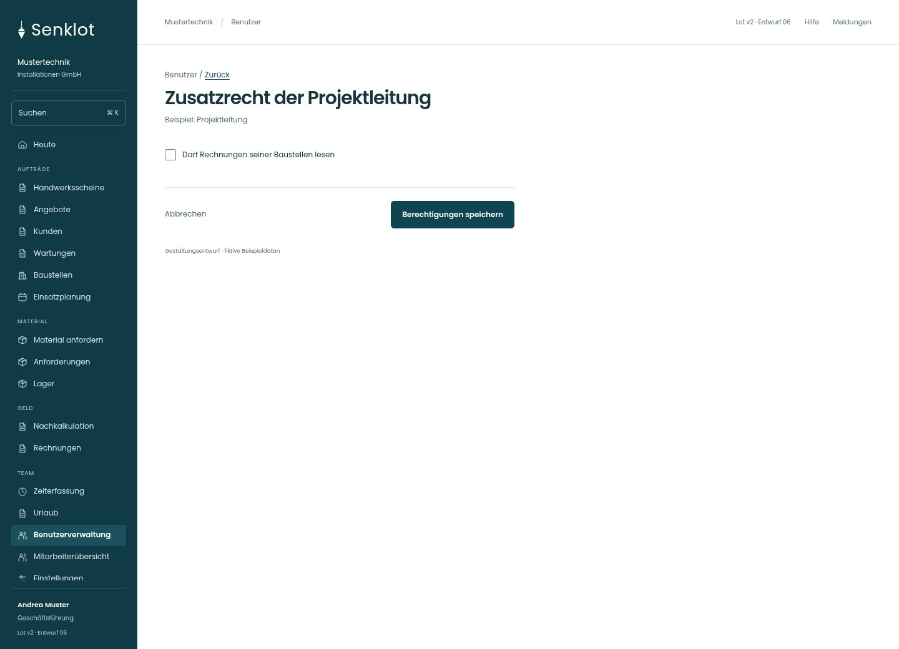
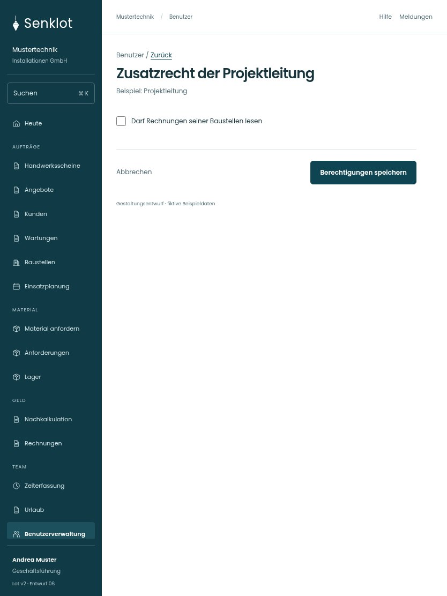

# 193 · Zusatzrecht der Projektleitung

[Zur Gesamtübersicht](../README.md) · [Vollständiges Konzept](../Konzept.md)

**Bereich:** Benutzer · **Bestandsort:** `/user-mgmt/:uid · Berechtigungen`

Handy · 390 px

Tablet · 834 px

## Entscheidung

Nur arbeitsrelevante Angaben; Details über die Zeile öffnen.

**Gezeigte Rolle:** Geschäftsführung. Sichtbarkeit und Aktionen bleiben an bestehende Rollen, Zusatzrechte, Module und Datensatzstatus gebunden.

**Hauptaktion:** Berechtigungen speichern.

**Handy/Tablet:** Zeilen statt zusätzlicher Karten; Hauptaktion bleibt gut erreichbar.

## Muss erhalten bleiben

- Im echten Formular nur die zur aktuellen Rolle passenden Felder
- Katalogfreigabe umfasst Einkaufspreise
- Kein Rechnungs-Schreibrecht für Projektleitung
- Projektleitung erhält ausschließlich das separate Feld Rechnungen seiner Baustellen lesen, kein Rechnungs-Schreibrecht

## Felder

- Darf Rechnungen seiner Baustellen lesen

## Quelle

- [src/features/users/BenutzerakteView.tsx](https://github.com/juliandeutsch22/Prototype-App-Installateure/blob/d4b8542821d86c7057761af16de1331d1de87e09/src/features/users/BenutzerakteView.tsx)

Gestaltungsvorschau mit fiktiven Beispieldaten. Keine Änderung oder Auslieferung der App.
