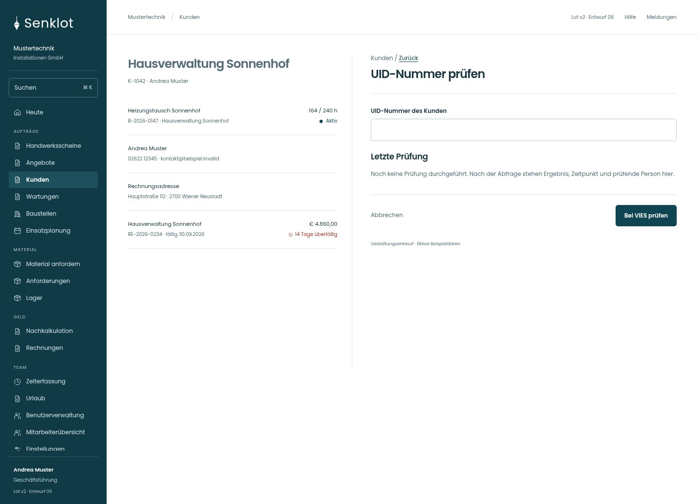
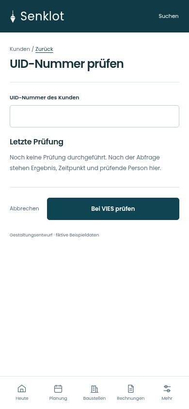
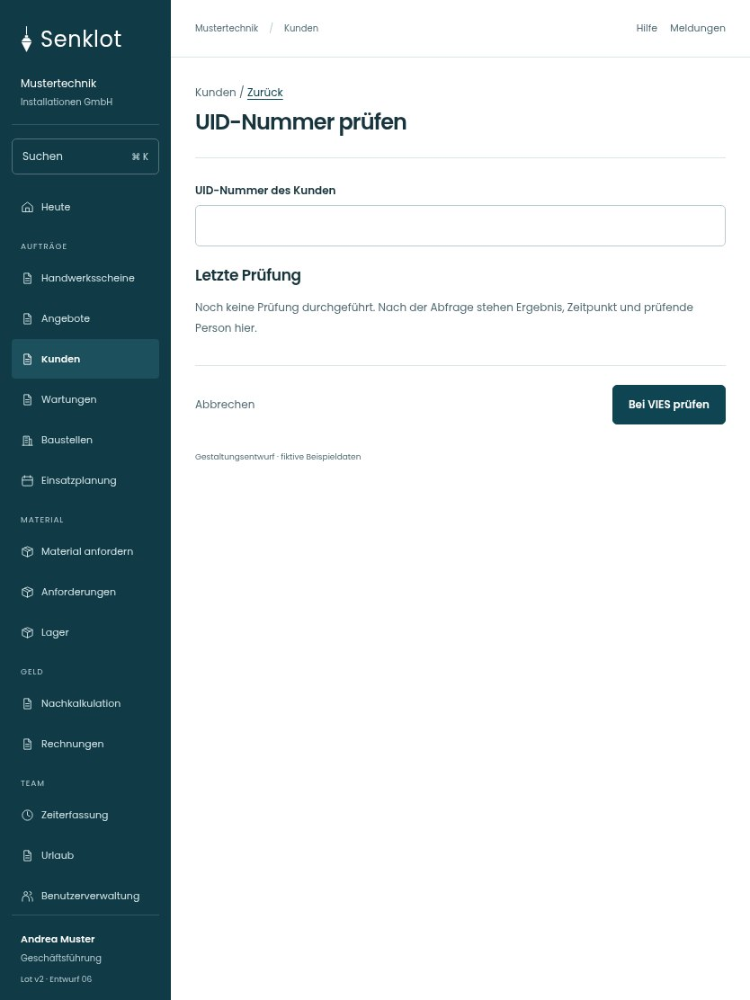

# 194 · UID-Nummer prüfen

[Zur Gesamtübersicht](../README.md) · [Vollständiges Konzept](../Konzept.md)

**Bereich:** Kunden · **Bestandsort:** `/customers/:id · UID-Nummer prüfen`

Handy · 390 px

Tablet · 834 px

## Entscheidung

Nur die konkrete Aufgabe mit ihren notwendigen Angaben. Keine zusätzliche Erklärungsebene.

**Gezeigte Rolle:** Geschäftsführung. Sichtbarkeit und Aktionen bleiben an bestehende Rollen, Zusatzrechte, Module und Datensatzstatus gebunden.

**Hauptaktion:** Bei VIES prüfen.

**Handy/Tablet:** Zeilen statt zusätzlicher Karten; Hauptaktion bleibt gut erreichbar.

## Muss erhalten bleiben

- Nur bestehende Prüfrechte
- Firmen-UID erforderlich
- Keine Echtheitszusage bei Netzfehler
- Prüfergebnis mit Zeit und Person

## Felder

- UID-Nummer des Kunden

## Quelle

- [src/features/customers/UidVies.tsx](https://github.com/juliandeutsch22/Prototype-App-Installateure/blob/d4b8542821d86c7057761af16de1331d1de87e09/src/features/customers/UidVies.tsx)

Gestaltungsvorschau mit fiktiven Beispieldaten. Keine Änderung oder Auslieferung der App.
