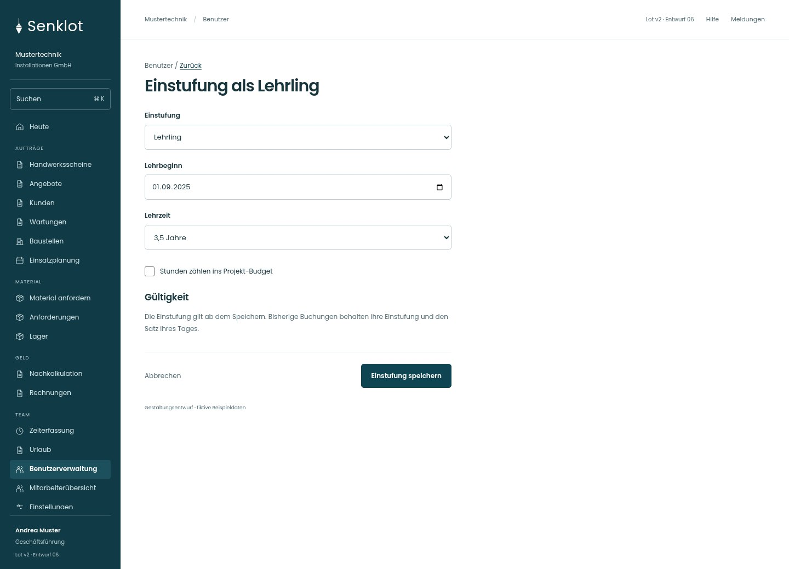
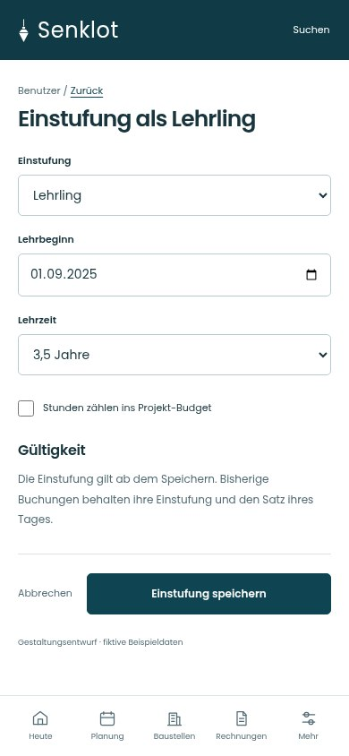
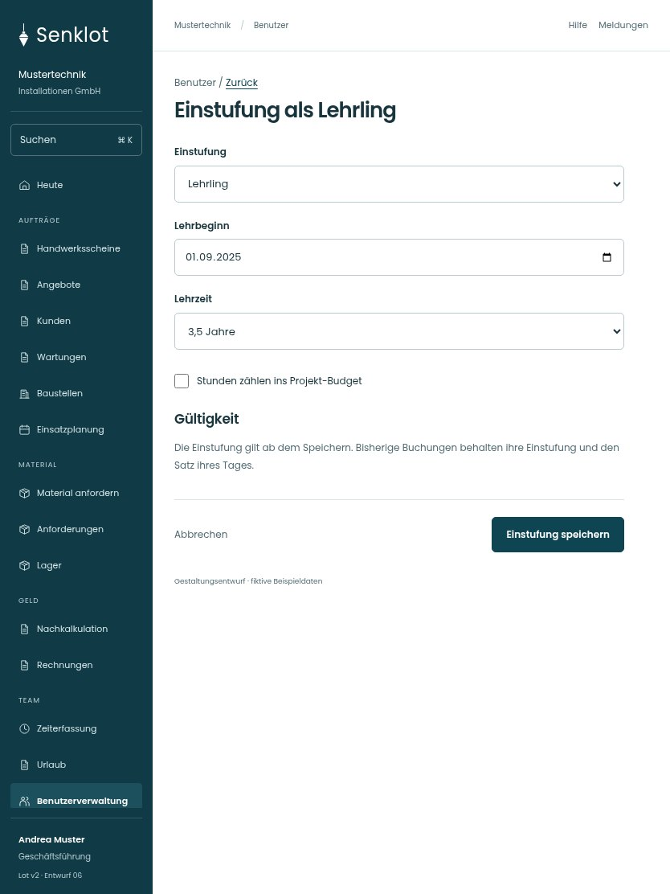

# 197 · Einstufung als Lehrling

[Zur Gesamtübersicht](../README.md) · [Vollständiges Konzept](../Konzept.md)

**Bereich:** Benutzer · **Bestandsort:** `/user-mgmt/:uid · Einstufung als Lehrling`

Handy · 390 px

Tablet · 834 px

## Entscheidung

Nur die konkrete Aufgabe mit ihren notwendigen Angaben. Keine zusätzliche Erklärungsebene.

**Gezeigte Rolle:** Geschäftsführung. Sichtbarkeit und Aktionen bleiben an bestehende Rollen, Zusatzrechte, Module und Datensatzstatus gebunden.

**Hauptaktion:** Einstufung speichern.

**Handy/Tablet:** Zeilen statt zusätzlicher Karten; Hauptaktion bleibt gut erreichbar.

## Muss erhalten bleiben

- Lehrbeginn kann vor Eintritt liegen
- Budgetzählung je Person
- Historische Stundensätze bleiben
- Keine Rollenrechte aus Einstufung ableiten

## Felder

- Einstufung
- Lehrbeginn
- Lehrzeit
- Stunden zählen ins Projekt-Budget

## Quelle

- [src/features/users/EinstufungFelder.tsx](https://github.com/juliandeutsch22/Prototype-App-Installateure/blob/d4b8542821d86c7057761af16de1331d1de87e09/src/features/users/EinstufungFelder.tsx)

Gestaltungsvorschau mit fiktiven Beispieldaten. Keine Änderung oder Auslieferung der App.
