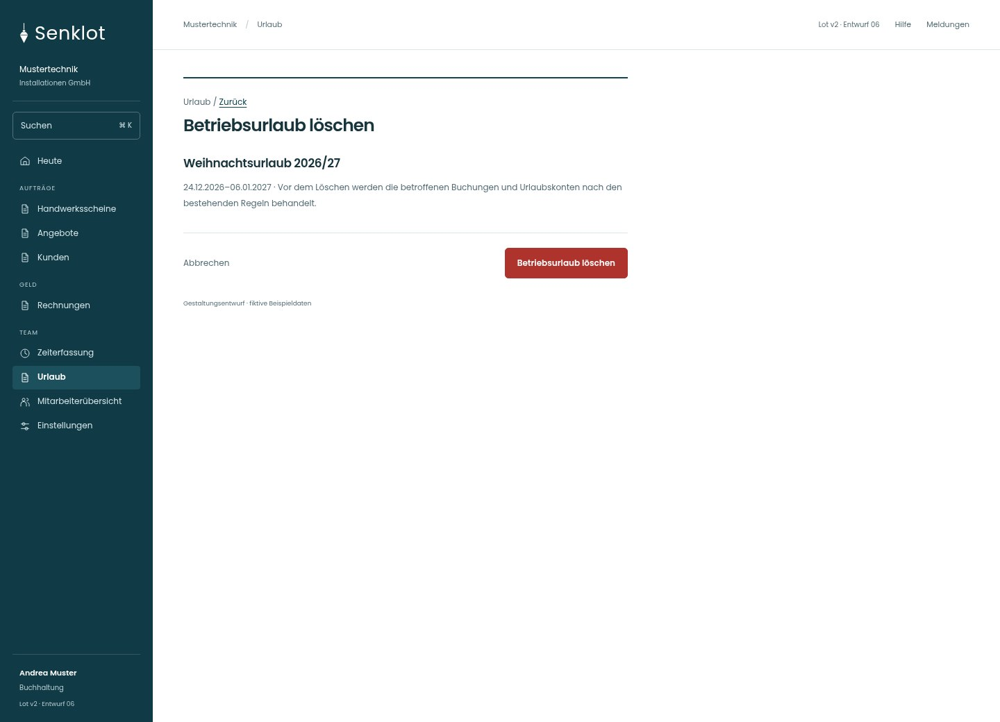
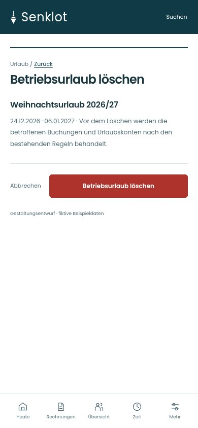
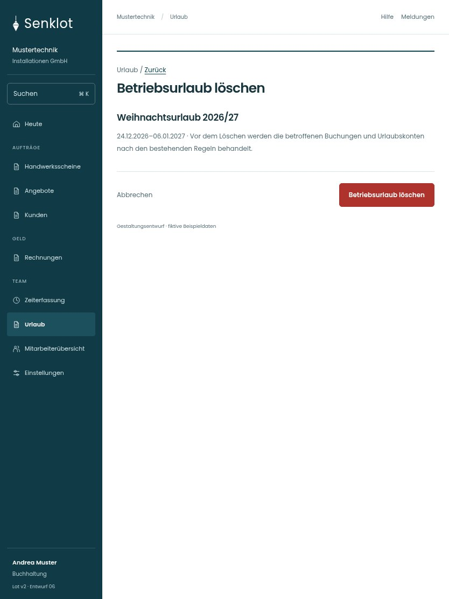

# 198 · Betriebsurlaub löschen

[Zur Gesamtübersicht](../README.md) · [Vollständiges Konzept](../Konzept.md)

**Bereich:** Urlaub · **Bestandsort:** `/vacations · Betriebsurlaub löschen`

Handy · 390 px

Tablet · 834 px

## Entscheidung

Nur die konkrete Aufgabe mit ihren notwendigen Angaben. Keine zusätzliche Erklärungsebene.

**Gezeigte Rolle:** Buchhaltung. Sichtbarkeit und Aktionen bleiben an bestehende Rollen, Zusatzrechte, Module und Datensatzstatus gebunden.

**Hauptaktion:** Betriebsurlaub löschen.

**Handy/Tablet:** Zeilen statt zusätzlicher Karten; Hauptaktion bleibt gut erreichbar.

## Muss erhalten bleiben

- Bestehende Bestätigung
- Rücknahme der zugehörigen Buchungen nur nach bestehender Funktion

## Quelle

- [src/features/vacations/BetriebsurlaubReiter.tsx](https://github.com/juliandeutsch22/Prototype-App-Installateure/blob/d4b8542821d86c7057761af16de1331d1de87e09/src/features/vacations/BetriebsurlaubReiter.tsx)

Gestaltungsvorschau mit fiktiven Beispieldaten. Keine Änderung oder Auslieferung der App.
