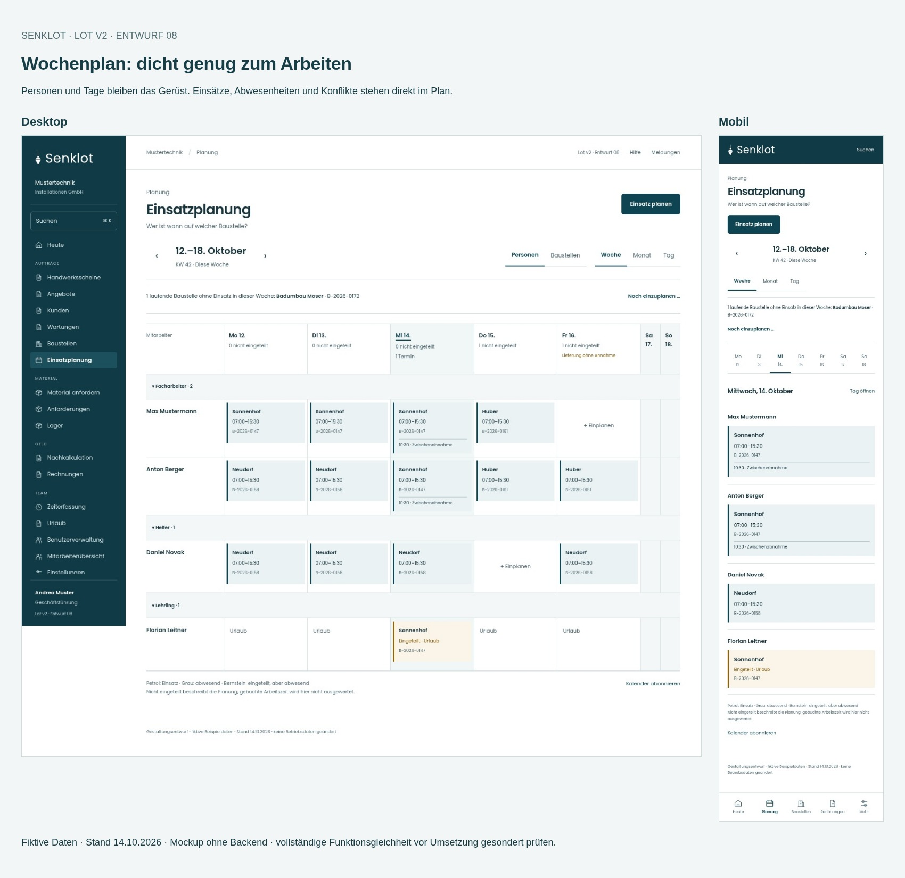
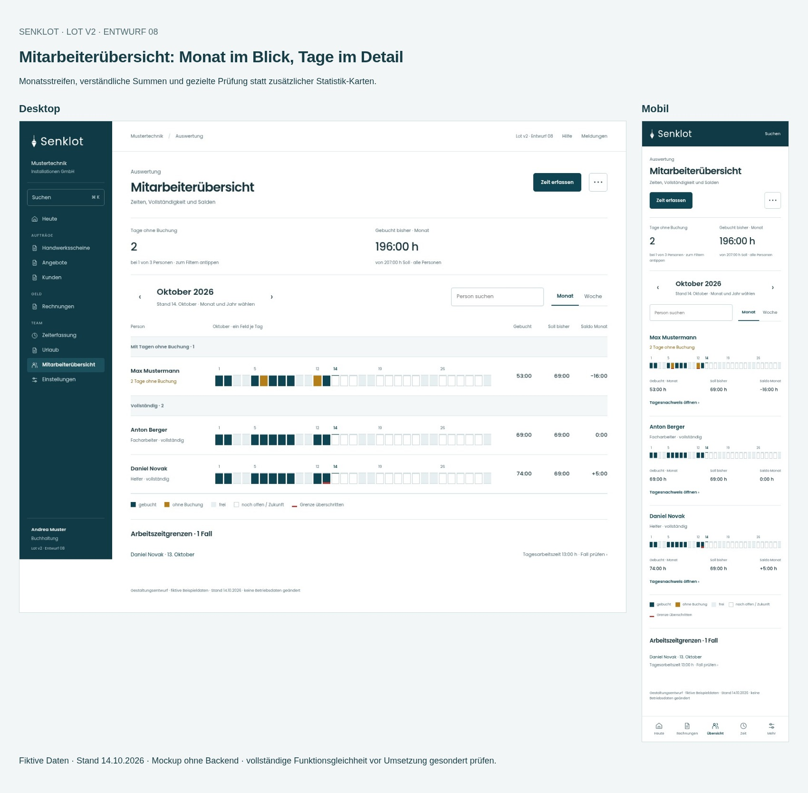

# Lot v2 · Wochenplan, Einsatzplan und Mitarbeiterübersicht

**Empfehlung: Die bewährte Struktur bleibt, diese Arbeitsansichten werden bewusst dichter als die Startseite.** Personen-/Baustellenraster, Monat/Woche/Tag und die Tageszustände sind wichtige Werkzeuge.

[Alle Screens und Vorschau herunterladen](../Lot-v2-Planung-2026-10-15.zip?raw=true) · [Empfehlung und Funktionsvertrag](Empfehlung.md) · [Prüfungen](pruefung.json)

Das ZIP entpacken und `galerie.html` öffnen. Dort lassen sich Desktop, Tablet und Mobil wählen. Der Cloud-Browser erlaubt keine file://-Prüfung; getestet wird über einen lokalen Server. Bei Bedarf aus dem entpackten Ordner `python -m http.server 8000` starten und `http://localhost:8000/galerie.html` öffnen.

## Wochenplan

[Personen · Desktop](bilder/plan-personen-desktop.jpg) · [Baustellen · Desktop](bilder/plan-baustellen-desktop.jpg) · [Tablet](bilder/plan-personen-tablet.jpg) · [Mobil](bilder/plan-personen-mobil.jpg)

## Einsatz bearbeiten

[Desktop](bilder/einsatz-08-desktop.jpg) · [Tablet](bilder/einsatz-08-tablet.jpg) · [Mobil](bilder/einsatz-08-mobil.jpg)

## Mitarbeiterübersicht

[Monat · Desktop](bilder/konten-monat-desktop.jpg) · [Woche · Desktop](bilder/konten-woche-desktop.jpg) · [Tablet](bilder/konten-monat-tablet.jpg) · [Mobil](bilder/konten-monat-mobil.jpg)

## Person und Tagesnachweis

[Desktop](bilder/person-08-desktop.jpg) · [Tablet](bilder/person-08-tablet.jpg) · [Mobil](bilder/person-08-mobil.jpg)

## Was dieses Paket belegt

Sechs neue Ansichten in drei Breiten (1440, 834, 390), ausgewählte Demo-Interaktionen und automatische WCAG-Prüfungen. Vollseitenbilder zeigen das Raster vollständig und die Navigation am Seitenende. In der Vorschau scrollt das Raster innerhalb der Ansicht, die mobile Navigation bleibt am Bildschirmrand.

Fiktive Beispieldaten, Stand 14.10.2026. **Die bestehende App ist unverändert.** Das Paket ist keine produktive Umsetzung und kein vollständiger Nachweis des Funktionserhalts. Helferzuordnung, komplette Rüstlistenbearbeitung/Materialanforderung, Löschungen und einige Detail-/Korrektur-/Exportzustände sind nur verlinkt bzw. im Funktionsvertrag festgehalten. Sie müssen vor einer Umsetzung vollständig nachgezogen werden. Weitere verlinkte Ansichten stammen aus Entwurf 06.
