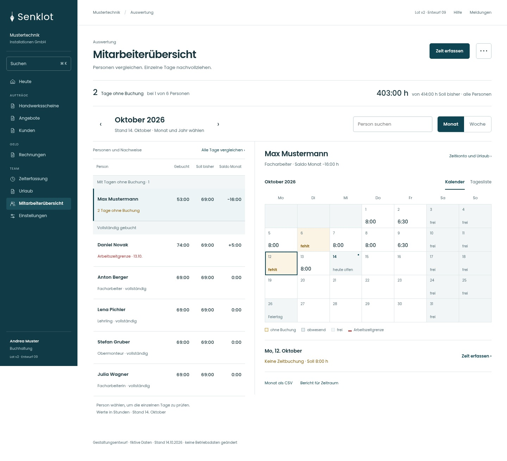
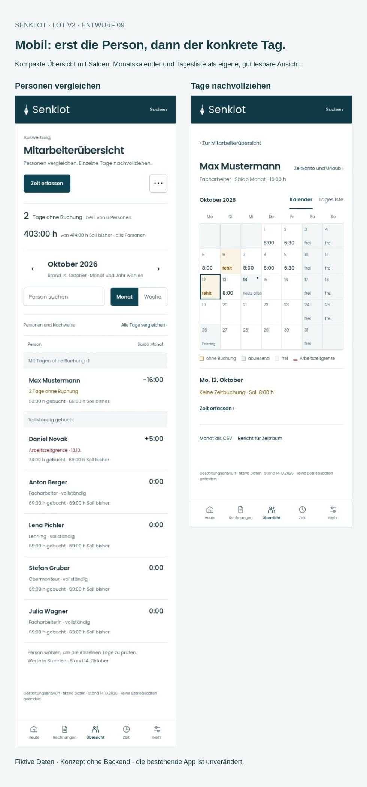
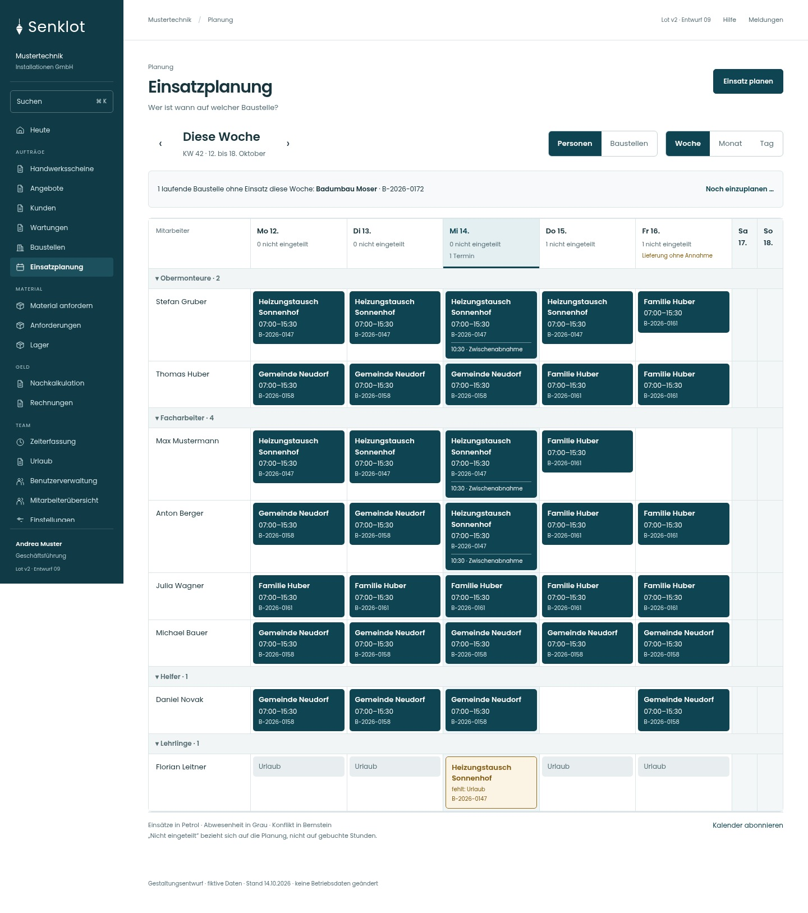

# Lot v2 · Revision 09

**Mitarbeiterübersicht neu aufgebaut, Wochenplan näher am aktuellen Stil.**

[Galerie und interaktive Vorschau herunterladen](../Lot-v2-Revision-09-2026-10-15.zip?raw=true) · [Entscheidungen und offene Arbeit](Entwurf.md) · [Prüfung](pruefung.json)

ZIP entpacken und `galerie.html` öffnen. Die Galerie zeigt alle sieben Darstellungen auf Desktop, Tablet und Mobil. Falls lokale HTML-Dateien im Browser gesperrt sind, aus dem entpackten Ordner `python -m http.server 8000` starten und `http://localhost:8000/galerie.html` öffnen.

## Mitarbeiterübersicht

Eine kompakte Personenliste und ein lesbarer Monatsnachweis nebeneinander. Stunden und Zustände stehen direkt an den Tagen. Kalender und Tagesliste lassen sich umschalten.

[Tablet](bilder/mitarbeiter-tablet.jpg) · [Mobile Personenliste](bilder/mitarbeiter-mobil.jpg) · [Mobiler Monatskalender](bilder/person-mobil.jpg) · [Mobile Tagesliste](bilder/tagesliste-mobil.jpg)

## Mobil

## Wochenplan

Dunkle Petrolflächen, kompaktere Zeilen und die bekannten Gruppierungen. Der Stil orientiert sich an den aktuellen Originalkomponenten; Kopf, Schrift und Navigation folgen der neuen Linie.

[Tablet](bilder/wochenplan-tablet.jpg) · [Mobil](bilder/wochenplan-mobil.jpg) · [Baustellensicht](bilder/baustellen-desktop.jpg)

## Weitere Vergleichswege bleiben erhalten

[Stundenvergleich in der Woche](bilder/stunden-desktop.jpg) · [Gemeinsamer Monatsvergleich aller Personen](bilder/monatsvergleich-desktop.jpg) · [Tagesliste](bilder/tagesliste-desktop.jpg)

## Umfang und Grenzen

21 neue Screens: sieben Darstellungen in drei Breiten. Fiktive Beispieldaten, Stand 14.10.2026. Die App ist unverändert. Die Vorschau bucht nichts und erzeugt keine echten Exporte. Die vollständige Anbindung aller Bestandsfunktionen und Rollen bleibt vor einer Umsetzung erforderlich; sie ist durch die Screens nicht nachgewiesen.

Die als `bestand-*` beiliegenden Vergleichsbilder stammen aus der lokalen Vorschau der Originalkomponenten mit Testdaten. Sie sind keine Produktionsaufnahmen. Messungen und der genaue Prüfungsumfang liegen im Paket.
