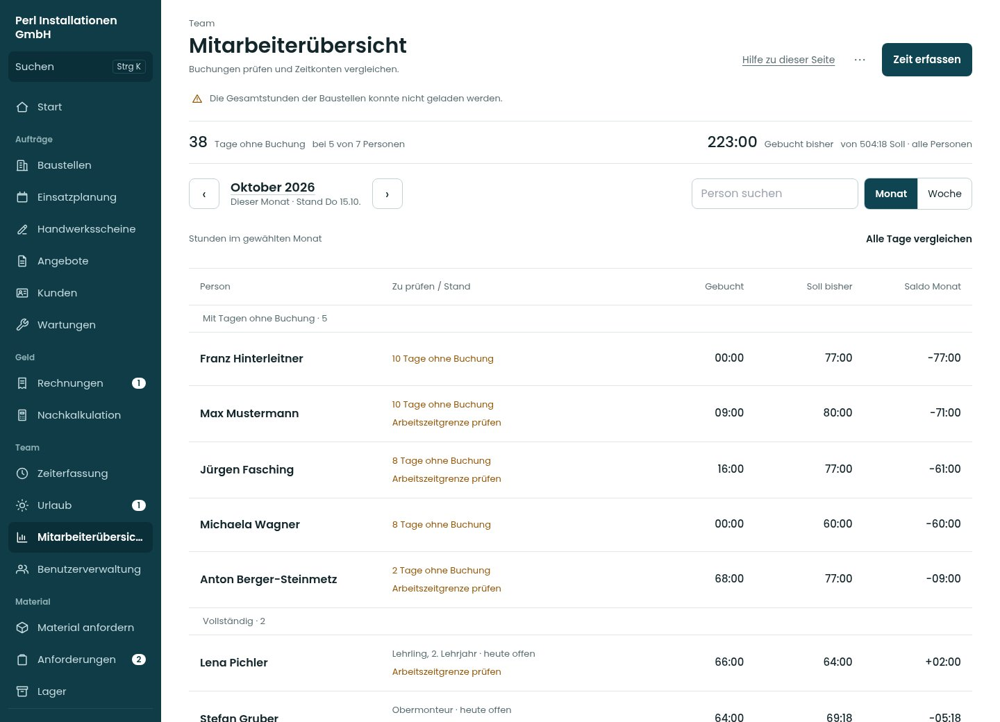
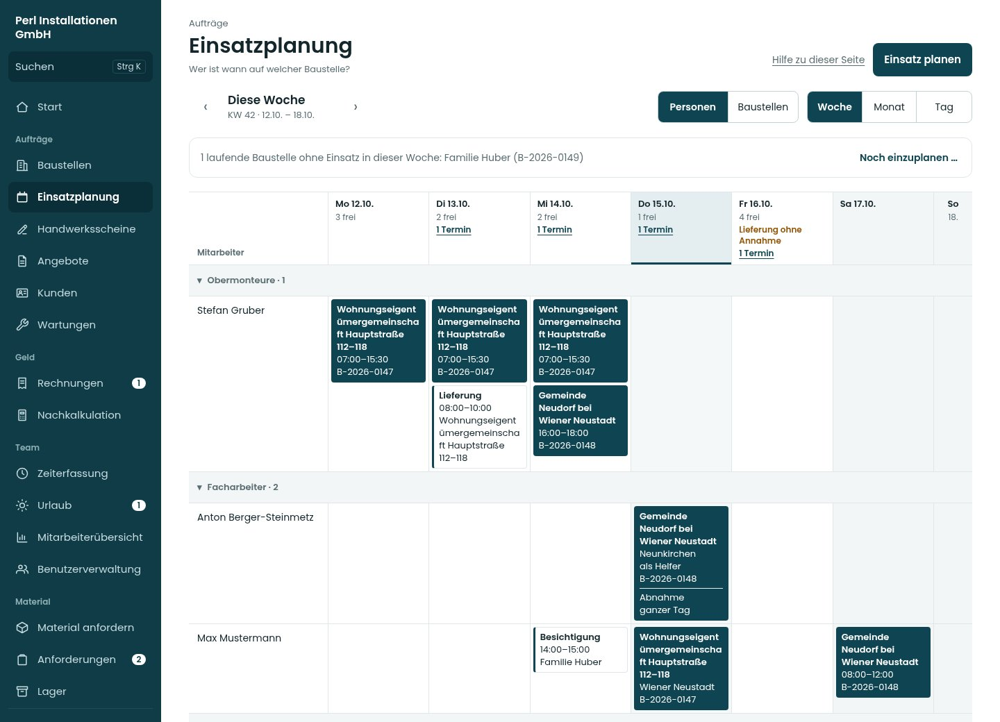
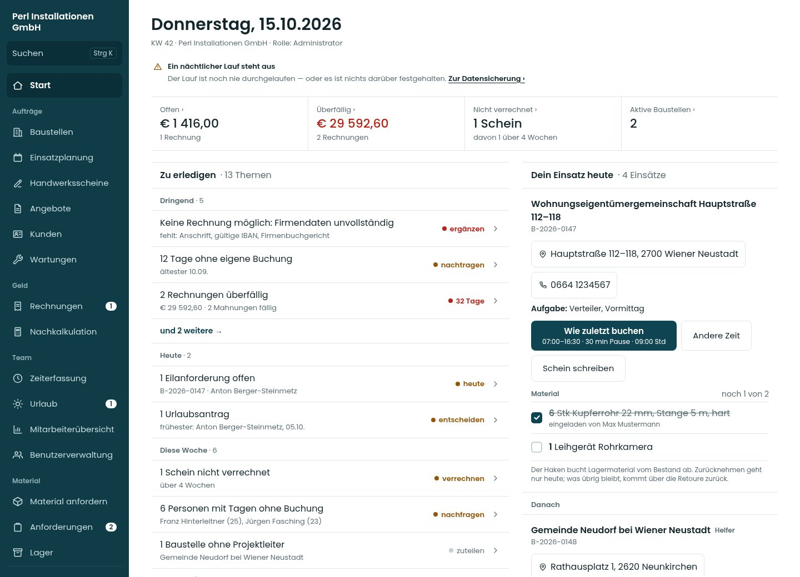

# Lot v2 · tatsächliche Umsetzung 01

Screens vom 15.10.2026 · **App seit 16.10.2026 live, Commit `29bc810`.** [Auslieferungsnachweis](../lot-v2-auslieferung-2026-10-16/README.md) · [App-Änderung zur Prüfung](https://github.com/juliandeutsch22/Prototype-App-Installateure/pull/311) · Quellstand `bc804862318b2b5e94056b2d48aeb86bee7202c1`.

120 Screens aus echten App-Komponenten: 38 Einstiege sowie Tagesliste und Kalender einer Person, jeweils bei 390, 834 und 1.440 px. Zusätzlich 15 vollständige Vorher- und 15 Nachher-Seitenbilder der fünf Referenzeinstiege. Das sind tatsächliche Ansichten der Umsetzung mit fiktiven Daten. Die Live-App wird durch diese Bilddateien nicht geändert.

[Galerie als ZIP herunterladen](../Lot-v2-Umsetzung-01-2026-10-15.zip?raw=true), vollständig entpacken und `galerie.html` öffnen. Alle Bilder und Schriften liegen im Paket; kein CDN und keine App-Anmeldung. GitHub selbst zeigt HTML als Quelltext an. Alternativ unten die einzelnen Bilder direkt öffnen.

## Mitarbeiterübersicht

[Handy](ansichten/38-accounting-390.jpg) · [Tablet](ansichten/38-accounting-834.jpg) · [Desktop](ansichten/38-accounting-1440.jpg) · [Person mit Tagesliste](person/tagesliste-1440.jpg) · [Person mit Kalender](person/kalender-1440.jpg) · [Kalender am Handy](person/kalender-390.jpg)

Der Monat startet mit dem Personenvergleich. „Alle Tage vergleichen“ öffnet das bisherige Raster. Die vollständige Tagesliste und Fremderfassung bleiben erhalten; der Kalender ist eine zusätzliche Ansicht derselben Tagesauswertung.

## Wochenplan

[Handy](ansichten/23-assignments-woche-390.jpg) · [Tablet](ansichten/23-assignments-woche-834.jpg) · [Desktop](ansichten/23-assignments-woche-1440.jpg)

Die vorhandenen dunklen Einsatzblöcke und Bedienwege bleiben; die gemeinsame Schrift- und Flächenlinie ist angepasst. Am Handy wird der ausgewählte Tag bedient.

## Start und weitere Ansichten

[Start am Handy](ansichten/01-start-390.jpg) · [Zeiterfassung](ansichten/04-time-390.jpg) · [Baustelle](ansichten/19-admin-projects-p1-1440.jpg) · [Rechnungen](ansichten/37-invoices-1440.jpg) · [Kunden](ansichten/15-customers-1440.jpg) · [Alle 114 Einstiegsbilder](ansichten/)

Die Galerie enthält weitere Rollen, Material/Lager, Urlaub, Angebote, Scheine, Benutzer und Einstellungen. Eine neue gemeinsame Linie bedeutet keine vereinfachten statischen Fachformulare: vorhandene passende Arbeitsabläufe bleiben.

## Prüfung und Grenzen

5.093 Modulprüfungen, Typen, Lint, Build und sieben Linkprüfungen bestanden. 72 Browserwege gegen den lokalen Supabase-Stapel bestanden; ein gerätebedingter Skip. Remote-CI vollständig grün: 5.093 Modulprüfungen, 82 Browserprüfungen einschließlich WebKit (zwei gerätebedingte Skips) und sieben Linkprüfungen bestanden. [Prüfbericht und genaue Grenzen](Pruefung.md).

Die Screens verwenden den vorhandenen fiktiven Vorschau-Bestand. Künstliche Grenzfälle, doppelte Beispielzeilen und Hinweise über nicht verfügbare Vorschaudaten – etwa die Baustellen-Gesamtstunden – sind keine Aussage über einen Produktivbetrieb. Diese Bilder enthalten keine echten Betriebs- oder Zugangsdaten. Sie belegen Darstellung; echte Speicherung wird gesondert in den Browserwegen geprüft.

Die Galerie wurde über HTTP mit allen 120 Bildern geprüft. Direktes Öffnen mit `file://` ist in dieser Cloud-Browserrichtlinie gesperrt; die Dateien benötigen technisch keinen Webdienst. Echte Mobilgeräte, Sichtfreigabe und Pilotwochen bleiben offen.

## Vorher / nachher

Fünf Referenzen (Start, Mitarbeiter, Einsatzplanung, Zeiterfassung und Baustelle), jeweils in drei Breiten: [vorher/](vorher/) und [nachher/](nachher/). Die kompletten Seitenbilder zeigen auch Inhalte unterhalb des ersten Bildschirms.
