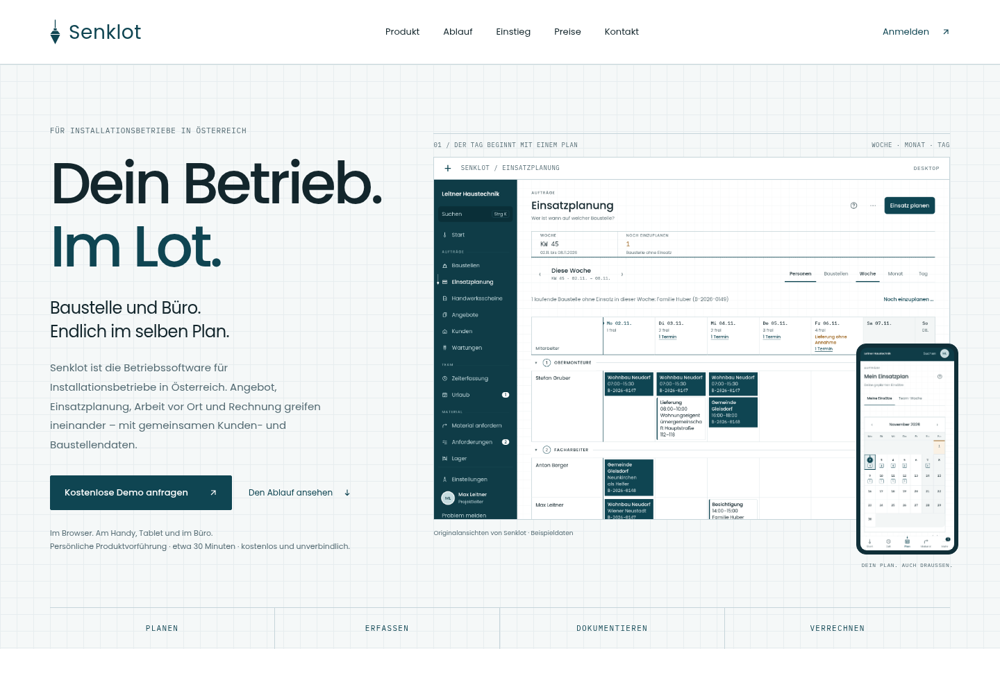
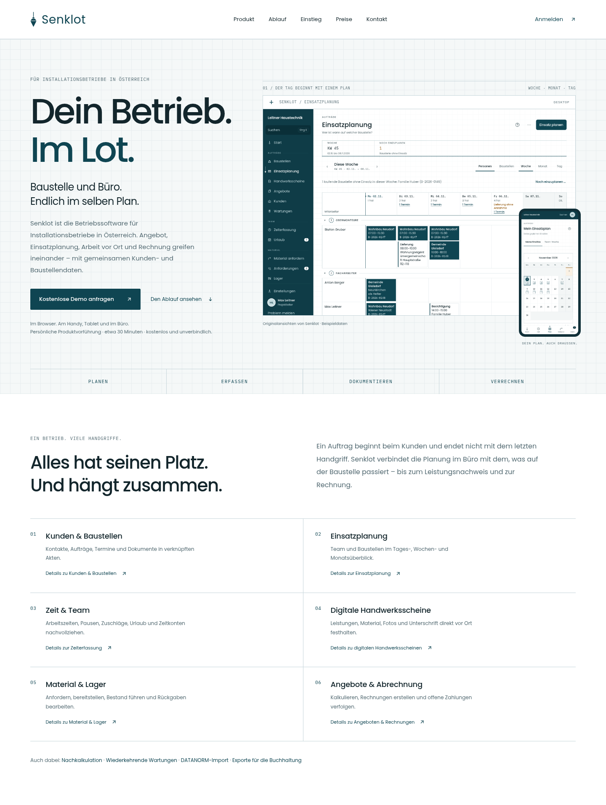
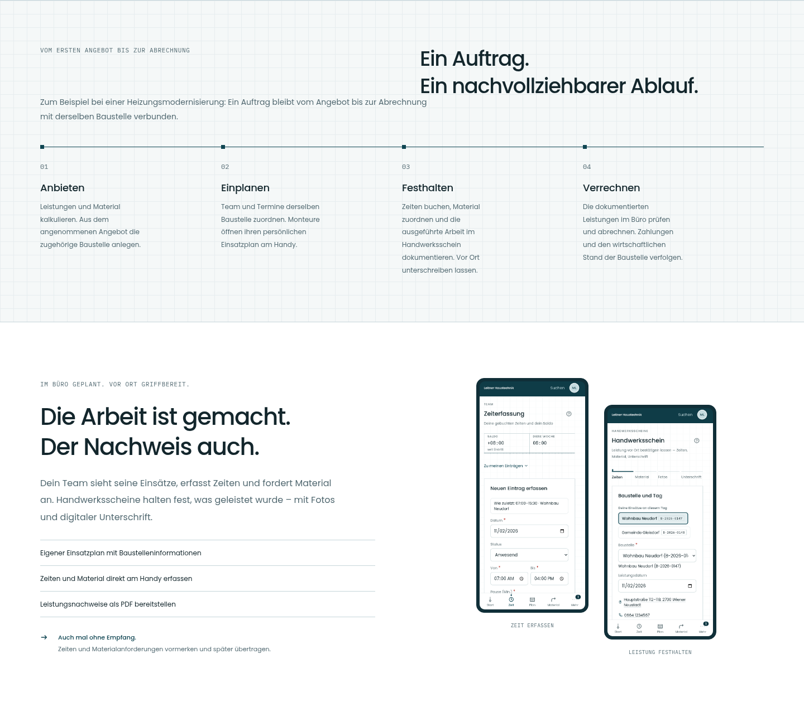
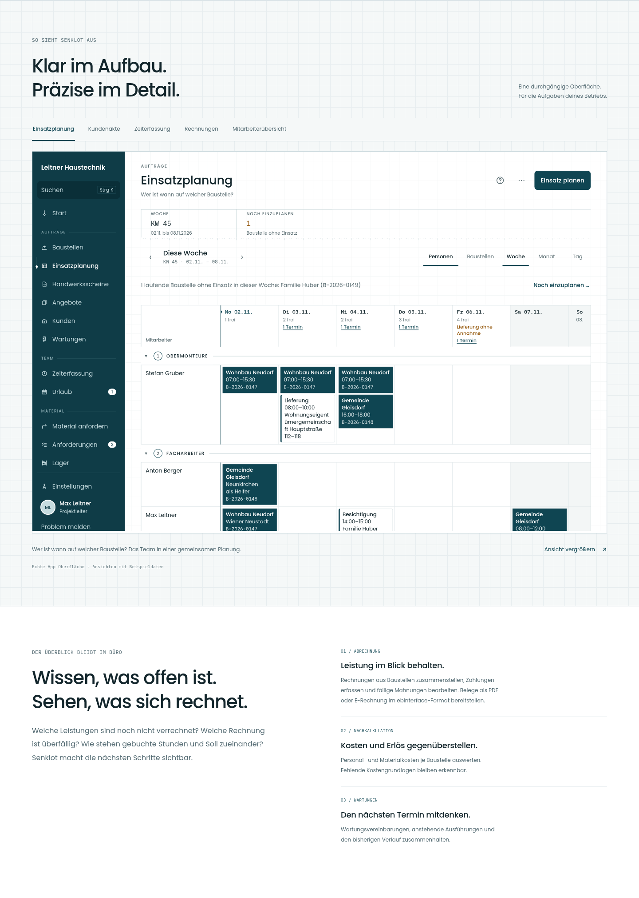
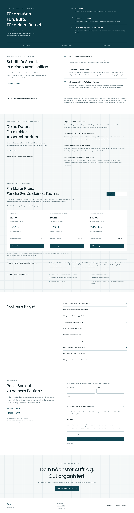
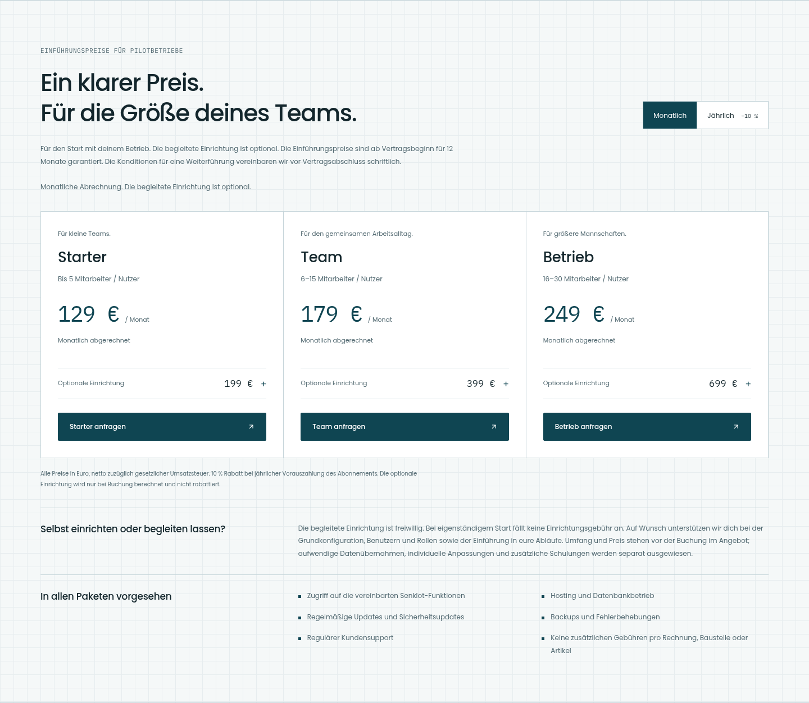
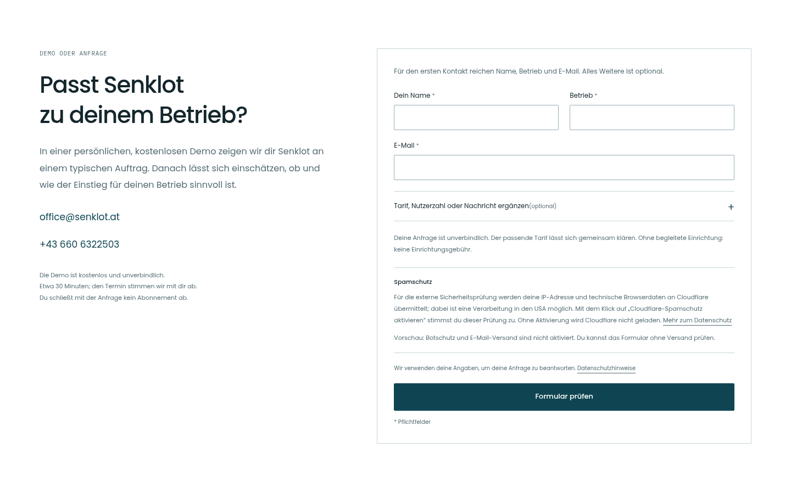

# Senklot – Dein Betrieb. Im Lot.

Landingpage auf Grundlage der am 02.11.2026 veröffentlichten App. Die bisherige Preis-/Kontaktfassung ist inzwischen unter senklot.at erreichbar. **Die neue Sicherheitsrevision mit PHP/SMTP für World4you, optional aktivierbarem Turnstile und separaten Rechtstexten samt bereitgestellten Betreiberangaben ist vorbereitet; sie wurde aus dieser Sitzung noch nicht zu World4you hochgeladen.** Die Betriebssoftware bleibt unverändert.

- [Vollständige Desktop-Seite](landingpage-1440.png)
- [Vollständige mobile Seite](landingpage-390.png)
- [Tablet](landingpage-834.png)
- [Fertige HTML-Seite herunterladen](landingpage.zip?raw=true) – entpacken und mit Node.js ab 24.5 über `npm run preview` starten. Für funktionierende Verzeichnislinks und die Formularprüfung den lokalen Server verwenden.
- [World4you-Uploadpaket](world4you-upload.zip?raw=true) – Website und geschütztes PHP-Backend einschließlich `.htaccess`, Sitemap und Rechtstexten. Kein Node-Server und keine echten Zugangsdaten. In das Hauptverzeichnis der Domain hochladen.
- [Veröffentlichung und Google/Bing einrichten](VEROEFFENTLICHEN.md).
- [Kurze Aufnahme der Animationen](animationen.webm?raw=true).

## SEO und Funktionsseiten

Individuelle Titel und Beschreibungen, Canonical-URLs, Open-Graph-/Social-Vorschaubild, strukturierte Anbieter-/Software-/Preisdaten, Sitemap mit sieben URLs sowie Crawlingregeln einschließlich OAI-SearchBot sind enthalten. Die sechs Seiten besitzen eigene Inhalte, Abläufe, Fragen, Produktbilder und passende Verbindungen:

| Funktion | Desktop | Mobil |
|---|---|---|
| Einsatzplanung | [Screen](einsatzplanung-1440.png) | [Screen](einsatzplanung-390.png) |
| Zeiterfassung & Team | [Screen](zeiterfassung-1440.png) | [Screen](zeiterfassung-390.png) |
| Digitale Handwerksscheine | [Screen](handwerksscheine-1440.png) | [Screen](handwerksscheine-390.png) |
| Kunden & Baustellen | [Screen](kunden-baustellen-1440.png) | [Screen](kunden-baustellen-390.png) |
| Material & Lager | [Screen](material-lager-1440.png) | [Screen](material-lager-390.png) |
| Angebote & Rechnungen | [Screen](angebote-rechnungen-1440.png) | [Screen](angebote-rechnungen-390.png) |

Die Apache-Datei führt HTTP und www dauerhaft auf `https://senklot.at/` und entfernt `index.html` aus den öffentlichen URLs. Pfade und Queryparameter bleiben erhalten; Status 308 erhält auch die Request-Methode. Die Regeln wurden lokal in einem tatsächlichen Apache-Server geprüft. Die Konfiguration auf World4you muss nach dem Upload ebenfalls geprüft werden.

Die kurzen Erscheinanimationen laufen einmal beim Sichtbarwerden. Reduzierte Bewegung wird auch bei nachträglicher Änderung respektiert; Inhalte bleiben ohne JavaScript oder Animationsunterstützung sichtbar. Produktbilder sind verlustfrei als WebP rund 65 % kleiner. Es gibt keine dauernden Bewegungen oder animierten Formularzustände.

**Noch extern auszuführen:** Upload zu World4you, Verifizierung in Google Search Console und Bing Webmaster Tools, Sitemap einreichen und den tatsächlichen Indexierungsstatus beobachten. Dafür fehlen in dieser Sitzung die Kontozugänge. Es wurde keine Indexierung oder bestimmte Suchplatzierung behauptet.

## Die Seite von oben nach unten

## Inhalt und Verbindungen

- Demo-Anfragen: Kontaktformular mit Tarifvorauswahl sowie direkter E-Mail-Link **office@senklot.at**.
- Telefon im Kontaktbereich und Footer: **+43 660 6322503**.
- Anmeldung: **https://app.senklot.at/**. Die erreichbare Schreibweise mit „k“ wurde anhand der App und ihrer Versionskennung überprüft.
- Impressum und Datenschutz verweisen auf die vorhandenen Seiten der App.
- Einführungspreise für Pilotbetriebe nach Vorgabe: Starter 129 €, Team 179 €, Betrieb 249 € monatlich. Optionale Einrichtung 290 / 590 / 699 €, nur bei Buchung. Alle Beträge netto zuzüglich gesetzlicher Umsatzsteuer. Keine erfundenen Referenzkunden, Bewertungen oder Einsparungszahlen.

## Neue Preis- und Kontaktbereiche

[Jahreszahlung ansehen](06-preise-jaehrlich-1440.png) · [Preise mobil](06-preise-390.png) · [Kontakt mobil](07-kontakt-390.png)

Jährliche Vorauszahlung: genau 10 % Rabatt auf zwölf Monatsbeträge. Das entspricht effektiv 116,10 / 161,10 / 224,10 € monatlich; abgerechnet werden 1.393,20 / 1.933,20 / 2.689,20 € jährlich im Voraus. Die optionale Einrichtung wird nur bei Buchung berechnet und nicht rabattiert. Alle sechs vom Auftraggeber genannten Paketleistungen sind enthalten.

**Noch nicht live aktiviert:** Das World4you-Paket enthält jetzt PHP 8.2+ mit PHPMailer/SMTP statt des ursprünglichen Node-/Resend-Versandwegs. Turnstile lädt nur nach ausdrücklicher Aktivierung. Für echte Anfragen fehlen Postfachdaten, Turnstile-Schlüssel, Abgleich der Anbieterunterlagen/Rechtstexte und der Upload. Deine Betreiberangaben und Texte vom 3. November 2026 sind bereits eingearbeitet; die 12-Monats-Fristen sind im Postfach organisatorisch umzusetzen. Das Formular bleibt bis zur vollständigen privaten Konfiguration gesperrt. [Konkrete Einrichtung und verbleibende Aufgaben](VEROEFFENTLICHEN.md).

Die bisherigen Node-Tests und die zusätzliche Prüfung der optionalen Einrichtung bleiben als Prüfung des Vorschau-/alternativen Backends erhalten. Das neue PHP-Backend hat zusätzliche automatisierte Sicherheits- und Persistenzprüfungen, einen lokalen TLS-SMTP-Test und Browserprüfungen unter echtem Apache/PHP. Protokolle und reproduzierbare Tests stehen unter `nachweise/sicherheit/`. Es wurden keine echten E-Mails versendet. Die reale Turnstile-Integration und der Postfacheingang müssen auf dem eigenen Hosting geprüft werden.

## Tatsächliche Produktansichten

Zehn neue Aufnahmen aus dem veröffentlichten Quellstand, mit derselben App-Oberfläche und ausschließlich fiktiven Vorschau-Daten. Die Oberfläche wurde für die Bilder nicht vereinfacht, umgebaut oder durch generierte UI ersetzt. Die IBM-Plex-Mono-Schrift wird in der lokalen App-Vorschau entsprechend der Produktions-Schriftdefinition ergänzt.

Die Landingpage übernimmt Petrol, das technische Raster, Poppins und IBM Plex Mono sowie die sachliche Liniengestaltung der aktuellen Planlinie. Auf der Website sind die Texte und Abstände auf Produktvorstellung statt tägliche App-Bedienung abgestimmt.

## Prüfung

Die Sicherheitsrevision wurde auf allen neun Seiten bei 320, 390, 834 und 1440 px geprüft. Die bestehenden Funktionsprüfungen der Startseite liefen bei 390, 834 und 1440 px: keine horizontalen Dokumentüberläufe, JavaScriptfehler oder fehlenden lokalen Ressourcen. Produkt-Tabs, Tastatursteuerung, Bildvergrößerung, Escape/Rückfokus, Fragen, interne Sprungziele und Kontakt-/Login-Links sind geprüft. Hinzu kommen monatliche/jährliche Preise, Tarifvorauswahl und Formularprüfung ohne Versand. Die automatische axe-Prüfung meldete auf diesen Ansichten keine Befunde; das ersetzt keine vollständige Barrierefreiheitsabnahme.

Die Aufnahmen sind keine erneute fachliche Prüfung der Betriebssoftware. Es wurden keine Produktionskonten angemeldet, Geschäftsdaten geschrieben oder E-Mails versendet.

[Quellen und Abgrenzung](QUELLEN.md) · [Messdaten](nachweise/pruefung.json) · [Produktaufnahmen](nachweise/app-aufnahmen.json) · [Formularprüfungen](nachweise/kontakt-pruefung.json) · [Serverprüfungen](nachweise/server-tests.txt) · [SEO-Prüfungen](nachweise/seo-pruefung.json) · [Animationen](nachweise/animationen-pruefung.json) · [Apache](nachweise/apache-pruefung.json) · [Sicherheitsprüfung](nachweise/sicherheit/README.md)

## Feedback-Überarbeitung vom 4. November 2026

Neue Einführungspreise 129 / 180 / 249 € netto bei unveränderten Nutzergrenzen. Die begleitete Einrichtung ist optional: 290 / 590 / 699 € netto, ausschließlich bei Buchung. Ohne Buchung fällt keine Einrichtungsgebühr an. Anzeige, Suchmaschinen-Daten, Jahresrabatt, Tarifauswahl und serverseitige Anfrage-E-Mails verwenden dieselbe Preisquelle. Die Einführungspreise sind ab Vertragsbeginn für 12 Monate garantiert. Die Konditionen einer Weiterführung stehen vor Vertragsabschluss im Angebot; es gibt keinen hinterlegten automatischen Preissprung.

Ein typischer Auftrag (Heizungsmodernisierung) erklärt den Zusammenhang der Funktionen. Neue Abschnitte beschreiben den Einstieg in drei Schritten, die Prüfung vorhandener Exportdateien, den Einrichtungsumfang, Support, Rollen, Sicherungen und Datenauszüge. Grundlage sind nachprüfbare Funktionen; Betriebsvereinbarungen werden vor dem Start geklärt. Es gibt keine erfundenen Kundenstimmen, Verfügbarkeitsgarantien oder gemessenen Zeitersparnisse.

Die kostenlose Demo ist mit etwa 30 Minuten veranschlagt. Das Formular zeigt zunächst die drei Pflichtfelder; Telefon, Tarif, Nutzerzahl, Nachricht und die freiwillige Anfrage zur optionalen Einrichtung bleiben aufklappbar verfügbar. Die Einrichtung ist nicht vorausgewählt und wird ohne ausdrückliche Auswahl auch in der Anfrage-E-Mail nicht als gewünscht dargestellt. Eingeklappte Eingaben bleiben erhalten und werden mitgesendet. Bei Validierungsfehlern öffnet sich der betreffende Bereich.

- [Einstieg Desktop](08-einstieg-1440.png) · [Einstieg mobil](08-einstieg-390.png)
- [Betriebsgrundlagen Desktop](09-vertrauen-1440.png) · [Betriebsgrundlagen mobil](09-vertrauen-390.png)
- [Prüfung von Preisen und Formular](nachweise/feedback-pruefung.json)

Vor dem tatsächlichen Pilotstart sind Angebotsumfang, Supportzeiten, Datenübernahme und Sicherungs-/Wiederherstellungsprozess verbindlich abzustimmen. Nach den ersten Monaten sind tatsächliche Einrichtungs- und Supportzeiten sowie Betriebskosten zu erfassen und die Preise für weitere Kunden zu prüfen. Echte Erfahrungsberichte können erst nach einem Pilotbetrieb und mit dessen Zustimmung ergänzt werden.

Bei jedem Tarif lässt sich der genaue Einrichtungsumfang aufklappen: Grundeinstellungen, Nutzer und Rollen im jeweiligen Paketumfang, Modulkonfiguration sowie eine Einführung mit Testauftrag und gemeinsamer Prüfung. Zusätzliche Datenübernahmen, Entwicklung und Schulungen sind gesondert abgegrenzt.

[Aufgeklappte Einrichtung Desktop](06-einrichtung-offen-1440.png) · [Aufgeklappte Einrichtung mobil](06-einrichtung-offen-390.png).
