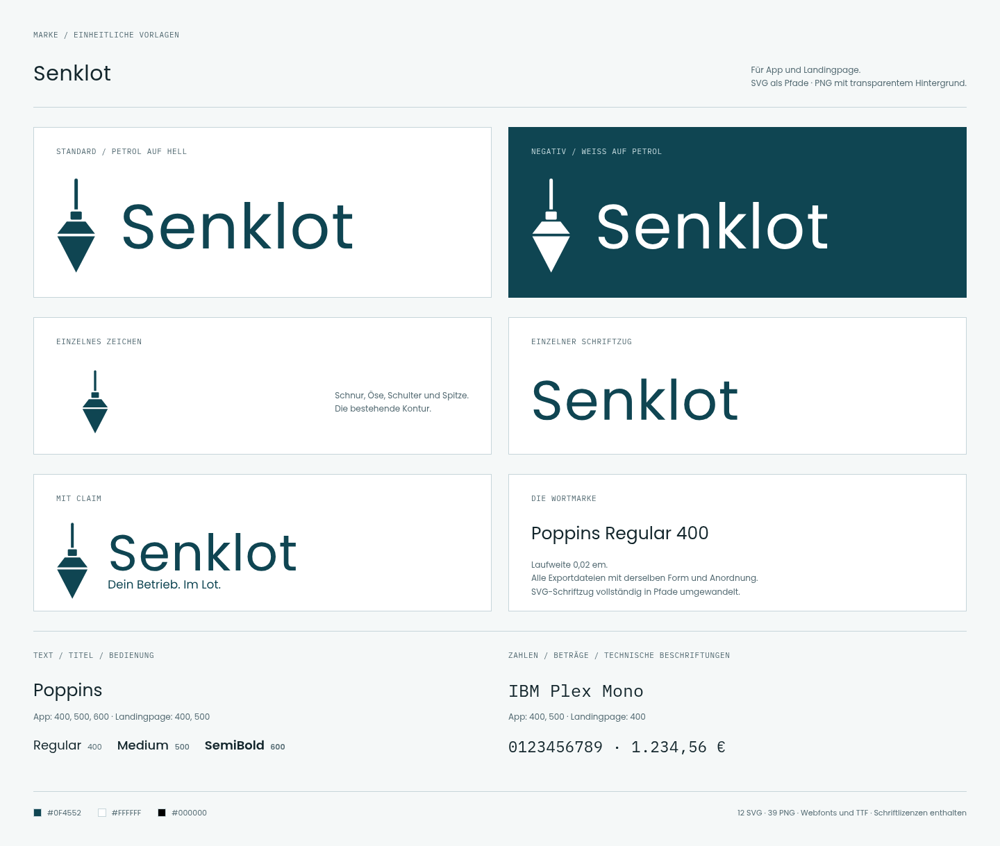

# Senklot – einheitliches Markenpaket

Ein gemeinsames Zeichen und ein einheitlicher Schriftzug für App, Landingpage und weitere Anwendungen. Grundlage sind das bestehende Senklot-Zeichen und die aktuell tatsächlich verwendete Poppins-Schrift. Die SVG-Schriftzüge bestehen vollständig aus Pfaden und benötigen keine installierten Schriften. Alle PNG-Dateien besitzen transparenten Hintergrund.

**[Komplettes Paket herunterladen](senklot-markenpaket.zip?raw=true)**

## Direkt zu den Standarddateien

| Datei | SVG | PNG, 2048 px breit |
|---|---|---|
| Zeichen + Senklot | [SVG](svg/senklot-logo-petrol.svg) | [PNG](png/2048/senklot-logo-petrol.png) |
| Nur das Zeichen | [SVG](svg/senklot-zeichen-petrol.svg) | [PNG](png/2048/senklot-zeichen-petrol.png) |
| Nur der Schriftzug | [SVG](svg/senklot-schriftzug-petrol.svg) | [PNG](png/2048/senklot-schriftzug-petrol.png) |
| Logo mit „Dein Betrieb. Im Lot.“ | [SVG](svg/senklot-logo-mit-claim-petrol.svg) | [PNG](png/2048/senklot-logo-mit-claim-petrol.png) |

Jede Form gibt es in **Petrol #0F4552**, **Weiß #FFFFFF** und **Schwarz #000000**. Die weißen Dateien sind auf dunklen Hintergründen einzusetzen; auf weißem Grund sind sie durch ihre Transparenz unsichtbar. Die schwarzen Dateien eignen sich für einfarbige Anwendungen.

PNG-Größen: Logo/Schriftzug jeweils 1024, 2048 und 4096 Pixel breit; das quadratische Zeichen jeweils 256, 512, 1024 und 2048 Pixel. Die Höhe ergibt sich aus den festen Proportionen. Insgesamt 12 SVG- und 39 PNG-Dateien.

## Exakte Schriftarten

| Anwendung | Schriftfamilie | Geladene Schnitte |
|---|---|---|
| App: Texte, Überschriften, Bedienung | **Poppins** | Regular **400**, Medium **500**, SemiBold **600** |
| App: Nummern, Geldbeträge, Stunden und Mengen | **IBM Plex Mono** | Regular **400**, Medium **500** |
| Landingpage: Texte, Überschriften, Bedienung | **Poppins** | Regular **400**, Medium **500** |
| Landingpage: Kennzahlen, Preise und technische Beschriftungen | **IBM Plex Mono** | Regular **400** |
| Einheitlicher Senklot-Schriftzug | **Poppins** | Regular **400**, Laufweite **0,02 em** |

In der Landingpage heißt IBM Plex Mono in der CSS-Definition intern `Plex`. Das ist ein Alias derselben Schrift und keine dritte Schriftfamilie. Die WOFF2-Dateien von Poppins 400/500 und IBM Plex Mono 400 sind zwischen App und Landingpage bytegleich.

Poppins: Fontversion **4.004**. IBM Plex Mono: Fontversion **2.3**. Maßgeblich sind die tatsächlichen Fontdateien, nicht allein die Versionsnummer des Fontsource-Pakets.

Unter `schriftarten/woff2/` liegen die fünf originalen Webfonts der App. Unter `schriftarten/ttf/` liegen daraus formatkonvertierte installierbare TTF-Dateien mit denselben Glyphen. **Dies sind die Latin-Subsets aus der App, keine vollständigen internationalen Schriftfamilien.** Deutsche Umlaute, ß und Eurozeichen sind enthalten. Die Original-Lizenzen liegen unter `lizenzen/`. Alle Schnitte sind aufrecht, nicht kursiv.

[Offizielle Poppins-Familie](https://fonts.google.com/specimen/Poppins) · [Offizielle IBM-Plex-Mono-Familie](https://fonts.google.com/specimen/IBM+Plex+Mono)

## Einheitliche Verwendung

- Standard auf hellen Flächen: die petrolfarbene SVG-Kombination `senklot-logo-petrol.svg`.
- Auf dunklen Flächen: dieselbe Kombination in Weiß, ohne zusätzliche Platte.
- Für enge Stellen: das einzelne Zeichen; für ausgeschriebene Markenauftritte: der Schriftzug oder die Kombination.
- Seitenverhältnis beibehalten, nur proportional skalieren. SVG ist die Vektorvorlage für Web und Druck; PNG ist der Rasterexport.
- Als Schutzraum außen mindestens die Breite des Lotkörpers freilassen.
- Einbettung als Bild mit zugänglicher Beschriftung, beispielsweise ``.

Die Kontur stammt unverändert aus der aktuellen ProduktMarke: Schnur, Öse, Schulter und Spitze; die Fuge zwischen Schulter und Spitze bleibt erhalten. Für die Kombination gilt das Verhältnis der App: Schriftgröße 0,62 × Zeichenhöhe, Abstand 0,38 em. Die Wortmarke ist nach ihren sichtbaren Konturen vertikal ausgerichtet. Ein älteres `marke/logo.svg` im Repository verwendete noch Poppins 500 und einen fontabhängigen Textknoten; die aktuellen Produktansichten verwenden Poppins 400. Dieses Paket vereinheitlicht die exportierten Vorlagen auf die aktuelle Regular-Fassung.

Das Paket liefert die Dateien. Es verändert keine veröffentlichte App, keine Mandantenlogos und keine installierten Homescreen-Icons.

## Nachweis

Geprüft anhand von `src/components/ProduktMarke.tsx`, `src/main.tsx`, `src/index.css` und den geladenen Fontdateien auf main (`7589bf0`, Stand 03.11.2026), sowie der aktuellen Landingpage-Dateien. Prüfungen: SVG ohne Textknoten oder externe Ressourcen, echte Alphatransparenz, korrekte Pixelgrößen, identische Konturen aller Farbvarianten, lesbare Fontdateien und vollständige ZIP-Datei.

[Schrift- und Markenwerte](marke.json) · [Exportprüfung](nachweise/pruefung.json)
