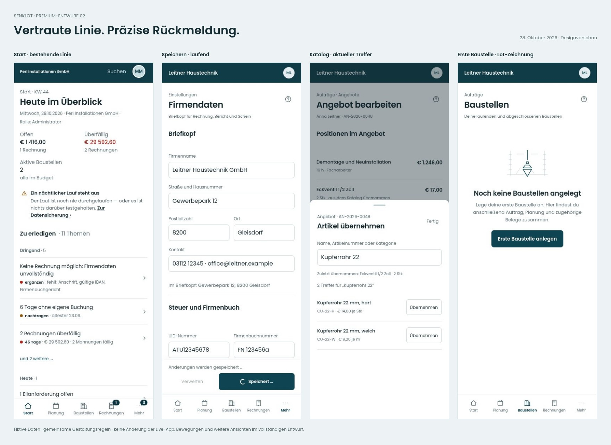

# Lot · Premium-Entwurf 02

**Neue Screens und Bewegungsbeispiele zur Durchsicht. App und Live-Stand unverändert.**

Die freigegebene Linie bleibt: offene Listen, ruhige Typografie, dünnere Zahlen und das bisherige mobile Menü. Neu ausgearbeitet sind einheitliche Aktionszustände, kurze Übergänge, nachvollziehbares Speichern und zwei zurückhaltende Lot-Zeichnungen für den ersten Einstieg.

- [Desktop-Überblick](ueberblick-desktop.jpg)
- [Galerie und interaktive Zustandsvorschau herunterladen](entwurf.zip?raw=true) – vollständig entpacken, dann `index.html` öffnen. Alle Bilder und Videos sind im Paket. Die Galerie benötigt keine Anmeldung und lädt keine Live-App-Daten.
- [Gestaltungsregeln und Bewegungswerte](DESIGNLINIE.md) · [Prüfung und Grenzen](PRUEFUNG.md)
- [Weiterhin offene technische Punkte](AUDIT-BASIS.md) · [Funktionsschutz](FUNKTIONSERHALT.md)

## Zuerst ansehen

| Ergänzung | Handy | Desktop |
|---|---|---|
| Speicheraktion läuft | [Screen](screens/firma-speichert-390.jpg) | [Screen](screens/firma-speichert-1440.jpg) |
| Bestätigter Stand | [Screen](screens/gespeichert-390.jpg) | [Screen](screens/gespeichert-1440.jpg) |
| Fehler mit erhaltenen Eingaben | [Screen](screens/firma-fehler-390.jpg) | [Screen](screens/firma-fehler-1440.jpg) |
| Erste Baustelle mit Lot-Zeichnung | [Screen](screens/baustellen-leer-390.jpg) | [Screen](screens/baustellen-leer-1440.jpg) |
| Erstes Angebot, gleiche Bildsprache | [Screen](screens/angebote-leer-390.jpg) | [Screen](screens/angebote-leer-1440.jpg) |
| Gemeinsame Zustände und alle 29 Icons | [Screen](screens/bausteine-390.jpg) | [Screen](screens/bausteine-1440.jpg) |

## Bewegungsbeispiele

MP4-Dateien lassen sich direkt öffnen oder herunterladen. Kein automatischer Start. Drei Designmodelle mit ausdrücklich simulierten Antworten und ein tatsächliches Menü der lokalen React-Vorschau; keine echten Schreibvorgänge.

- [Speichern · laufend, bestätigt, Fehler, erneuter Versuch](bewegung/01-speichern.mp4)
- [Offene Änderungen · weiterarbeiten oder bewusst verwerfen](bewegung/02-rueckfrage.mp4)
- [Katalog · Übernahme, aktuelle Suche, keine Treffer](bewegung/03-katalog.mp4)
- [Echtes React-Menü · öffnen, Tastatur, Escape, Rückfokus](bewegung/04-zeilenmenue.mp4)

## Alle vorgeschlagenen Zustände

24 Szenarien in drei Breiten, zusätzlich zwölf dunkle Bilder. Die vollständigen Fachseiten werden durch diese gezielt reduzierten Ausschnitte nicht ersetzt.

| Zustand | Idee | Handy | Tablet | Desktop |
|---|---|---|---|---|
| Rechnung erstellt, PDF fehlgeschlagen | Speicherbestätigung bleibt stehen. Nur die PDF-Ausgabe wird erneut versucht. | [390](screens/rechnung-pdf-390.jpg) | [834](screens/rechnung-pdf-834.jpg) | [1440](screens/rechnung-pdf-1440.jpg) |
| Ausgang der Erstellung unklar | Kein unbelegtes Erfolgs- oder Misserfolgsversprechen. Der sichere Statusabgleich ist noch technisch zu klären. | [390](screens/rechnung-unklar-390.jpg) | [834](screens/rechnung-unklar-834.jpg) | [1440](screens/rechnung-unklar-1440.jpg) |
| Firmendaten gespeichert, Anzeige nicht aktualisiert | Der bestätigte Schreibvorgang bleibt von einem fehlgeschlagenen Nachladen getrennt. | [390](screens/firma-teilerfolg-390.jpg) | [834](screens/firma-teilerfolg-834.jpg) | [1440](screens/firma-teilerfolg-1440.jpg) |
| Wichtiger Nachsendefehler bleibt sichtbar | Die Warnung verschwindet erst nach bewusster Bestätigung. Kein automatisches erneutes Buchen. | [390](screens/buchung-abgelehnt-390.jpg) | [834](screens/buchung-abgelehnt-834.jpg) | [1440](screens/buchung-abgelehnt-1440.jpg) |
| Ungespeicherte Firmendaten | Ruhige Speicherleiste mit eindeutigem Änderungsstand. Gezeigt sind Briefkopf und Steuer als Ausschnitt. | [390](screens/firmendaten-390.jpg) | [834](screens/firmendaten-834.jpg) | [1440](screens/firmendaten-1440.jpg) |
| Sichere Rückfrage beim Verlassen | Weiterarbeiten ist die sichere Alternative. Gespeicherte Daten und aktuelle Änderungen bleiben unterscheidbar. | [390](screens/verlassen-390.jpg) | [834](screens/verlassen-834.jpg) | [1440](screens/verlassen-1440.jpg) |
| Bestätigter Speicherstand | Gespeichert ist ein nachvollziehbarer Zustand. Eine neue Eingabe setzt die Anzeige wieder auf ungespeichert. | [390](screens/gespeichert-390.jpg) | [834](screens/gespeichert-834.jpg) | [1440](screens/gespeichert-1440.jpg) |
| Neue Katalogsuche läuft | Ein neuer Suchbegriff zeigt einen eigenen Ladezustand. Alte Treffer werden nicht als aktuelle angeboten. | [390](screens/katalog-390.jpg) | [834](screens/katalog-834.jpg) | [1440](screens/katalog-1440.jpg) |
| Katalogsuche fehlgeschlagen | Bereits übernommene Positionen bleiben erhalten. Dieselbe Suche lässt sich wiederholen. | [390](screens/katalog-fehler-390.jpg) | [834](screens/katalog-fehler-834.jpg) | [1440](screens/katalog-fehler-1440.jpg) |
| Material tatsächlich auf dem Gerät vorgemerkt | Der konkrete Vorgang erhält erst nach lokaler Ablage die Zusage zum Nachsenden. | [390](screens/material-offline-390.jpg) | [834](screens/material-offline-834.jpg) | [1440](screens/material-offline-1440.jpg) |
| Zeitbuchung vorgemerkt, noch nicht bestätigt | Vorgemerkt und bestätigt werden verständlich auseinandergehalten. Keine Erweiterung des Offline-Schreibumfangs. | [390](screens/zeit-vorgemerkt-390.jpg) | [834](screens/zeit-vorgemerkt-834.jpg) | [1440](screens/zeit-vorgemerkt-1440.jpg) |
| Validierung mit direktem Weg zum Feld | Vorhandene Prüfungen erhalten eine verknüpfte Zusammenfassung. Die zwei Felder sind ein Ausschnitt. | [390](screens/rechnung-pruefen-390.jpg) | [834](screens/rechnung-pruefen-834.jpg) | [1440](screens/rechnung-pruefen-1440.jpg) |
| Nachladen fehlgeschlagen, Bestand bleibt sichtbar | Bekannter Bestand, Aktualität und Wiederholungsmöglichkeit bleiben klar erkennbar. Ein Zeitstempel wird nur gezeigt, wenn er tatsächlich erfasst wurde. | [390](screens/rechnung-fehler-390.jpg) | [834](screens/rechnung-fehler-834.jpg) | [1440](screens/rechnung-fehler-1440.jpg) |
| Keine Treffer zur Suche | Die bereits vorhandene Unterscheidung zwischen leerem Bestand und leerer Suche bleibt erhalten. | [390](screens/leer-390.jpg) | [834](screens/leer-834.jpg) | [1440](screens/leer-1440.jpg) |
| Fehlende Berechtigung | Keine zusätzlichen Rechte. Der gezeigte Rollenzustand ersetzt keine bestehende serverseitige Prüfung. | [390](screens/berechtigung-390.jpg) | [834](screens/berechtigung-834.jpg) | [1440](screens/berechtigung-1440.jpg) |
| Ruhige Rechnungsübersicht | Zeigt die gemeinsame Lot-Sprache. Vorhandene fachliche Filter und Aktionen bleiben vollständig. | [390](screens/rechnungen-390.jpg) | [834](screens/rechnungen-834.jpg) | [1440](screens/rechnungen-1440.jpg) |
| Erste Baustelle · Lot-Zeichnung | Eine kleine statische Zeichnung nur beim Einstieg; eindeutige nächste Aktion. | [390](screens/baustellen-leer-390.jpg) | [834](screens/baustellen-leer-834.jpg) | [1440](screens/baustellen-leer-1440.jpg) |
| Erstes Angebot · dieselbe Bildsprache | Gleiche Konstruktion, Strichführung, Größe und Abstände wie bei den Baustellen. | [390](screens/angebote-leer-390.jpg) | [834](screens/angebote-leer-834.jpg) | [1440](screens/angebote-leer-1440.jpg) |
| Filter ohne passende Ergebnisse | Keine Illustration; ein verständlicher Weg zurück zum Bestand. | [390](screens/filter-leer-390.jpg) | [834](screens/filter-leer-834.jpg) | [1440](screens/filter-leer-1440.jpg) |
| Zeitraum ohne Buchungen | Der Zeitraum bleibt sichtbar. Leerer Bestand und Fehler werden getrennt. | [390](screens/zeitraum-leer-390.jpg) | [834](screens/zeitraum-leer-834.jpg) | [1440](screens/zeitraum-leer-1440.jpg) |
| Katalogtreffer und Übernahme | Aktueller Suchlauf, lesbare Ergebnisse und direkte Bestätigung der Übernahme. | [390](screens/katalog-treffer-390.jpg) | [834](screens/katalog-treffer-834.jpg) | [1440](screens/katalog-treffer-1440.jpg) |
| Speichert · Eingaben bleiben erhalten | Unmittelbare Rückmeldung, stabile Buttonbreite und Schutz vor wiederholtem Absenden. | [390](screens/firma-speichert-390.jpg) | [834](screens/firma-speichert-834.jpg) | [1440](screens/firma-speichert-1440.jpg) |
| Speicherfehler · wieder sicher fortfahren | Gleiche Aktion, erhaltene Werte, konkrete Fehlerrückmeldung. Keine falsche Erfolgsanimation. | [390](screens/firma-fehler-390.jpg) | [834](screens/firma-fehler-834.jpg) | [1440](screens/firma-fehler-1440.jpg) |
| Gemeinsame Bausteine und Icons | Gestaltungsfläche zur Durchsicht der gemeinsamen Zustände; keine neue Seite der App. | [390](screens/bausteine-390.jpg) | [834](screens/bausteine-834.jpg) | [1440](screens/bausteine-1440.jpg) |

## Alle Seiten, Rollen und Tabs

69 Kontexte, jeweils drei Breiten. Echte React-Komponenten mit fiktiven Vorschau-Daten und im Browser ergänzten gemeinsamen Darstellungsregeln. Kein neuer Seitenumbau: vorhandene Gestaltung bleibt gezielt erhalten. Nicht jede mögliche Dialog-, Rechte- oder Datenkombination ist ein eigener Screen.

| Ansicht | Rolle | Handy | Tablet | Desktop |
|---|---|---|---|---|
| Start · Verwaltung | Administrator | [390](seiten/start-390.jpg) | [834](seiten/start-834.jpg) | [1440](seiten/start-1440.jpg) |
| Start · Mitarbeiter | Mitarbeiter | [390](seiten/start-monteur-390.jpg) | [834](seiten/start-monteur-834.jpg) | [1440](seiten/start-monteur-1440.jpg) |
| Start · Buchhaltung | Buchhaltung | [390](seiten/start-buchhaltung-390.jpg) | [834](seiten/start-buchhaltung-834.jpg) | [1440](seiten/start-buchhaltung-1440.jpg) |
| Zeiterfassung | Mitarbeiter | [390](seiten/zeit-390.jpg) | [834](seiten/zeit-834.jpg) | [1440](seiten/zeit-1440.jpg) |
| Material erfassen | Mitarbeiter | [390](seiten/material-390.jpg) | [834](seiten/material-834.jpg) | [1440](seiten/material-1440.jpg) |
| Materialanforderungen | Verwaltung | [390](seiten/anforderungen-390.jpg) | [834](seiten/anforderungen-834.jpg) | [1440](seiten/anforderungen-1440.jpg) |
| Lager | Verwaltung | [390](seiten/lager-390.jpg) | [834](seiten/lager-834.jpg) | [1440](seiten/lager-1440.jpg) |
| Eigener Einsatzplan | Mitarbeiter | [390](seiten/eigener-plan-390.jpg) | [834](seiten/eigener-plan-834.jpg) | [1440](seiten/eigener-plan-1440.jpg) |
| Teamplan | Mitarbeiter | [390](seiten/teamplan-390.jpg) | [834](seiten/teamplan-834.jpg) | [1440](seiten/teamplan-1440.jpg) |
| Meine Baustellen | Mitarbeiter | [390](seiten/meine-baustellen-390.jpg) | [834](seiten/meine-baustellen-834.jpg) | [1440](seiten/meine-baustellen-1440.jpg) |
| Urlaub | Administrator | [390](seiten/urlaub-390.jpg) | [834](seiten/urlaub-834.jpg) | [1440](seiten/urlaub-1440.jpg) |
| Sonderurlaub | Administrator | [390](seiten/sonderurlaub-390.jpg) | [834](seiten/sonderurlaub-834.jpg) | [1440](seiten/sonderurlaub-1440.jpg) |
| Handwerksscheine | Administrator | [390](seiten/scheine-390.jpg) | [834](seiten/scheine-834.jpg) | [1440](seiten/scheine-1440.jpg) |
| Handwerksschein schreiben | Mitarbeiter | [390](seiten/schein-neu-390.jpg) | [834](seiten/schein-neu-834.jpg) | [1440](seiten/schein-neu-1440.jpg) |
| Angebote | Administrator | [390](seiten/angebote-390.jpg) | [834](seiten/angebote-834.jpg) | [1440](seiten/angebote-1440.jpg) |
| Angebotsakte | Administrator | [390](seiten/angebotsakte-390.jpg) | [834](seiten/angebotsakte-834.jpg) | [1440](seiten/angebotsakte-1440.jpg) |
| Kunden | Administrator | [390](seiten/kunden-390.jpg) | [834](seiten/kunden-834.jpg) | [1440](seiten/kunden-1440.jpg) |
| Kundenakte · Übersicht | Administrator | [390](seiten/kundenakte-390.jpg) | [834](seiten/kundenakte-834.jpg) | [1440](seiten/kundenakte-1440.jpg) |
| Wartungen | Administrator | [390](seiten/wartungen-390.jpg) | [834](seiten/wartungen-834.jpg) | [1440](seiten/wartungen-1440.jpg) |
| Baustellen | Administrator | [390](seiten/baustellen-390.jpg) | [834](seiten/baustellen-834.jpg) | [1440](seiten/baustellen-1440.jpg) |
| Baustellenakte · Auftrag | Administrator | [390](seiten/baustellenakte-390.jpg) | [834](seiten/baustellenakte-834.jpg) | [1440](seiten/baustellenakte-1440.jpg) |
| Einsatzplanung · Woche | Projektleiter | [390](seiten/wochenplan-390.jpg) | [834](seiten/wochenplan-834.jpg) | [1440](seiten/wochenplan-1440.jpg) |
| Einsatzplanung · Tag | Projektleiter | [390](seiten/tagesplan-390.jpg) | [834](seiten/tagesplan-834.jpg) | [1440](seiten/tagesplan-1440.jpg) |
| Benutzerverwaltung | Administrator | [390](seiten/benutzer-390.jpg) | [834](seiten/benutzer-834.jpg) | [1440](seiten/benutzer-1440.jpg) |
| Benutzerakte · Person | Administrator | [390](seiten/benutzerakte-390.jpg) | [834](seiten/benutzerakte-834.jpg) | [1440](seiten/benutzerakte-1440.jpg) |
| Eigenes Konto · Meldungen | Mitarbeiter | [390](seiten/konto-390.jpg) | [834](seiten/konto-834.jpg) | [1440](seiten/konto-1440.jpg) |
| Einstellungen · Übersicht | Administrator | [390](seiten/einstellungen-390.jpg) | [834](seiten/einstellungen-834.jpg) | [1440](seiten/einstellungen-1440.jpg) |
| Einstellungen · Firma | Administrator | [390](seiten/firmendaten-390.jpg) | [834](seiten/firmendaten-834.jpg) | [1440](seiten/firmendaten-1440.jpg) |
| Einstellungen · Verrechnungssätze | Administrator | [390](seiten/saetze-390.jpg) | [834](seiten/saetze-834.jpg) | [1440](seiten/saetze-1440.jpg) |
| Einstellungen · Rechnung | Buchhaltung | [390](seiten/rechnungsvorgaben-390.jpg) | [834](seiten/rechnungsvorgaben-834.jpg) | [1440](seiten/rechnungsvorgaben-1440.jpg) |
| Einstellungen · Nummern | Administrator | [390](seiten/nummern-390.jpg) | [834](seiten/nummern-834.jpg) | [1440](seiten/nummern-1440.jpg) |
| Einstellungen · Personal | Administrator | [390](seiten/personal-390.jpg) | [834](seiten/personal-834.jpg) | [1440](seiten/personal-1440.jpg) |
| Einstellungen · Buchhaltungskonten | Buchhaltung | [390](seiten/konten-390.jpg) | [834](seiten/konten-834.jpg) | [1440](seiten/konten-1440.jpg) |
| Einstellungen · Support | Administrator | [390](seiten/support-390.jpg) | [834](seiten/support-834.jpg) | [1440](seiten/support-1440.jpg) |
| Einstellungen · Module | Administrator | [390](seiten/module-390.jpg) | [834](seiten/module-834.jpg) | [1440](seiten/module-1440.jpg) |
| Einstellungen · Datensicherung | Administrator | [390](seiten/sicherung-390.jpg) | [834](seiten/sicherung-834.jpg) | [1440](seiten/sicherung-1440.jpg) |
| Nachkalkulation | Administrator | [390](seiten/kalkulation-390.jpg) | [834](seiten/kalkulation-834.jpg) | [1440](seiten/kalkulation-1440.jpg) |
| Rechnungen | Buchhaltung | [390](seiten/rechnungen-390.jpg) | [834](seiten/rechnungen-834.jpg) | [1440](seiten/rechnungen-1440.jpg) |
| Mitarbeiterübersicht · Monat | Buchhaltung | [390](seiten/mitarbeiter-390.jpg) | [834](seiten/mitarbeiter-834.jpg) | [1440](seiten/mitarbeiter-1440.jpg) |
| Impressum | Administrator | [390](seiten/impressum-390.jpg) | [834](seiten/impressum-834.jpg) | [1440](seiten/impressum-1440.jpg) |
| Datenschutz | Administrator | [390](seiten/datenschutz-390.jpg) | [834](seiten/datenschutz-834.jpg) | [1440](seiten/datenschutz-1440.jpg) |
| Globaler Admin · Betriebe | Plattformadministrator | [390](seiten/plattform-390.jpg) | [834](seiten/plattform-834.jpg) | [1440](seiten/plattform-1440.jpg) |
| Einsatzplanung · Monat | Projektleiter | [390](seiten/planung-monat-390.jpg) | [834](seiten/planung-monat-834.jpg) | [1440](seiten/planung-monat-1440.jpg) |
| Mitarbeiterübersicht · Woche | Buchhaltung | [390](seiten/mitarbeiter-woche-390.jpg) | [834](seiten/mitarbeiter-woche-834.jpg) | [1440](seiten/mitarbeiter-woche-1440.jpg) |
| Mitarbeiterübersicht · Tage ohne Buchung | Buchhaltung | [390](seiten/mitarbeiter-tage-390.jpg) | [834](seiten/mitarbeiter-tage-834.jpg) | [1440](seiten/mitarbeiter-tage-1440.jpg) |
| Lager · Katalog | Administrator | [390](seiten/lager-katalog-390.jpg) | [834](seiten/lager-katalog-834.jpg) | [1440](seiten/lager-katalog-1440.jpg) |
| Lager · Import | Administrator | [390](seiten/lager-import-390.jpg) | [834](seiten/lager-import-834.jpg) | [1440](seiten/lager-import-1440.jpg) |
| Anforderungen · Einkauf | Verwaltung | [390](seiten/anforderungen-einkauf-390.jpg) | [834](seiten/anforderungen-einkauf-834.jpg) | [1440](seiten/anforderungen-einkauf-1440.jpg) |
| Anforderungen · Retouren | Verwaltung | [390](seiten/anforderungen-retouren-390.jpg) | [834](seiten/anforderungen-retouren-834.jpg) | [1440](seiten/anforderungen-retouren-1440.jpg) |
| Anforderungen · Erledigt | Verwaltung | [390](seiten/anforderungen-erledigt-390.jpg) | [834](seiten/anforderungen-erledigt-834.jpg) | [1440](seiten/anforderungen-erledigt-1440.jpg) |
| Globaler Admin · Supportzugänge | Plattformadministrator | [390](seiten/plattform-support-390.jpg) | [834](seiten/plattform-support-834.jpg) | [1440](seiten/plattform-support-1440.jpg) |
| Globaler Admin · Fehlerprotokoll | Plattformadministrator | [390](seiten/plattform-fehler-390.jpg) | [834](seiten/plattform-fehler-834.jpg) | [1440](seiten/plattform-fehler-1440.jpg) |
| Globaler Admin · Basiszinssatz | Plattformadministrator | [390](seiten/plattform-zins-390.jpg) | [834](seiten/plattform-zins-834.jpg) | [1440](seiten/plattform-zins-1440.jpg) |
| Globaler Admin · Mein Konto | Plattformadministrator | [390](seiten/plattform-konto-390.jpg) | [834](seiten/plattform-konto-834.jpg) | [1440](seiten/plattform-konto-1440.jpg) |
| Urlaub · Krankenstände | Administrator | [390](seiten/urlaub-krank-390.jpg) | [834](seiten/urlaub-krank-834.jpg) | [1440](seiten/urlaub-krank-1440.jpg) |
| Urlaub · Betriebsurlaub | Administrator | [390](seiten/urlaub-betrieb-390.jpg) | [834](seiten/urlaub-betrieb-834.jpg) | [1440](seiten/urlaub-betrieb-1440.jpg) |
| Baustellenakte · Scheine | Administrator | [390](seiten/baustellenakte-scheine-390.jpg) | [834](seiten/baustellenakte-scheine-834.jpg) | [1440](seiten/baustellenakte-scheine-1440.jpg) |
| Baustellenakte · Termine | Administrator | [390](seiten/baustellenakte-termine-390.jpg) | [834](seiten/baustellenakte-termine-834.jpg) | [1440](seiten/baustellenakte-termine-1440.jpg) |
| Baustellenakte · Pläne | Administrator | [390](seiten/baustellenakte-plaene-390.jpg) | [834](seiten/baustellenakte-plaene-834.jpg) | [1440](seiten/baustellenakte-plaene-1440.jpg) |
| Kundenakte · Baustellen | Administrator | [390](seiten/kundenakte-baustellen-390.jpg) | [834](seiten/kundenakte-baustellen-834.jpg) | [1440](seiten/kundenakte-baustellen-1440.jpg) |
| Kundenakte · Belege | Administrator | [390](seiten/kundenakte-belege-390.jpg) | [834](seiten/kundenakte-belege-834.jpg) | [1440](seiten/kundenakte-belege-1440.jpg) |
| Kundenakte · Termine und Wartungen | Administrator | [390](seiten/kundenakte-termine-390.jpg) | [834](seiten/kundenakte-termine-834.jpg) | [1440](seiten/kundenakte-termine-1440.jpg) |
| Kundenakte · Stammdaten | Administrator | [390](seiten/kundenakte-stammdaten-390.jpg) | [834](seiten/kundenakte-stammdaten-834.jpg) | [1440](seiten/kundenakte-stammdaten-1440.jpg) |
| Benutzerakte · Arbeitszeit und Urlaub | Administrator | [390](seiten/benutzerakte-arbeitszeit-390.jpg) | [834](seiten/benutzerakte-arbeitszeit-834.jpg) | [1440](seiten/benutzerakte-arbeitszeit-1440.jpg) |
| Benutzerakte · Zugang und Rechte | Administrator | [390](seiten/benutzerakte-zugang-390.jpg) | [834](seiten/benutzerakte-zugang-834.jpg) | [1440](seiten/benutzerakte-zugang-1440.jpg) |
| Anmeldung | Mitarbeiter | [390](seiten/anmeldung-390.jpg) | [834](seiten/anmeldung-834.jpg) | [1440](seiten/anmeldung-1440.jpg) |
| Passwort vergessen | Mitarbeiter | [390](seiten/passwort-vergessen-390.jpg) | [834](seiten/passwort-vergessen-834.jpg) | [1440](seiten/passwort-vergessen-1440.jpg) |
| Zweiter Faktor | Mitarbeiter | [390](seiten/zweiter-faktor-390.jpg) | [834](seiten/zweiter-faktor-834.jpg) | [1440](seiten/zweiter-faktor-1440.jpg) |
| Wiederherstellungscode | Mitarbeiter | [390](seiten/wiederherstellung-390.jpg) | [834](seiten/wiederherstellung-834.jpg) | [1440](seiten/wiederherstellung-1440.jpg) |

## Dunkle Darstellung

| Kontext | Handy | Desktop |
|---|---|---|
| Rechnung erstellt, PDF fehlgeschlagen · Zustände | [390](screens/rechnung-pdf-390-dunkel.jpg) | [1440](screens/rechnung-pdf-1440-dunkel.jpg) |
| Sichere Rückfrage beim Verlassen · Zustände | [390](screens/verlassen-390-dunkel.jpg) | [1440](screens/verlassen-1440-dunkel.jpg) |
| Neue Katalogsuche läuft · Zustände | [390](screens/katalog-390-dunkel.jpg) | [1440](screens/katalog-1440-dunkel.jpg) |
| Wichtiger Nachsendefehler bleibt sichtbar · Zustände | [390](screens/buchung-abgelehnt-390-dunkel.jpg) | [1440](screens/buchung-abgelehnt-1440-dunkel.jpg) |
| Erste Baustelle · Lot-Zeichnung · Zustände | [390](screens/baustellen-leer-390-dunkel.jpg) | [1440](screens/baustellen-leer-1440-dunkel.jpg) |
| Gemeinsame Bausteine und Icons · Zustände | [390](screens/bausteine-390-dunkel.jpg) | [1440](screens/bausteine-1440-dunkel.jpg) |
| Start · Verwaltung · Seiten | [390](seiten/start-390-dunkel.jpg) | [1440](seiten/start-1440-dunkel.jpg) |
| Einsatzplanung · Woche · Seiten | [390](seiten/wochenplan-390-dunkel.jpg) | [1440](seiten/wochenplan-1440-dunkel.jpg) |
| Mitarbeiterübersicht · Monat · Seiten | [390](seiten/mitarbeiter-390-dunkel.jpg) | [1440](seiten/mitarbeiter-1440-dunkel.jpg) |
| Kundenakte · Übersicht · Seiten | [390](seiten/kundenakte-390-dunkel.jpg) | [1440](seiten/kundenakte-1440-dunkel.jpg) |
| Rechnungen · Seiten | [390](seiten/rechnungen-390-dunkel.jpg) | [1440](seiten/rechnungen-1440-dunkel.jpg) |
| Globaler Admin · Betriebe · Seiten | [390](seiten/plattform-390-dunkel.jpg) | [1440](seiten/plattform-1440-dunkel.jpg) |

## Prüfbasis und offene Arbeit

303 Bilder, keine gefundenen horizontalen Dokumentüberläufe in den erfassten Hauptbreiten. 75 mobile axe-Prüfungen an tatsächlichen Seiten und 84 an Zustandsentwürfen, 13 Modell-Interaktionsprüfungen, 92 ergänzende Breitenprüfungen sowie vier Fokusprüfungen. Das ist eine Vorschauprüfung in Chromium, keine Zusicherung vollständiger Barrierefreiheit oder fertiger Funktionsabnahme. Safari und echte Mobilgeräte folgen bei einer späteren Umsetzung.

Die neun technischen Audit-Befunde bleiben offen. Insbesondere muss ein sicherer Statusabgleich nach unterbrochener Rechnungserstellung technisch belegt werden; Animation oder Buttonbeschriftung lösen das nicht. [Details und Grenzen](PRUEFUNG.md).

Basis: [7601e378](https://github.com/juliandeutsch22/Prototype-App-Installateure/tree/7601e3781d4645aed2479bb8bbae9a1742e57b5b). Keine neue Bibliothek, Datenbank oder API. Keine Änderung des App-Icons, kein Merge in main, kein App-Deploy.
