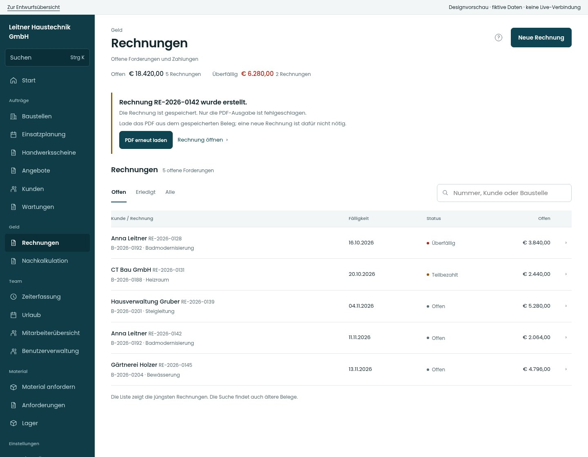

# Senklot · Premium UI/UX-Feinschliff

**Entwürfe zur Durchsicht – die App ist unverändert.**

Grundlage ist der aktuelle Produktionsstand `7601e378` vom 28. Oktober 2026. Die neue Linie bleibt Lot: Poppins, Petrol, ruhige Zeilen und normale Zahlgewichte. Der Schwerpunkt liegt auf verlässlichem Feedback und sicherem Weiterarbeiten.

[Audit mit neun priorisierten Befunden](AUDIT.md) · [Funktionsumfang für die Umsetzung](FUNKTIONSERHALT.md) · [Vorschau herunterladen](entwurf.zip)

Die ZIP entpacken und `index.html` öffnen. Die Galerie funktioniert lokal ohne Anmeldung und ohne Verbindung zur Live-App. Die Bildlinks unten lassen sich auch direkt hier auf GitHub öffnen.

## Zuerst ansehen

[Mobiler PDF-Teilerfolg](screens/rechnung-pdf-390.jpg) · [Speicherleiste mobil](screens/firmendaten-390.jpg) · [Verlassen-Rückfrage mobil](screens/verlassen-390.jpg) · [Katalogsuche mobil](screens/katalog-390.jpg)

## Alle vorgeschlagenen Zustände

| Situation | Worum es geht | Smartphone | Tablet | Desktop |
| --- | --- | --- | --- | --- |
| **Rechnung erstellt, PDF fehlgeschlagen** · F01 | Speicherbestätigung bleibt stehen. Nur die PDF-Ausgabe wird erneut versucht. | [390](screens/rechnung-pdf-390.jpg) | [834](screens/rechnung-pdf-834.jpg) | [1440](screens/rechnung-pdf-1440.jpg) |
| **Ausgang der Erstellung unklar** · F06 | Kein unbelegtes Erfolgs- oder Misserfolgsversprechen. Der sichere Statusabgleich ist noch technisch zu klären. | [390](screens/rechnung-unklar-390.jpg) | [834](screens/rechnung-unklar-834.jpg) | [1440](screens/rechnung-unklar-1440.jpg) |
| **Firmendaten gespeichert, Anzeige nicht aktualisiert** · F07 | Der bestätigte Schreibvorgang bleibt von einem fehlgeschlagenen Nachladen getrennt. | [390](screens/firma-teilerfolg-390.jpg) | [834](screens/firma-teilerfolg-834.jpg) | [1440](screens/firma-teilerfolg-1440.jpg) |
| **Wichtiger Nachsendefehler bleibt sichtbar** · F02 | Die Warnung verschwindet erst nach bewusster Bestätigung. Kein automatisches erneutes Buchen. | [390](screens/buchung-abgelehnt-390.jpg) | [834](screens/buchung-abgelehnt-834.jpg) | [1440](screens/buchung-abgelehnt-1440.jpg) |
| **Ungespeicherte Firmendaten** · F03 | Ruhige Speicherleiste mit eindeutigem Änderungsstand. Gezeigt sind Briefkopf und Steuer als Ausschnitt. | [390](screens/firmendaten-390.jpg) | [834](screens/firmendaten-834.jpg) | [1440](screens/firmendaten-1440.jpg) |
| **Sichere Rückfrage beim Verlassen** · F03 | Weiterarbeiten ist die sichere Alternative. Gespeicherte Daten und aktuelle Änderungen bleiben unterscheidbar. | [390](screens/verlassen-390.jpg) | [834](screens/verlassen-834.jpg) | [1440](screens/verlassen-1440.jpg) |
| **Bestätigter Speicherstand** · F03 / F07 | Gespeichert ist ein nachvollziehbarer Zustand. Eine neue Eingabe setzt die Anzeige wieder auf ungespeichert. | [390](screens/gespeichert-390.jpg) | [834](screens/gespeichert-834.jpg) | [1440](screens/gespeichert-1440.jpg) |
| **Neue Katalogsuche läuft** · F04 | Ein neuer Suchbegriff zeigt einen eigenen Ladezustand. Alte Treffer werden nicht als aktuelle angeboten. | [390](screens/katalog-390.jpg) | [834](screens/katalog-834.jpg) | [1440](screens/katalog-1440.jpg) |
| **Katalogsuche fehlgeschlagen** · F04 | Bereits übernommene Positionen bleiben erhalten. Dieselbe Suche lässt sich wiederholen. | [390](screens/katalog-fehler-390.jpg) | [834](screens/katalog-fehler-834.jpg) | [1440](screens/katalog-fehler-1440.jpg) |
| **Material tatsächlich auf dem Gerät vorgemerkt** · F05 | Der konkrete Vorgang erhält erst nach lokaler Ablage die Zusage zum Nachsenden. | [390](screens/material-offline-390.jpg) | [834](screens/material-offline-834.jpg) | [1440](screens/material-offline-1440.jpg) |
| **Zeitbuchung vorgemerkt, noch nicht bestätigt** · F05 | Vorgemerkt und bestätigt werden verständlich auseinandergehalten. Keine Erweiterung des Offline-Schreibumfangs. | [390](screens/zeit-vorgemerkt-390.jpg) | [834](screens/zeit-vorgemerkt-834.jpg) | [1440](screens/zeit-vorgemerkt-1440.jpg) |
| **Validierung mit direktem Weg zum Feld** · F08 | Vorhandene Prüfungen erhalten eine verknüpfte Zusammenfassung. Die zwei Felder sind ein Ausschnitt. | [390](screens/rechnung-pruefen-390.jpg) | [834](screens/rechnung-pruefen-834.jpg) | [1440](screens/rechnung-pruefen-1440.jpg) |
| **Nachladen fehlgeschlagen, Bestand bleibt sichtbar** · Zustandsmuster | Bekannter Bestand, Aktualität und Wiederholungsmöglichkeit bleiben klar erkennbar. Ein Zeitstempel wird nur gezeigt, wenn er tatsächlich erfasst wurde. | [390](screens/rechnung-fehler-390.jpg) | [834](screens/rechnung-fehler-834.jpg) | [1440](screens/rechnung-fehler-1440.jpg) |
| **Keine Treffer zur Suche** · Bestandsmuster | Die bereits vorhandene Unterscheidung zwischen leerem Bestand und leerer Suche bleibt erhalten. | [390](screens/leer-390.jpg) | [834](screens/leer-834.jpg) | [1440](screens/leer-1440.jpg) |
| **Fehlende Berechtigung** · Zustandsmuster | Keine zusätzlichen Rechte. Der gezeigte Rollenzustand ersetzt keine bestehende serverseitige Prüfung. | [390](screens/berechtigung-390.jpg) | [834](screens/berechtigung-834.jpg) | [1440](screens/berechtigung-1440.jpg) |
| **Ruhige Rechnungsübersicht** · Linienreferenz | Zeigt die gemeinsame Lot-Sprache. Vorhandene fachliche Filter und Aktionen bleiben vollständig. | [390](screens/rechnungen-390.jpg) | [834](screens/rechnungen-834.jpg) | [1440](screens/rechnungen-1440.jpg) |

## Dunkle Darstellung

| Situation | Mobil | Desktop |
| --- | --- | --- |
| Rechnung erstellt, PDF fehlgeschlagen | [390](screens/rechnung-pdf-390-dunkel.jpg) | [1440](screens/rechnung-pdf-1440-dunkel.jpg) |
| Sichere Rückfrage beim Verlassen | [390](screens/verlassen-390-dunkel.jpg) | [1440](screens/verlassen-1440-dunkel.jpg) |
| Neue Katalogsuche läuft | [390](screens/katalog-390-dunkel.jpg) | [1440](screens/katalog-1440-dunkel.jpg) |
| Wichtiger Nachsendefehler bleibt sichtbar | [390](screens/buchung-abgelehnt-390-dunkel.jpg) | [1440](screens/buchung-abgelehnt-1440-dunkel.jpg) |

## Bestehende Ansichten – als Referenz erhalten

Diese Screens stammen aus den echten, unveränderten React-Komponenten mit fiktiven Vorschau-Daten. Sie sind **keine neu gestalteten Screens**. Unterschiedliche Datensätze zwischen Bestand und Entwurf sind kein inhaltlicher Vorher-/Nachher-Vergleich.

| Bereich / Ansicht | Mobil | Tablet | Desktop |
| --- | --- | --- | --- |
| start | [390](bestand/start-390.jpg) | [834](bestand/start-834.jpg) | [1440](bestand/start-1440.jpg) |
| start-monteur | [390](bestand/start-monteur-390.jpg) | [834](bestand/start-monteur-834.jpg) | [1440](bestand/start-monteur-1440.jpg) |
| start-buchhaltung | [390](bestand/start-buchhaltung-390.jpg) | [834](bestand/start-buchhaltung-834.jpg) | [1440](bestand/start-buchhaltung-1440.jpg) |
| zeit | [390](bestand/zeit-390.jpg) | [834](bestand/zeit-834.jpg) | [1440](bestand/zeit-1440.jpg) |
| material | [390](bestand/material-390.jpg) | [834](bestand/material-834.jpg) | [1440](bestand/material-1440.jpg) |
| anforderungen | [390](bestand/anforderungen-390.jpg) | [834](bestand/anforderungen-834.jpg) | [1440](bestand/anforderungen-1440.jpg) |
| lager | [390](bestand/lager-390.jpg) | [834](bestand/lager-834.jpg) | [1440](bestand/lager-1440.jpg) |
| eigener-plan | [390](bestand/eigener-plan-390.jpg) | [834](bestand/eigener-plan-834.jpg) | [1440](bestand/eigener-plan-1440.jpg) |
| teamplan | [390](bestand/teamplan-390.jpg) | [834](bestand/teamplan-834.jpg) | [1440](bestand/teamplan-1440.jpg) |
| meine-baustellen | [390](bestand/meine-baustellen-390.jpg) | [834](bestand/meine-baustellen-834.jpg) | [1440](bestand/meine-baustellen-1440.jpg) |
| urlaub | [390](bestand/urlaub-390.jpg) | [834](bestand/urlaub-834.jpg) | [1440](bestand/urlaub-1440.jpg) |
| sonderurlaub | [390](bestand/sonderurlaub-390.jpg) | [834](bestand/sonderurlaub-834.jpg) | [1440](bestand/sonderurlaub-1440.jpg) |
| scheine | [390](bestand/scheine-390.jpg) | [834](bestand/scheine-834.jpg) | [1440](bestand/scheine-1440.jpg) |
| schein-neu | [390](bestand/schein-neu-390.jpg) | [834](bestand/schein-neu-834.jpg) | [1440](bestand/schein-neu-1440.jpg) |
| angebote | [390](bestand/angebote-390.jpg) | [834](bestand/angebote-834.jpg) | [1440](bestand/angebote-1440.jpg) |
| angebotsakte | [390](bestand/angebotsakte-390.jpg) | [834](bestand/angebotsakte-834.jpg) | [1440](bestand/angebotsakte-1440.jpg) |
| kunden | [390](bestand/kunden-390.jpg) | [834](bestand/kunden-834.jpg) | [1440](bestand/kunden-1440.jpg) |
| kundenakte | [390](bestand/kundenakte-390.jpg) | [834](bestand/kundenakte-834.jpg) | [1440](bestand/kundenakte-1440.jpg) |
| wartungen | [390](bestand/wartungen-390.jpg) | [834](bestand/wartungen-834.jpg) | [1440](bestand/wartungen-1440.jpg) |
| baustellen | [390](bestand/baustellen-390.jpg) | [834](bestand/baustellen-834.jpg) | [1440](bestand/baustellen-1440.jpg) |
| baustellenakte | [390](bestand/baustellenakte-390.jpg) | [834](bestand/baustellenakte-834.jpg) | [1440](bestand/baustellenakte-1440.jpg) |
| wochenplan | [390](bestand/wochenplan-390.jpg) | [834](bestand/wochenplan-834.jpg) | [1440](bestand/wochenplan-1440.jpg) |
| tagesplan | [390](bestand/tagesplan-390.jpg) | [834](bestand/tagesplan-834.jpg) | [1440](bestand/tagesplan-1440.jpg) |
| benutzer | [390](bestand/benutzer-390.jpg) | [834](bestand/benutzer-834.jpg) | [1440](bestand/benutzer-1440.jpg) |
| benutzerakte | [390](bestand/benutzerakte-390.jpg) | [834](bestand/benutzerakte-834.jpg) | [1440](bestand/benutzerakte-1440.jpg) |
| konto | [390](bestand/konto-390.jpg) | [834](bestand/konto-834.jpg) | [1440](bestand/konto-1440.jpg) |
| einstellungen | [390](bestand/einstellungen-390.jpg) | [834](bestand/einstellungen-834.jpg) | [1440](bestand/einstellungen-1440.jpg) |
| firmendaten | [390](bestand/firmendaten-390.jpg) | [834](bestand/firmendaten-834.jpg) | [1440](bestand/firmendaten-1440.jpg) |
| saetze | [390](bestand/saetze-390.jpg) | [834](bestand/saetze-834.jpg) | [1440](bestand/saetze-1440.jpg) |
| rechnungsvorgaben | [390](bestand/rechnungsvorgaben-390.jpg) | [834](bestand/rechnungsvorgaben-834.jpg) | [1440](bestand/rechnungsvorgaben-1440.jpg) |
| nummern | [390](bestand/nummern-390.jpg) | [834](bestand/nummern-834.jpg) | [1440](bestand/nummern-1440.jpg) |
| personal | [390](bestand/personal-390.jpg) | [834](bestand/personal-834.jpg) | [1440](bestand/personal-1440.jpg) |
| konten | [390](bestand/konten-390.jpg) | [834](bestand/konten-834.jpg) | [1440](bestand/konten-1440.jpg) |
| support | [390](bestand/support-390.jpg) | [834](bestand/support-834.jpg) | [1440](bestand/support-1440.jpg) |
| module | [390](bestand/module-390.jpg) | [834](bestand/module-834.jpg) | [1440](bestand/module-1440.jpg) |
| sicherung | [390](bestand/sicherung-390.jpg) | [834](bestand/sicherung-834.jpg) | [1440](bestand/sicherung-1440.jpg) |
| kalkulation | [390](bestand/kalkulation-390.jpg) | [834](bestand/kalkulation-834.jpg) | [1440](bestand/kalkulation-1440.jpg) |
| rechnungen | [390](bestand/rechnungen-390.jpg) | [834](bestand/rechnungen-834.jpg) | [1440](bestand/rechnungen-1440.jpg) |
| mitarbeiter | [390](bestand/mitarbeiter-390.jpg) | [834](bestand/mitarbeiter-834.jpg) | [1440](bestand/mitarbeiter-1440.jpg) |
| impressum | [390](bestand/impressum-390.jpg) | [834](bestand/impressum-834.jpg) | [1440](bestand/impressum-1440.jpg) |
| datenschutz | [390](bestand/datenschutz-390.jpg) | [834](bestand/datenschutz-834.jpg) | [1440](bestand/datenschutz-1440.jpg) |
| plattform | [390](bestand/plattform-390.jpg) | [834](bestand/plattform-834.jpg) | [1440](bestand/plattform-1440.jpg) |
| planung-monat | [390](bestand/planung-monat-390.jpg) | [834](bestand/planung-monat-834.jpg) | [1440](bestand/planung-monat-1440.jpg) |
| mitarbeiter-woche | [390](bestand/mitarbeiter-woche-390.jpg) | [834](bestand/mitarbeiter-woche-834.jpg) | [1440](bestand/mitarbeiter-woche-1440.jpg) |
| mitarbeiter-tage | [390](bestand/mitarbeiter-tage-390.jpg) | [834](bestand/mitarbeiter-tage-834.jpg) | [1440](bestand/mitarbeiter-tage-1440.jpg) |
| lager-katalog | [390](bestand/lager-katalog-390.jpg) | [834](bestand/lager-katalog-834.jpg) | [1440](bestand/lager-katalog-1440.jpg) |
| lager-import | [390](bestand/lager-import-390.jpg) | [834](bestand/lager-import-834.jpg) | [1440](bestand/lager-import-1440.jpg) |
| anforderungen-einkauf | [390](bestand/anforderungen-einkauf-390.jpg) | [834](bestand/anforderungen-einkauf-834.jpg) | [1440](bestand/anforderungen-einkauf-1440.jpg) |
| anforderungen-retouren | [390](bestand/anforderungen-retouren-390.jpg) | [834](bestand/anforderungen-retouren-834.jpg) | [1440](bestand/anforderungen-retouren-1440.jpg) |
| anforderungen-erledigt | [390](bestand/anforderungen-erledigt-390.jpg) | [834](bestand/anforderungen-erledigt-834.jpg) | [1440](bestand/anforderungen-erledigt-1440.jpg) |
| plattform-support | [390](bestand/plattform-support-390.jpg) | [834](bestand/plattform-support-834.jpg) | [1440](bestand/plattform-support-1440.jpg) |
| plattform-fehler | [390](bestand/plattform-fehler-390.jpg) | [834](bestand/plattform-fehler-834.jpg) | [1440](bestand/plattform-fehler-1440.jpg) |
| plattform-zins | [390](bestand/plattform-zins-390.jpg) | [834](bestand/plattform-zins-834.jpg) | [1440](bestand/plattform-zins-1440.jpg) |
| plattform-konto | [390](bestand/plattform-konto-390.jpg) | [834](bestand/plattform-konto-834.jpg) | [1440](bestand/plattform-konto-1440.jpg) |
| urlaub-krank | [390](bestand/urlaub-krank-390.jpg) | [834](bestand/urlaub-krank-834.jpg) | [1440](bestand/urlaub-krank-1440.jpg) |
| urlaub-betrieb | [390](bestand/urlaub-betrieb-390.jpg) | [834](bestand/urlaub-betrieb-834.jpg) | [1440](bestand/urlaub-betrieb-1440.jpg) |

## Nachweise und Grenzen

- Bestand: 126 Basisaufnahmen, zusätzlich weitere Tab-Referenzen; Berichte in [Bestand](bestand-pruefung.json) und [weitere Tabs](weitere-referenzen.json).
- Entwurf: [56 Aufnahme-/axe-Prüfungen](entwurf-pruefung.json) in Hell und Dunkel; zusätzliche Randbreiten und Beispielinteraktionen siehe [ergänzende Prüfungen](ergaenzende-pruefung.json).
- [Vier gezielte Bestandsproben](nachweise/bestandsproben.txt) und [Browserprobe zum Verlust ungespeicherter Firmendaten](firmendaten-bestandsprobe.json). Hier wurde das bestehende Problem reproduziert; es ist noch nicht behoben.
- Alle Beispiele sind fiktiv. Die Vorschau simuliert Zustände; sie ist kein Ersatz der produktiven Komponenten oder ein vollständiger End-to-End-Test.
- **Noch offen:** alle neun Audit-Befunde, technische Klärung des sicheren Rechnungs-Statusabgleichs, anschließende Umsetzung und reale Funktionsabnahme.
- **Unverändert:** App-Quellcode, Live-App, Daten, Rollen, APIs, Exporte und App-Icon. Kein Merge oder Deploy.
